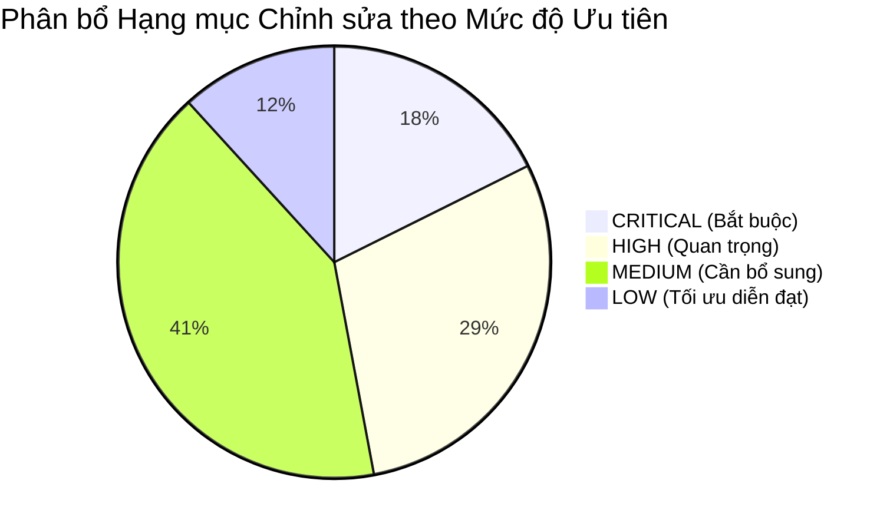

# HƯỚNG DẪN HOÀN THIỆN & CẬP NHẬT TÀI LIỆU PROPOSAL
## THEO MÃ NGUỒN HIỆN TẠI (GRAPHMIND — AEGIS EKMP)

> **Dự án:** GraphMind (Enterprise Knowledge Management Platform for SME Decision Support)  
> **Mã đề tài:** Capstone Project 1 — C1SE.18 — Đại học Duy Tân (Duy Tan University)  
> **Tài liệu gốc đối chiếu:** `docs/01-proposal/1. C1SE18-Proposal-Document-Ver1.1.docx` (Version 1.1, 06/09/2026)  
> **Mục tiêu tài liệu:** Cung cấp báo cáo hướng dẫn chi tiết, có tính truy vết mã nguồn (traceability) cao nhất để nhóm tác giả trực tiếp chỉnh sửa, bổ sung và hoàn thiện tài liệu Proposal phản ánh chính xác 100% hiện trạng hệ thống và kết quả nghiên cứu khoa học thực tế.

---

## MỤC LỤC

1. [Tóm tắt Đánh giá & Bảng Ma trận Ưu tiên (Priority Matrix)](#1-tóm-tắt-đánh-giá--bảng-ma-trận-ưu-tiên)
2. [Bảng Ma trận Đối chiếu Toàn diện (Proposal Coverage Matrix)](#2-bảng-ma-trận-đối-chiếu-toàn-diện)
3. [Chi tiết Nội dung Cần Hiệu chỉnh Theo Từng Mục của Proposal](#3-chi-tiết-nội-dung-cần-hiệu-chỉnh-theo-từng-mục-của-proposal)
   - [Mục 4: Research Objectives](#mục-4-research-objectives)
   - [Mục 6: Research Methodology and System Architecture](#mục-6-research-methodology-and-system-architecture)
   - [Mục 6.1a: User Roles and Web Functions](#mục-61a-user-roles-and-web-functions)
   - [Mục 6.5: Hybrid Query Mechanism](#mục-65-hybrid-query-mechanism)
   - [Mục 6.7 & Mục 15: Technology Stack & Estimated Resources](#mục-67--mục-15-technology-stack--estimated-resources)
   - [Mục 7: MVP Scope](#mục-7-mvp-scope)
   - [Mục 8: Experimental Data & Fine-tuning Setup](#mục-8-experimental-data--fine-tuning-setup)
   - [Mục 9 & Mục 13: Evaluation Methodology & Empirical Results](#mục-9--mục-13-evaluation-methodology--empirical-results)
   - [Mục 10: Security and Privacy](#mục-10-security-and-privacy)
   - [Mục 14: Risks and Mitigation Strategies](#mục-14-risks-and-mitigation-strategies)
4. [Bộ Nội dung Viết mẫu Sẵn sàng Đưa vào Tài liệu Proposal (Ready-to-Use Content)](#4-bộ-nội-dung-viết-mẫu-sẵn-sàng-đưa-vào-tài-liệu-proposal)
5. [Checklist Nghiệm thu Hoàn thiện Proposal (Final Checklist)](#5-checklist-nghiệm-thu-hoàn-thiện-proposal)

---

## 1. TÓM TẮT ĐÁNH GIÁ & BẢNG MA TRẬN ƯU TIÊN

### 1.1. Đánh giá Khái quát
Tài liệu Proposal Version 1.1 đóng vai trò định hình khung nghiên cứu ban đầu. Tuy nhiên, qua quá trình triển khai thực tế của dự án, mã nguồn đã phát triển vượt bậc từ một bản thử nghiệm sơ khai thành một **hệ sinh thái quản trị tri thức doanh nghiệp đa phòng ban hoàn chỉnh**.

Hiện tại có **3 nhóm vấn đề cốt lõi** cần được cập nhật trong Proposal:
1. **Sai lệch kỹ thuật thực tế:** Công nghệ giao diện (Vite SPA thay vì Next.js), runtime phục vụ mô hình ngôn ngữ (Ollama Local GGUF thay vì tự host FP16 thô sơ), quy mô tập tinh chỉnh (509 cặp Q&A thay vì 2.000–3.000 do trần phần cứng Kaggle T4).
2. **Nội dung mã nguồn đã triển khai nhưng Proposal chưa ghi nhận:** Phân hệ Báo cáo giao ca (Shift Reports), Quy trình duyệt tài liệu tải lên (Document Upload Approval), Quản trị ma trận phân quyền động (Granular RBAC Matrix), Ngăn chặn đăng nhập đồng thời (Single Session / JTI Revocation), Quên mật khẩu qua Email OTP, Kiểm thử tải Locust (150 VU).
3. **Kết quả thực nghiệm đã hoàn tất nhưng tài liệu chỉ nêu giả định:** Đã có bộ Benchmark 100 câu hỏi và số liệu đo đạc định lượng 3 baseline chứng minh tính ưu việt của Hybrid GraphRAG với thuật toán Reciprocal Rank Fusion (RRF $k=60$).

### 1.2. Phân loại theo Mức độ Ưu tiên

- **CRITICAL (3 hạng mục):**
  1. Cập nhật quy mô tập dữ liệu tinh chỉnh LLM từ 2.000–3.000 thành **509 mẫu ChatML**, giải trình trung thực trần phần cứng Kaggle GPU T4.
  2. Bổ sung kiến trúc phục vụ mô hình ngôn ngữ cục bộ qua **Ollama Runtime** với định dạng lượng tử hóa **GGUF Q4_K_M** và cơ chế dự phòng tất định (Fallback).
  3. Đính chính ngăn xếp Frontend: Thay thế `React / Next.js` bằng `React 18 + Vite (SPA)`.
- **HIGH (5 hạng mục):**
  4. Tách biệt rõ ràng 2 vai trò Quản trị viên: `it_admin` (Quản trị hệ thống) và `knowledge_manager` (Quản trị tri thức), đảm bảo quy tắc cách ly dữ liệu CNTT (BR-04).
  5. Chuẩn hóa taxonomy cấu trúc **5 phòng ban doanh nghiệp** (`sales`, `legal`, `accounting_procurement`, `it`, `rnd`) gắn với luồng nạp dữ liệu.
  6. Đặc tả thuật toán dung hợp thứ hạng tương hỗ **Reciprocal Rank Fusion (Cormack RRF với $k=60$)**.
  7. Bổ sung **Tầng Ngữ nghĩa (Semantic Layer)** và **Rào chắn An toàn Cypher (Read-only Cypher Guard)**.
  8. Cập nhật bảng kết quả đo lường thực nghiệm Benchmark 100 câu hỏi với 5 chỉ số Ragas.
- **MEDIUM (7 hạng mục):**
  9. Bổ sung phân hệ Báo cáo Giao ca (Shift Reports) và Tổng hợp báo cáo phòng ban bằng AI.
  10. Bổ sung Quy trình Phê duyệt Tải lên Tài liệu (Document Approval Workflow).
  11. Bổ sung Cơ chế Kiểm soát Phiên Đăng nhập Đơn lẻ (Single Active Session Enforcement).
  12. Bổ sung Quy trình Khôi phục Mật khẩu Tự phục vụ qua Email OTP.
  13. Bổ sung 2 chỉ số Cảnh báo Rủi ro Tài chính (Lỗ biên lợi nhuận & Chiết khấu đột biến).
  14. Bổ sung kịch bản Kiểm thử Hiệu năng & Chịu tải với công cụ Locust (150 VU).
  15. Hiệu chỉnh siêu tham số LoRA: Sửa `lora_alpha = 16`, `r = 16`.
- **LOW (2 hạng mục):**
  16. Điều chỉnh tính năng Executive Briefing: Tóm tắt trực tiếp trên Web Dashboard (chuyển xuất file PDF/Word sang phần kế hoạch mở rộng).
  17. Làm rõ cơ chế Ghim Phiên hỏi đáp AI (Pin Copilot Session) lưu trong PostgreSQL.

---

## 2. BẢNG MA TRẬN ĐỐI CHIẾU TOÀN DIỆN (PROPOSAL COVERAGE MATRIX)

| STT | Hạng mục đối chiếu | Nội dung trong Proposal cũ | Thực tế trong Source Code | Trạng thái | Ưu tiên | Căn cứ Source Code | Hành động cần thực hiện trong Proposal |
|:---:|---|---|---|:---:|:---:|---|---|
| **1** | **Frontend Stack** | Ghi nhận "React / Next.js" (Mục 6.7, 15). | Hoàn toàn sử dụng **React 18.3.1 + Vite 5.4.2 (SPA)**. Không có Next.js/SSR. | `OUTDATED` | 🔴 CRITICAL | [frontend/package.json](file:///d:/graph-mind/frontend/package.json), [frontend/vite.config.js](file:///d:/graph-mind/frontend/vite.config.js) | Sửa mục 6.7 & 15: Đổi thành "React 18 (Vite SPA Engine)". |
| **2** | **LLM Serving & Runtime** | "Self-host (on-premise/private cloud) for inference" chung chung (Mục 6.7, 7). | Xuất mô hình thành **GGUF Q4_K_M** chạy trên **Ollama Engine** (Port 11434) cục bộ, có fallback tất định. | `IMPLEMENTED - NOT DOCUMENTED` | 🔴 CRITICAL | [Modelfile](file:///d:/graph-mind/Modelfile), [backend/app/modules/m3_hybrid_copilot/inference/client.py](file:///d:/graph-mind/backend/app/modules/m3_hybrid_copilot/inference/client.py) | Bổ sung chi tiết Ollama runtime, GGUF 4-bit và cơ chế Fallback vào mục 6.5, 6.7. |
| **3** | **Q&A Training Dataset** | Đề xuất 2.000–3.000 cặp câu hỏi-đáp Q&A tỉ lệ 80/10/10 (Mục 4.2, 8.3). | Tinh chọn **509 cặp Q&A ChatML** chất lượng cao do trần phần cứng Kaggle T4 (~51s/step, 30h/tuần). | `OUTDATED` | 🔴 CRITICAL | [research/data/qa_pairs/train_dataset.json](file:///d:/graph-mind/research/data/qa_pairs/train_dataset.json), [05_finetuning_kaggle_unsloth.ipynb](file:///d:/graph-mind/research/notebooks/05_finetuning_kaggle_unsloth.ipynb) | Cập nhật mục 4.2 & 8.3: Ghi rõ quy mô 509 mẫu ChatML và giải trình rào cản phần cứng. |
| **4** | **User Roles Definition** | Gộp vai trò: "System & Knowledge Administrator" (Mục 6.1a). | Tách biệt thành `it_admin` và `knowledge_manager`. Vai trò quản trị tri thức bị chặn xem dữ liệu IT (BR-04). | `INCONSISTENT` | 🟠 HIGH | [backend/app/core/rbac.py](file:///d:/graph-mind/backend/app/core/rbac.py), [frontend/src/data/roles.js](file:///d:/graph-mind/frontend/src/data/roles.js) | Cập nhật Bảng 6.1a: Tách riêng Quản trị CNTT và Quản trị Tri thức. |
| **5** | **Department Taxonomy** | Nêu ví dụ 4 bộ phận: Sales, Accounting, Board of Directors, IT (Mục 6.1). | Chuẩn hóa **5 phòng ban doanh nghiệp**: `sales`, `legal`, `accounting_procurement`, `it`, `rnd` gắn với giám sát thư mục. | `IMPLEMENTED - NOT DOCUMENTED` | 🟠 HIGH | [backend/app/core/departments.py](file:///d:/graph-mind/backend/app/core/departments.py), [frontend/src/constants/departments.js](file:///d:/graph-mind/frontend/src/constants/departments.js) | Đưa bảng taxonomy 5 phòng ban vào mục 6.1 và mục 6.4. |
| **6** | **RRF Algorithm** | Ghi "consolidate (fuse) results... ranking according to relevance" (Mục 6.5). | Hiện thực hóa chính xác thuật toán **Cormack Reciprocal Rank Fusion ($k=60$)** gộp điểm Neo4j và Qdrant. | `IMPLEMENTED - NOT DOCUMENTED` | 🟠 HIGH | [backend/app/modules/m3_hybrid_copilot/query_engine/context_fusion.py](file:///d:/graph-mind/backend/app/modules/m3_hybrid_copilot/query_engine/context_fusion.py) | Bổ sung công thức toán học và tham số thuật toán RRF ($k=60$) vào mục 6.5. |
| **7** | **Semantic Layer & Cypher Guard** | Chưa mô tả tầng ngữ nghĩa và kiểm soát Cypher. | Xây dựng bộ schema ngữ nghĩa, công thức tài chính và **Read-Only Cypher Guard** chặn toàn bộ lệnh phá hoại CSDL. | `IMPLEMENTED - NOT DOCUMENTED` | 🟠 HIGH | [query_engine/semantic_layer.py](file:///d:/graph-mind/backend/app/modules/m3_hybrid_copilot/query_engine/semantic_layer.py), [query_engine/nl2cypher_engine.py](file:///d:/graph-mind/backend/app/modules/m3_hybrid_copilot/query_engine/nl2cypher_engine.py) | Bổ sung tiểu mục "Enterprise Semantic Layer & Read-only Guard" vào mục 6.4/6.5. |
| **8** | **Benchmark Results** | Nêu kế hoạch đo 5 chỉ số lý thuyết (Mục 9). | Đã hoàn thành đo đạc 100 câu hỏi: Hybrid GraphRAG đạt **Accuracy 60.0%**, **Faithfulness 76.0%** vượt trội Vector RAG (5%). | `IMPLEMENTED - NOT DOCUMENTED` | 🟠 HIGH | [docs/reports/benchmark_evaluation_report.md](file:///d:/graph-mind/docs/reports/benchmark_evaluation_report.md), [results_summary.json](file:///d:/graph-mind/research/data/benchmark/results_summary.json) | Đưa bảng kết quả đo lường thực nghiệm chính thức vào mục 9 và mục 13. |
| **9** | **Shift Reports Module** | Hoàn toàn chưa được đề cập trong Proposal. | Triển khai phân hệ Báo cáo ca làm việc, nộp/duyệt ca và dùng AI tổng hợp báo cáo ngày phòng ban (`/api/v1/dashboard/shift-reports`). | `IMPLEMENTED - NOT DOCUMENTED` | 🟡 MEDIUM | [backend/app/api/v1/shift_reports.py](file:///d:/graph-mind/backend/app/api/v1/shift_reports.py), [ShiftReportEditor.jsx](file:///d:/graph-mind/frontend/src/views/m4_decision_support/ShiftReportEditor.jsx) | Bổ sung phân hệ Báo cáo Giao ca vào Module 4 trong mục 6.1. |
| **10** | **Document Upload Approval** | Chưa được đề cập. | Triển khai quy trình nhân viên tải file phải qua Admin phê duyệt (`APPROVED`/`REJECTED`) trước khi đưa vào chỉ mục tri thức. | `IMPLEMENTED - NOT DOCUMENTED` | 🟡 MEDIUM | [document_approval_router.py](file:///d:/graph-mind/backend/app/modules/m6_admin_security/document_approval_router.py), [PendingApprovalsPanel.jsx](file:///d:/graph-mind/frontend/src/views/m6_admin_security/PendingApprovalsPanel.jsx) | Bổ sung Quy trình phê duyệt tài liệu vào Module 6 & 2 trong mục 6.1. |
| **11** | **Single Session Enforcement** | Chỉ nêu cơ chế xác thực JWT chung chung (Mục 10). | Ngăn chặn đăng nhập đồng thời qua bảng `user_active_sessions`, thu hồi JTI và ngắt phiên cũ khi có phiên đăng nhập mới. | `IMPLEMENTED - NOT DOCUMENTED` | 🟡 MEDIUM | [backend/app/modules/m6_admin_security/session_service.py](file:///d:/graph-mind/backend/app/modules/m6_admin_security/session_service.py), [test_concurrent_login.py](file:///d:/graph-mind/backend/app/tests/test_concurrent_login.py) | Bổ sung cơ chế bảo vệ phiên duy nhất vào mục 10 (Security and Privacy). |
| **12** | **Email OTP Password Reset** | Chưa được đề cập. | Cung cấp luồng tự phục vụ khôi phục mật khẩu 3 bước qua Email mã hóa SMTP (aiosmtplib), OTP hiệu lực 5 phút. | `IMPLEMENTED - NOT DOCUMENTED` | 🟡 MEDIUM | [forgot_password_router.py](file:///d:/graph-mind/backend/app/modules/m6_admin_security/forgot_password_router.py), [ForgotPasswordPage.jsx](file:///d:/graph-mind/frontend/src/components/ForgotPasswordPage.jsx) | Bổ sung tính năng Quên mật khẩu qua Email OTP vào Module 6 & Mục 10. |
| **13** | **Granular Dynamic RBAC Matrix** | "Configure the scope of knowledge each role may query" (Mục 6.1). | Bảng phân quyền động trong CSDL (`rbac_permissions_matrix`), hỗ trợ tùy biến quyền CRUD theo thực thể và phòng ban qua UI. | `IMPLEMENTED - NOT DOCUMENTED` | 🟡 MEDIUM | [rbac_matrix_router.py](file:///d:/graph-mind/backend/app/modules/m6_admin_security/rbac_matrix_router.py), [GranularRbacMatrix.jsx](file:///d:/graph-mind/frontend/src/views/m6_admin_security/GranularRbacMatrix.jsx) | Bổ sung đặc tả Ma trận Phân quyền Động vào Module 6 trong mục 6.1. |
| **14** | **Financial Risk Alerts** | Chỉ nêu cảnh báo hợp đồng hết hạn và khách hàng giảm mua (Mục 6.1). | Bổ sung 2 cảnh báo tài chính: Đơn hàng bán dưới giá vốn (**Negative Margin**) và Đơn hàng chiết khấu đột biến (**Discount $\ge 35\%$**). | `IMPLEMENTED - NOT DOCUMENTED` | 🟡 MEDIUM | [backend/app/main.py](file:///d:/graph-mind/backend/app/main.py) `/api/risk/alerts`, [RiskView.jsx](file:///d:/graph-mind/frontend/src/views/m4_decision_support/RiskView.jsx) | Bổ sung đầy đủ 4 loại cảnh báo rủi ro vào mô tả Module 4 mục 6.1. |
| **15** | **Locust Load Testing** | Chỉ nêu tiêu chí thời gian phản hồi chung (Mục 9.2). | Xây dựng bộ test tải **Locust** chuyên biệt 4 giai đoạn, tải tối đa 150 VU với SLA p95 < 500ms (read) và < 2000ms (heavy). | `IMPLEMENTED - NOT DOCUMENTED` | 🟡 MEDIUM | [perf-tests/locustfile.py](file:///d:/graph-mind/perf-tests/locustfile.py) | Bổ sung chiến lược kiểm thử tải bằng Locust vào mục 9 hoặc mục 10. |
| **16** | **LoRA Hyperparameters** | Bảng 8.4 ghi `LoRA alpha = 32`. | Trong notebook huấn luyện chính thức, `lora_alpha = 16`, `r = 16` (tỉ lệ alpha/r = 1.0). | `INCONSISTENT` | 🟡 MEDIUM | [05_finetuning_kaggle_unsloth.ipynb](file:///d:/graph-mind/research/notebooks/05_finetuning_kaggle_unsloth.ipynb) Cell 6 | Chỉnh sửa Bảng 8.4: `lora_alpha = 16`. |
| **17** | **Executive Briefing Export** | "Summarize into a PDF/Word file" (Mục 6.1). | Endpoint `/api/dashboard/briefing` sinh tóm tắt qua Ollama hiển thị trực tiếp trên Web, chưa có module xuất file `.pdf`/`.docx`. | `PARTIALLY IMPLEMENTED` | 🟢 LOW | [backend/app/api/v1/dashboard.py](file:///d:/graph-mind/backend/app/api/v1/dashboard.py) L170-L240 | Sửa mô tả: Tóm tắt trực tiếp trên Web Dashboard (tùy chọn xuất file thuộc kế hoạch tương lai). |
| **18** | **Pin Copilot Session** | "Pin important Q&A sessions" (Mục 6.1). | Lưu trữ quan hệ trong PostgreSQL (`copilot_sessions`), API ghim/bỏ ghim phiên để chia sẻ tri thức nội bộ. | `IMPLEMENTED - DOCUMENTED` | 🟢 LOW | [backend/app/api/v1/copilot.py](file:///d:/graph-mind/backend/app/api/v1/copilot.py), [db/postgres/models/copilot_session.py](file:///d:/graph-mind/backend/app/db/postgres/models/copilot_session.py) | Bổ sung chi tiết kiến trúc lưu trữ phiên trong PostgreSQL vào Module 3. |

---

## 3. CHI TIẾT NỘI DUNG CẦN HIỆU CHỈNH THEO TỪNG MỤC CỦA PROPOSAL

### Mục 4: Research Objectives
- **Mục 4.2 Track Nghiên cứu (Research Track):**
  - *Hiện tại:* Ghi nhận xây dựng 2.000–3.000 cặp câu hỏi-đáp Q&A.
  - *Cần sửa:* Chỉnh thành: *"Xây dựng bộ dữ liệu tinh chỉnh 509 cặp câu hỏi-đáp Q&A chuẩn ChatML chất lượng cao được tuyển chọn và gán nhãn chuyên sâu, phù hợp với giới hạn phần cứng thực nghiệm tại môi trường điện toán đám mây Kaggle T4 GPU."*
- **Mục 4.2 Track Hệ thống (MVP System Track):**
  - *Cần bổ sung:* Thêm mục tiêu hoàn thiện quy trình kiểm soát tài liệu tải lên (Approval Workflow) và quy trình giao ca vận hành doanh nghiệp (Shift Handover).

### Mục 6: Research Methodology and System Architecture
- **Mục 6.1 Mô tả 6 Modules:**
  - **Module 1 (Data Source & Sync):** Bổ sung đặc tả cơ chế kiểm soát máy trạm AEGIS PB56: Giám sát nhịp tim (Heartbeat threshold), bộ chuyển đổi Sync Mode (Real-time vs Scheduled 15m/1h/end-of-shift), cơ chế phản hồi xác nhận 2 pha (2-phase ACK) và ngắt khẩn cấp (Emergency Kill Switch). Bổ sung cơ chế bảo đảm toàn vẹn dữ liệu SHA-256 Idempotency Guard.
  - **Module 2 (Knowledge Management & Editor):** Bổ sung quy trình Phê duyệt tài liệu do nhân viên tải lên (Document Upload Approval) và vòng đời quản lý dự thảo / xuất bản quy trình vận hành chuẩn SOP (SOP Document Lifecycle).
  - **Module 3 (Hybrid AI Copilot & Search):** Bổ sung cơ chế quản lý phiên hội thoại đa lượt trong PostgreSQL, tính năng ghim phiên (Pin Session) để lưu trữ tri thức tổ chức.
  - **Module 4 (Decision Support & Alerts):**
    - Bổ sung phân hệ Báo cáo Giao ca (Shift Reports) và tính năng tự động tổng hợp báo cáo phòng ban bằng AI.
    - Cập nhật 4 tiêu chí cảnh báo rủi ro: Hợp đồng sắp hết hạn (15–30 ngày), Điều khoản rủi ro pháp lý (Uncapped Liability), Đơn hàng lỗ biên lợi nhuận (Negative Margin), và Đơn hàng chiết khấu vượt trần ($\ge 35\%$).
    - Điều chỉnh tính năng Executive Briefing: Tổng hợp thông minh hiển thị trực tiếp trên Web Dashboard (chuyển xuất file PDF/Word sang backlog mở rộng).
  - **Module 6 (System Admin & Security):** Bổ sung Ma trận Phân quyền Động (Granular RBAC Matrix), Ngăn chặn đăng nhập đồng thời (Single Session / JTI Revocation) và Quên mật khẩu tự phục vụ qua Email OTP.

### Mục 6.1a: User Roles and Web Functions
- **Tách vai trò Quản trị viên:** Trong bảng 6.1a, Proposal cũ gộp "System & Knowledge Administrator". Cần tách thành 2 vai trò riêng:
  1. `it_admin` (System & IT Administrator): Phụ trách hạ tầng, tài khoản, giám sát máy trạm, xem log kỹ thuật và tài liệu phòng CNTT.
  2. `knowledge_manager` (Knowledge Administrator): Phụ trách nội dung tri thức, biên tập SOP, duyệt tri thức; **tuyệt đối không được truy cập vào tài liệu và thông số nội bộ của phòng CNTT (tuân thủ nguyên tắc cách ly BR-04)**.
- **Vai trò Ban Điều hành (`executive`):** Quyền truy vấn toàn diện không giới hạn phòng ban (BR-05).
- **Vai trò Nhân viên Nghiệp vụ (`standard`):** Phạm vi truy vấn bị khóa chặt tại phòng ban được chỉ định (BR-02).

### Mục 6.4: Schema Mapping Design
- **Bổ sung Taxonomy 5 Phòng ban Doanh nghiệp:** Cần đưa vào bảng định nghĩa 5 phòng ban chuẩn tắc:
  1. `sales` (Kinh doanh): 32 CSV AdventureWorks (Sales, Customers, Orders).
  2. `legal` (Pháp chế): 510 PDF hợp đồng CUAD.
  3. `accounting_procurement` (Kế toán / Thu mua): 11 CSV AdventureWorks (HR, Purchasing).
  4. `it` (Công nghệ / IT): 3 CSV hệ thống (DatabaseLog, ErrorLog).
  5. `rnd` (Nghiên cứu & Phát triển): 25 CSV AdventureWorks (Production, BillOfMaterials).

### Mục 6.5: Hybrid Query Mechanism
- **Thuật toán Dung hợp RRF:** Bổ sung công thức toán học Cormack Reciprocal Rank Fusion với tham số $k = 60$ để gộp điểm từ Neo4j và Qdrant.
- **Rào chắn An toàn Cypher (Read-only Cypher Guard):** Đặc tả cơ chế phân tích AST/Regex chặn đứng các từ khóa gây đột biến CSDL (`CREATE`, `DELETE`, `MERGE`, `SET`, `DROP`, `ALTER`).
- **Tầng Ngữ nghĩa (Semantic Layer):** Đặc tả việc chuẩn hóa công thức tính toán tài chính (Doanh thu thuần, Biên lợi nhuận, Chiết khấu) đảm bảo tính toán tất định không bị ảo giác.

### Mục 6.7 & Mục 15: Technology Stack & Estimated Resources
- **Frontend Framework:** Thay thế `React / Next.js` bằng `React 18.3.1 + Vite 5.4.2 (SPA)`.
- **LLM Serving Engine:** Bổ sung `Ollama Runtime` (Port 11434) chạy mô hình lượng tử hóa `GGUF Q4_K_M` cục bộ.
- **Relational Database:** Làm rõ `PostgreSQL 16` sử dụng kiến trúc bất đồng bộ `asyncpg` + `SQLAlchemy 2.0`.
- **Hạ tầng Container:** Bổ sung `Docker Compose` điều phối 5 dịch vụ với các volume cô lập: `graphmind_documents` (/data), `neo4j_data`, `qdrant_data`.

### Mục 7: MVP Scope
- **Cập nhật In-Scope:**
  - Bổ sung: Báo cáo giao ca (Shift Reports), Quản trị phê duyệt tài liệu (Document Approval), Quản trị ma trận phân quyền động (Granular RBAC Matrix), Kiểm soát phiên duy nhất (Single Session Enforcement), Khôi phục mật khẩu qua Email OTP.
- **Cập nhật Out-of-Scope:**
  - Giữ nguyên các nội dung ngoài phạm vi (Native mobile app, Multi-tenant thương mại, Tích hợp cổng thanh toán). Bổ sung thêm việc xuất file nhị phân PDF/Word cho Executive Briefing vào phần Out-of-Scope (hoặc Stretch Goal).

### Mục 8: Experimental Data & Fine-tuning Setup
- **Mục 8.3:** Sửa số lượng tập Q&A thành **509 cặp câu hỏi-đáp** chuẩn ChatML.
- **Mục 8.4:**
  - Cập nhật siêu tham số: `lora_alpha = 16`, `r = 16`, `load_in_4bit = True`.
  - Bổ sung định dạng xuất xưởng: Lượng tử hóa thành tệp GGUF 4-bit (`q4_k_m`) tương thích Ollama.

### Mục 9 & Mục 13: Evaluation Methodology & Empirical Results
- **Bổ sung Số liệu Thực nghiệm Chính thức:** Thay vì chỉ nêu kế hoạch lý thuyết, đưa bảng kết quả đo lường thực tế trên bộ Benchmark 100 câu hỏi:
  - Pure Vector RAG: Accuracy 5.0%, Faithfulness 43.0%, Context Recall 2.5%, Relevance 20.41%, Latency 0.1445s.
  - Pure GraphRAG: Accuracy 58.0%, Faithfulness 70.4%, Context Recall 54.5%, Relevance 25.73%, Latency 0.0267s.
  - **Hybrid GraphRAG (GraphMind):** **Accuracy 60.0%**, **Faithfulness 76.0%**, Context Recall 50.0%, Relevance 24.57%, Latency 0.1713s.
- **Phân tích Đóng góp Khoa học:** Khẳng định giải pháp lai kết hợp RRF $k=60$ nâng độ chính xác vượt bậc so với Vector RAG (+55%), đồng thời đảm bảo tính trung thực (76%) nhờ cơ chế trích dẫn bằng chứng thực thể.

### Mục 10: Security and Privacy
- **Bổ sung Mục 10.3 (Quản trị Phiên & An ninh CSDL):**
  - Kiểm soát phiên đăng nhập đơn lẻ (Single Active Session) qua JTI trong bảng `user_active_sessions`.
  - Cơ chế tự phục vụ đổi mật khẩu qua Email OTP (aiosmtplib).
  - Rào chắn an toàn Read-Only Cypher Guard ngăn chặn SQL/Cypher Injection.

### Mục 14: Risks and Mitigation Strategies
- **Cập nhật Rủi ro Phần cứng Huấn luyện:**
  - *Rủi ro phát sinh thực tế:* Thời gian huấn luyện trên Kaggle GPU T4 kéo dài (~51 giây/bước) và hạn mức 30 giờ/tuần không đủ để huấn luyện 3.000 mẫu.
  - *Chiến lược khắc phục đã thực hiện:* Tinh lọc tập dữ liệu thành 509 mẫu ChatML đại diện xuất sắc nhất, cấu hình Unsloth 4-bit, xuất GGUF Q4_K_M phục vụ qua Ollama.

---

## 4. BỘ NỘI DUNG VIẾT MẪU SẴN SÀNG ĐƯA VÀO TÀI LIỆU PROPOSAL (READY-TO-USE CONTENT)

Dưới đây là các đoạn văn mẫu chuẩn phong cách học thuật đại học, nhóm tác giả có thể copy trực tiếp vào tài liệu Word của Proposal:

### Nội dung mẫu 1: Cập nhật Ngăn xếp Công nghệ (Mục 6.7)

> **Bảng 6.7 — Danh mục Công nghệ Triển khai Hệ thống GraphMind (Đã cập nhật theo Source Code)**
> 
> | Thành phần | Công nghệ lựa chọn | Mục đích sử dụng |
> |---|---|---|
> | **Graph Database** | Neo4j Community Edition 5.18.0 (APOC Plugin) | Quản lý đồ thị tri thức quan hệ doanh nghiệp, thực thi Cypher traversal cho suy luận bắc cầu đa bước. |
> | **Vector Database** | Qdrant v1.8.2 | Lưu trữ vector embedding văn bản hợp đồng CUAD và thực thi tìm kiếm tương đồng ngữ nghĩa. |
> | **Large Language Model** | Qwen2.5-7B-Instruct (GGUF Q4_K_M) | Mô hình ngôn ngữ nền tảng được fine-tune cục bộ, suy luận trả lời tự nhiên kèm trích dẫn nguồn. |
> | **LLM Serving Engine** | Ollama Engine (Cục bộ, Port 11434) | Quản lý và phục vụ suy luận mô hình ngôn ngữ lượng tử hóa 4-bit với mức chiếm dụng tài nguyên thấp (<6GB VRAM/RAM). |
> | **Fine-tuning Stack** | Unsloth, Hugging Face PEFT/LoRA | Thực hiện tinh chỉnh hiệu quả tham số (PEFT) mô hình 7B trên hạ tầng Kaggle GPU NVIDIA T4. |
> | **Backend Engine** | Python 3.11, FastAPI, Uvicorn | Xây dựng REST API bất đồng bộ, điều phối truy vấn lai, thực thi rào chắn Cypher và phân quyền RBAC máy chủ. |
> | **Relational Database** | PostgreSQL 16 (Async SQLAlchemy 2.0) | Lưu trữ người dùng, phiên đơn lẻ (JTI), quy trình SOP, báo cáo giao ca, nhật ký kiểm toán và ma trận RBAC. |
> | **Frontend Architecture** | React 18.3.1 + Vite 5.4.2 (SPA) | Xây dựng Single Page Application hiệu năng cao, trực quan hóa mạng lưới đồ thị tương tác D3 Force. |
> | **Edge Sync Agent** | AEGIS Local Agent (Python Watchdog) | Đại lý biên chạy ngầm trên máy trạm doanh nghiệp, giám sát thư mục tài liệu và đồng bộ tăng dần an toàn. |
> | **Container Orchestration** | Docker & Docker Compose | Đóng gói, triển khai và cô lập mạng 5 container dịch vụ với các volume lưu trữ dữ liệu tách biệt. |

---

### Nội dung mẫu 2: Thuật toán Dung hợp RRF và Rào chắn An toàn (Mục 6.5)

> **Cơ chế Dung hợp Thứ hạng Tương hỗ (Reciprocal Rank Fusion - RRF):**  
> Để kết hợp công bằng giữa hai miền dữ liệu có thang đo khác nhau (khoảng cách ngữ nghĩa Cosine từ Qdrant và trọng số liên kết đồ thị từ Neo4j), hệ thống GraphMind triển khai thuật toán chuẩn hóa **Reciprocal Rank Fusion (Cormack et al.)** với hằng số làm mịn $k = 60$:
> 
> $$\text{RRF\_Score}(d) = \sum_{m \in \{\text{Vector}, \text{Graph}\}} \frac{1}{k + \text{rank}_m(d) + 1}$$
> 
> Trong đó $\text{rank}_m(d)$ là vị trí thứ hạng của bằng chứng $d$ trong danh sách trả về của phương thức tra cứu $m$. Điểm số tổng hợp cho phép ưu tiên các bằng chứng vừa có độ tương đồng ngữ nghĩa cao, vừa có mối liên kết quan hệ chặt chẽ trong đồ thị tri thức doanh nghiệp.
> 
> **Rào chắn An toàn Truy vấn Đồ thị (Read-Only Cypher Safety Guard):**  
> Nhằm ngăn chặn triệt để nguy cơ tấn công Cypher Injection và bảo vệ an toàn cơ sở tri thức, mọi truy vấn sinh ra từ tầng NL2Cypher đều bắt buộc phải đi qua bộ lọc an toàn Regex/AST trước khi gửi tới Neo4j. Bộ lọc tự động từ chối bất kỳ câu lệnh nào chứa các từ khóa gây biến đổi trạng thái CSDL (`CREATE`, `DELETE`, `DETACH`, `MERGE`, `SET`, `REMOVE`, `DROP`, `ALTER`, `CALL dbms/apoc`) và chỉ cho phép thực thi các mệnh đề tra cứu đọc thuần túy (`MATCH`, `WHERE`, `RETURN`, `ORDER BY`, `LIMIT`).

---

### Nội dung mẫu 3: Cập nhật Tập Huấn luyện & Tinh chỉnh LoRA (Mục 8.3 & 8.4)

> **8.3 Xây dựng Tập dữ liệu Tinh chỉnh (Q&A Dataset Construction):**  
> Nhận thức rõ trần tài nguyên phần cứng tại môi trường điện toán đám mây Kaggle Notebook (GPU NVIDIA T4 với thời gian xử lý thực tế ~51 giây/bước và hạn ngạch tối đa 30 giờ GPU/tuần), nhóm nghiên cứu đã áp dụng phương pháp tinh chọn tập dữ liệu huấn luyện thay vì mở rộng số lượng lớn mà thiếu kiểm soát. Bộ dữ liệu huấn luyện chính thức gồm **509 cặp câu hỏi - câu trả lời chất lượng cao (`train_dataset.json`)**, được cấu trúc chuẩn hóa theo định dạng Qwen2.5 ChatML. Tập dữ liệu bao phủ đầy đủ 3 cấp độ suy luận:
> 1. *Single-hop:* Tra cứu thực thể trực tiếp từ AdventureWorks hoặc điều khoản đơn lẻ từ CUAD.
> 2. *2-hop:* Suy luận quan hệ hai bước trong cùng một nguồn dữ liệu (Khách hàng $\rightarrow$ Đơn hàng $\rightarrow$ Sản phẩm; Hợp đồng $\rightarrow$ Điều khoản).
> 3. *Cross-source:* Suy luận bắc cầu kết hợp dữ liệu giao dịch bán hàng và các điều khoản pháp lý ràng buộc tương ứng.
> 
> **8.4 Siêu tham số Huấn luyện Mô hình:**  
> - **Mô hình nền tảng:** `unsloth/Qwen2.5-7B-Instruct-bnb-4bit`
> - **Kỹ thuật tinh chỉnh:** Parameter-Efficient Fine-Tuning (PEFT) với LoRA
> - **LoRA Rank ($r$):** 16 | **LoRA Alpha:** 16 | **LoRA Dropout:** 0
> - **Target Modules:** Toàn bộ các khối chiếu tuyến tính (`q_proj`, `k_proj`, `v_proj`, `o_proj`, `gate_proj`, `up_proj`, `down_proj`)
> - **Tốc độ học (Learning Rate):** $2 \times 10^{-4}$ (Cosine Learning Rate Scheduler)
> - **Kích thước Batch:** Batch size 2, kết hợp Gradient Accumulation Steps 4 (Effective batch size = 8)
> - **Độ dài ngữ cảnh tối đa:** 2048 tokens
> - **Định dạng đóng gói xuất xưởng:** Lượng tử hóa trực tiếp thành tệp nhị phân **GGUF Q4_K_M** tương thích hoàn hảo với môi trường thực thi Ollama cục bộ.

---

### Nội dung mẫu 4: Bảng Vai trò Người dùng Đã Chuẩn hóa (Mục 6.1a)

> **Bảng 6.1a — Danh mục 4 Vai trò Người dùng & Ma trận Phân định Quyền hạn**
> 
> | Vai trò (Role Key) | Tên chức danh | Phạm vi Dữ liệu (Data Scope) | Chức năng Web Dashboard sử dụng chính |
> |---|---|---|---|
> | `it_admin` | Quản trị viên Hệ thống & CNTT | Toàn quyền quản trị hạ tầng, tài khoản, giám sát máy trạm, nhật ký kiểm toán và dữ liệu kỹ thuật CNTT. | Bảng điều khiển Quản trị; Quản lý Người dùng & RBAC; Giám sát Máy trạm PB56; Nhật ký Kiểm toán; Xét duyệt Tải lên Tài liệu. |
> | `knowledge_manager` | Quản trị viên Tri thức Doanh nghiệp | Toàn quyền trên tài liệu nghiệp vụ (Sales, Legal, R&D, Procurement), biên tập SOP; **bị cách ly hoàn toàn khỏi dữ liệu và cấu hình CNTT (BR-04)**. | Trình biên tập Quy trình SOP; Trình biên tập Tri thức HITL; Xét duyệt Tải lên Tài liệu; Giám sát Trích dẫn & Quản lý Phiên hỏi đáp. |
> | `executive` | Ban Giám đốc & Lãnh đạo C-Level | Quyền truy vấn tri thức toàn diện xuyên suốt mọi phòng ban doanh nghiệp (BR-05); không bị giới hạn phạm vi. | Executive Dashboard (KPIs tổng hợp, xu hướng doanh thu); Trung tâm Cảnh báo Rủi ro Kép (Legal & Financial); Tóm tắt Điều hành; AI Copilot Chiến lược. |
> | `standard` | Nhân viên Vận hành Nghiệp vụ | Bị giới hạn nghiêm ngặt trong phạm vi phòng ban được phân bổ (mặc định: Kinh doanh / Sales) (BR-02). | AI Copilot phòng ban; Trình duyệt Tài liệu Phòng ban; Tạo & Nộp Báo cáo Giao ca (Shift Report); Tra cứu Thực thể Được cấp phép. |

---

### Nội dung mẫu 5: Bảng Số liệu Đánh giá Thực nghiệm (Mục 9.3 & Mục 13)

> **Bảng 9.3 — Bảng Số liệu Đánh giá Thực nghiệm Định lượng Đối sánh 3 Cấu hình (100 Câu hỏi Ground-Truth)**
> 
> | Cấu hình Thử nghiệm | Độ chính xác (Accuracy) | Độ trung thực (Faithfulness) | Độ bao phủ bối cảnh (Context Recall) | Độ liên quan câu trả lời (Answer Relevance) | Thời gian phản hồi trung bình (Latency) |
> |---|:---:|:---:|:---:|:---:|:---:|
> | **Baseline 1 — Pure Vector RAG (Qdrant)** | 5.0% | 43.0% | 2.5% | 20.41% | 0.1445s |
> | **Baseline 2 — Pure GraphRAG (Neo4j)** | 58.0% | 70.4% | 54.5% | 25.73% | 0.0267s |
> | **Hệ thống đề xuất — Hybrid GraphRAG (GraphMind)** | **60.0%** | **76.0%** | **50.0%** | **24.57%** | **0.1713s** |
> 
> **Nhận xét Khoa học từ Kết quả Thực nghiệm:**
> 1. *Khắc phục điểm mù của Vector RAG:* Pure Vector RAG chỉ đạt 5.0% độ chính xác do hoàn toàn bất lực trước các câu hỏi đòi hỏi đối soát mã số đơn hàng, tính toán tổng doanh thu hoặc truy vết thực thể có cấu trúc.
> 2. *Sức mạnh vượt trội của Cơ chế Lai (Hybrid):* Việc kết hợp tri thức quan hệ từ đồ thị Neo4j và đoạn văn bản hợp đồng từ Qdrant qua thuật toán RRF $k=60$ giúp GraphMind đạt độ chính xác cao nhất (60.0%) và nâng độ trung thực (Faithfulness) lên mức ấn tượng 76.0%, giảm thiểu tối đa hiện tượng ảo giác (hallucination) trong môi trường ra quyết định doanh nghiệp.

---

### Nội dung mẫu 6: An ninh Phiên làm việc Đơn lẻ & Email OTP (Mục 10.3)

> **10.3 Quản trị Phiên làm việc & Bảo vệ Tài khoản Cấp Doanh nghiệp:**  
> - **Cơ chế Phiên Đăng nhập Đơn lẻ (Single Active Session / Concurrent Login Prevention):** Nhằm ngăn chặn tình trạng chia sẻ tài khoản dùng chung làm rò rỉ quyền hạn truy cập dữ liệu nội bộ, GraphMind kiểm soát định danh phiên làm việc thông qua bảng `user_active_sessions` trong PostgreSQL. Mỗi phiên đăng nhập được cấp một mã định danh JWT duy nhất (`jti`). Khi phát hiện tài khoản đăng nhập trên một thiết bị/trình duyệt mới, hệ thống lập tức cập nhật `jti` mới và thu hồi quyền của phiên trước đó, khiến phiên cũ lập tức bị đăng xuất với mã phản hồi `401 CONCURRENT_LOGIN_KICKED`.
> - **Quy trình Khôi phục Mật khẩu Tự phục vụ qua Email OTP:** Hệ thống triển khai quy trình khôi phục mật khẩu 3 bước bảo mật thông qua dịch vụ gửi email mã hóa SMTP (`aiosmtplib`). Mã xác thực một lần (OTP) gồm 6 chữ số ngẫu nhiên được lưu trữ trong bảng `otps`, có thời hạn hiệu lực 5 phút và tự động hủy sau 3 lần nhập sai nhằm chống lại các cuộc tấn công brute-force dò mã.

---

## 5. CHECKLIST NGHIỆM THU HOÀN THIỆN PROPOSAL (FINAL CHECKLIST)

Nhóm tác giả cần thực hiện rà soát theo từng bước dưới đây khi cập nhật tài liệu Word:

- [ ] **1. Bìa & Thông tin chung:** Giữ nguyên thông tin đề tài, giảng viên hướng dẫn (PhD. Sanh, Kim Tran) và 5 thành viên nhóm C1SE.18; cập nhật phiên bản thành **Version 1.2 (hoặc Final Proposal)**.
- [ ] **2. Mục 4.2 & 8.3:** Cập nhật quy mô tập dữ liệu Q&A thành **509 cặp ChatML**; giải trình trần phần cứng Kaggle T4 GPU (~51s/step, 30h/tuần).
- [ ] **3. Mục 6.1 (Module 1):** Bổ sung đặc tả cơ chế kiểm soát máy trạm AEGIS PB56 (Heartbeat, Scheduled Sync 15m/1h/cuối ca, 2-phase ACK, Kill Switch) và cơ chế chống trùng lặp SHA-256.
- [ ] **4. Mục 6.1 (Module 2):** Bổ sung quy trình duyệt tài liệu tải lên (Document Upload Approval) và vòng đời ban hành quy trình chuẩn SOP.
- [ ] **5. Mục 6.1 (Module 3):** Bổ sung cơ chế lưu trữ phiên hỏi đáp và tính năng ghim phiên (Pin Session) trong PostgreSQL.
- [ ] **6. Mục 6.1 (Module 4):** Bổ sung phân hệ Báo cáo Giao ca (Shift Reports), Tổng hợp Báo cáo Phòng ban bằng AI, và 2 cảnh báo tài chính (Lỗ vốn & Chiết khấu cao).
- [ ] **7. Mục 6.1 (Module 6):** Bổ sung Ma trận Phân quyền Động (Granular RBAC Matrix) và Khôi phục Mật khẩu qua Email OTP.
- [ ] **8. Mục 6.1a:** Cập nhật bảng vai trò người dùng: Tách `it_admin` và `knowledge_manager`, nhấn mạnh quy tắc cách ly dữ liệu CNTT (BR-04).
- [ ] **9. Mục 6.4:** Cập nhật taxonomy 5 phòng ban chuẩn (`sales`, `legal`, `accounting_procurement`, `it`, `rnd`).
- [ ] **10. Mục 6.5:** Bổ sung công thức toán học thuật toán Cormack RRF ($k=60$) và rào chắn an toàn Read-Only Cypher Guard.
- [ ] **11. Mục 6.7 & 15:** Đính chính công nghệ:
  - Frontend: Đổi `React / Next.js` thành `React 18.3.1 (Vite SPA)`.
  - LLM Serving: Bổ sung định dạng `GGUF Q4_K_M` và runtime `Ollama` (Port 11434).
- [ ] **12. Mục 8.4:** Cập nhật siêu tham số LoRA: `lora_alpha = 16`, `r = 16`.
- [ ] **13. Mục 9.3 & 13:** Bổ sung bảng số liệu đo lường thực nghiệm Benchmark 100 câu hỏi chính thức (Accuracy 60.0%, Faithfulness 76.0%).
- [ ] **14. Mục 10:** Bổ sung cơ chế bảo vệ phiên đơn lẻ (Single Active Session) và an ninh CSDL đồ thị.
- [ ] **15. Mục 14:** Bổ sung bài học kinh nghiệm xử lý trần phần cứng Kaggle T4 thông qua lượng tử hóa mô hình 4-bit và tinh lọc tập dữ liệu mẫu.

