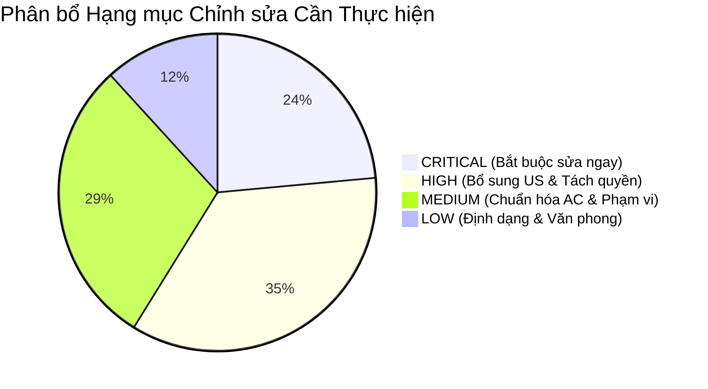

# HƯỚNG DẪN CẬP NHẬT TÀI LIỆU USER STORY (VER 1.1 ➔ VER 1.2)
## ĐỐI CHIẾU THEO PROPOSAL DOCUMENT VER 1.2 VÀ HIỆN TRẠNG SOURCE CODE

> **Dự án:** GraphMind (Enterprise Knowledge Management Platform for SME Decision Support)  
> **Mã đề tài:** Capstone Project 1 — C1SE.18 — Đại học Duy Tân (Duy Tan University)  
> **Tài liệu gốc cần chỉnh sửa:** `docs/02-user-story/4. C1SE18_UserStory_GraphMind-Ver1.1.docx`  
> **Tài liệu đối chiếu căn cứ:** `docs/01-proposal/C1SE18-Proposal-Document-Ver1.2.docx` (08/11/2026)  
> **Mục tiêu:** Cung cấp tài liệu chỉ dẫn chi tiết (Diff từng mục, từng bảng) để nhóm tác giả tiến hành cập nhật, sửa đổi và bổ sung tài liệu User Story lên phiên bản **Version 1.2**, phản ánh chính xác 100% phạm vi đề cương và mã nguồn thực tế.

---

## MỤC LỤC
1. [Tóm tắt Đánh giá & Ma trận Ưu tiên Cập nhật](#1-tóm-tắt-đánh-giá--ma-trận-ưu-tiên-cập-nhật)
2. [Phần Mở đầu & Chuẩn hóa Hệ thống Vai trò (Actors)](#2-phần-mở-đầu--chuẩn-hóa-hệ-thống-vai-trò-actors)
3. [Chi tiết Hiệu chỉnh 59 User Stories Hiện có (Diff Cũ ➔ Mới)](#3-chi-tiết-hiệu-chỉnh-59-user-stories-hiện-có-diff-cũ--mới)
4. [Bộ 10 User Stories Bổ sung Mới (US60 ➔ US69)](#4-bộ-10-user-stories-bổ-sung-mới-us60--us69)
5. [Tái cấu trúc Nhóm User Stories Kỹ thuật & Quản lý (US56 – US59)](#5-tái-cấu-trúc-nhóm-user-stories-kỹ-thuật--quản-lý-us56--us59)
6. [Bảng Ma trận Truy vết Toàn diện Sau Cập nhật (Updated Traceability Matrix)](#6-bảng-ma-trận-truy-vết-toàn-diện-sau-cập-nhật-updated-traceability-matrix)
7. [Checklist Nghiệm thu Cập nhật Tài liệu](#7-checklist-nghiệm-thu-cập-nhật-tài-liệu)

---

## 1. TÓM TẮT ĐÁNH GIÁ & MA TRẬN ƯU TIÊN CẬP NHẬT

Qua đối chiếu giữa tài liệu User Story Ver 1.1 hiện tại với Proposal Ver 1.2 và Source Code hệ thống, tài liệu User Story cần được thực hiện **3 nhóm điều chỉnh lớn**:
1. **Đính chính các sai lệch kỹ thuật và thông số thực tế:** Frontend Stack (React 18 + Vite SPA thay vì Next.js), Quy mô tập dữ liệu Q&A (509 cặp ChatML thay vì 2.000–3.000 do trần phần cứng Kaggle T4), Runtime phục vụ LLM (Ollama GGUF Q4_K_M port 11434 với cơ chế Fallback).
2. **Bổ sung 10 User Stories hoàn toàn mới (US60 – US69):** Bao phủ các phân hệ đã có trong Proposal 1.2 và Code nhưng US hiện tại bỏ sót: Phê duyệt tài liệu tải lên (Document Upload Approval), Phân hệ Báo cáo giao ca (Shift Reports), AI tổng hợp báo cáo ngày, Ma trận phân quyền động (`rbac_permissions_matrix`), Kiểm soát phiên đăng nhập đơn lẻ (Single Active Session / JTI), Khôi phục mật khẩu qua Email OTP 3 bước, Rào chắn an toàn Cypher (Read-only Cypher Guard), và Điều khiển trạm làm việc PB56 (Heartbeat & Kill Switch).
3. **Chuẩn hóa danh mục Actor & Tách vai trò Admin:** Tách riêng `it_admin` và `knowledge_manager` (tuân thủ Business Rule BR-04); Tách bạch giữa `Executive` (quyền hạn toàn diện, BR-05) và `Department Manager` (Trưởng phòng bộ phận). Chuyển đổi các Story bàn giao nội bộ nhóm (US56 – US59) thành Engineering Tasks / DoD.

### Ma trận Ưu tiên Thực hiện (Priority Matrix)



- 🔴 **CRITICAL (4 việc):**
  1. Đính chính **US12**: Thay thế `React / Next.js` bằng `React 18 + Vite (SPA)`.
  2. Đính chính **US46**: Sửa số lượng tập tinh chỉnh từ `2.000–3.000 pairs` thành `509 cặp ChatML`.
  3. Bổ sung **US60 & US61**: Quy trình nhân viên nộp tài liệu và Quản trị viên duyệt tài liệu.
  4. Bổ sung **US62, US63, US64**: Phân hệ Báo cáo giao ca và AI tổng hợp báo cáo ngày.
- 🟠 **HIGH (6 việc):**
  5. Bổ sung **US65**: Giao diện Ma trận phân quyền động CRUD (`rbac_permissions_matrix`).
  6. Bổ sung **US66**: Cơ chế kiểm soát phiên đăng nhập đơn lẻ (Single Active Session).
  7. Tách **US31** và tạo mới **US67**: Luồng Khôi phục mật khẩu 3 bước qua Email OTP.
  8. Bổ sung **US68**: Rào chắn an toàn Read-Only Cypher Guard cho câu lệnh Neo4j.
  9. Cập nhật **US34**: Bổ sung 2 loại cảnh báo tài chính (Negative Margin & Abnormal Discount $\ge 35\%$).
  10. Tách bạch Actor `Admin` thành `it_admin` và `knowledge_manager` (BR-04).
- 🟡 **MEDIUM (5 việc):**
  11. Bổ sung **US69** (hoặc cập nhật US41): Quản trị trạm PB56 với Heartbeat và Emergency Kill Switch.
  12. Cập nhật **US50**: Bổ sung Ollama serving (GGUF Q4_K_M) và Fallback tất định.
  13. Cập nhật **US35**: Bỏ xuất file PDF/Word (Out-of-Scope), chuyển thành hiển thị Web Dashboard.
  14. Cập nhật **US44**: Đưa LLMOps Dashboard vào In-Scope MVP Module 6.
  15. Tái phân loại **US56 – US59** thành Sprint Tasks / Definition of Done.
- 🟢 **LOW (2 việc):**
  16. Cập nhật **US51**: Chuẩn hóa chính xác 100 câu hỏi Benchmark Ground Truth.
  17. Chuẩn hóa cấu trúc Acceptance Criteria theo mẫu `Given - When - Then`.

---

## 2. PHẦN MỞ ĐẦU & CHUẨN HÓA HỆ THỐNG VAI TRÒ (ACTORS)

Tại phần đầu của tài liệu User Story Word (Mục 1 - Giới thiệu), tiến hành cập nhật văn bản theo nội dung sau:

### 2.1. Cập nhật Thông tin Tài liệu (Document Info)
- **Document Title:** User Story Document
- **Version:** **1.2** *(thay thế Version 1.1 / FINAL cũ)*
- **Date:** **November 2026** *(thay thế 19 Sep 2026)*
- **Referenced Proposal:** **Proposal Document Version 1.2 (08 Nov 2026)**

### 2.2. Đoạn văn Giới thiệu Cần Thay Thế (Introductory Text Diff)

```diff
- Scope, architecture and research activities follow the Proposal Document (Version 1.1); Sprint schedule and deliverables follow the Project Plan Document (FINAL).
- The platform serves exactly four system roles: SME Manager (including Executive), Standard User, Admin and Research Team. Sales, Accounting, HR, Legal and IT are department/data scopes enforced through RBAC, not system roles.

+ Scope, architecture and research activities follow the Proposal Document (Version 1.2, 08 Nov 2026); Sprint schedule and deliverables follow the Project Plan Document (FINAL).
+ The platform serves exactly four Web Dashboard roles and one research group, strictly aligned with Section 6.1a and Table 6.1a of the Proposal Document Ver 1.2:
+ 1. System & IT Administrator (it_admin): Full authority over infrastructure, user administration, AEGIS agent telemetry (PB56 kill switch), dynamic RBAC matrix configuration, technical audit logs, and IT department documents.
+ 2. Knowledge Administrator (knowledge_manager): Full authority over enterprise knowledge curation (Sales, Legal, Procurement, R&D), SOP authoring, human-in-the-loop graph editing, and document approval oversight. Strictly isolated from IT department documents and system technical configurations (Business Rule BR-04).
+ 3. Executive (executive): C-level decision-maker with unrestricted, full-access RBAC scope across all 5 departments (Business Rule BR-05), monitoring financial/legal risk alerts, viewing the Executive Decision Dashboard, and generating interactive Executive Briefings on the Web.
+ 4. Standard User (standard): Department business operations staff, restricted strictly to their assigned department's data scope (Default: Sales — Business Rule BR-02), using the department Copilot, viewing cited documents, and submitting Shift Reports.
+ 5. Research Team: Internal R&D team responsible for dataset curation, controlled synthetic linking, Kaggle LoRA fine-tuning, and empirical baseline benchmarking.
+ Enterprise data is strictly partitioned across five standard departments: Sales, Legal, Accounting & Procurement, IT, and R&D.
```

---

## 3. CHI TIẾT HIỆU CHỈNH 59 USER STORIES HIỆN CÓ (DIFF CŨ ➔ MỚI)

Dưới đây là chi tiết các User Story hiện có cần được chỉnh sửa lại Actor, Goal, Benefit hoặc Acceptance Criteria để hoàn toàn khớp với Proposal Ver 1.2:

---

### [US12] Frontend Technology Stack
- **Vấn đề:** Ghi nhận sai ngăn xếp công nghệ (`React/Next.js`). Mã nguồn thực tế là `React 18 + Vite (SPA)`.
- **Cập nhật:**

```diff
  ID: US12
- As a: SME Manager
+ As a: Standard User / Executive
- I want to: Access the GraphMind platform via a browser-based Web Dashboard
+ I want to: Access the GraphMind platform via a modern browser-based Single Page Application (SPA) built with React 18 and Vite
- so that: I can use the full Chat UI, Source and Citation Viewer and Knowledge Graph Viewer functionality without installing complex software
+ so that: I enjoy a lightning-fast, reactive, and responsive interface across all modules without desktop client installation

  Acceptance Criteria:
- • The Web Dashboard is built with React/Next.js and communicates with the Backend via REST API (FastAPI).
- • The interface includes at least three views: Chat UI, Source and Citation Viewer and Knowledge Graph Viewer.
- • The Web Dashboard is completed and integrated with the backend in Sprint 4.
+ • Given any modern desktop browser (Chrome, Edge, Firefox, Safari), when navigating to the platform URL, then the Web Dashboard loads within ≤ 2.0 seconds as a pure client-side SPA (React 18 + Vite engine).
+ • Given the SPA architecture, when switching between views (Chat UI, Knowledge Graph Viewer, Document Browser, Risk Center), then transitions occur instantly without full-page reloads.
+ • Given the REST API backend (FastAPI), when API calls are executed, then secure JWT tokens are automatically attached via HTTP Authorization Bearer headers.
```

---

### [US46] Q&A Dataset Scale for LoRA Fine-Tuning
- **Vấn đề:** Ghi `2,000–3,000 pairs`. Thực tế mã nguồn (`train_dataset.json`) và Proposal Ver 1.2 là **509 cặp ChatML** do giới hạn phần cứng Kaggle GPU T4.
- **Cập nhật:**

```diff
  ID: US46
  As a: Research Team
- I want to: Build a Q&A dataset (2,000–3,000 pairs) from AdventureWorks and CUAD
+ I want to: Construct a curated dataset of 509 high-quality ChatML Q&A pairs from AdventureWorks and CUAD
- so that: the language model has sufficient domain data for fine-tuning without manual annotation
+ so that: the open-weight Qwen2.5-7B-Instruct model can be fine-tuned effectively within the Kaggle GPU T4 hardware ceiling (~51s/step, 30h/week limit)

  Acceptance Criteria:
- • The dataset contains 2,000–3,000 question-answer pairs built from AdventureWorks and CUAD data, divided into train/val/test splits (80/10/10).
- • Questions are categorized into three difficulty levels: single-hop (lookup), 2-hop (linking within a source) and cross-source (CRM + contract).
- • The dataset is delivered in Sprint 1.
+ • Given the AdventureWorks CRM/ERP and CUAD contract corpora, when applying entity linking and question synthesis, then exactly 509 curated question-answer pairs in standardized ChatML format are generated and verified.
+ • Given the hardware constraints of the Kaggle free tier (NVIDIA T4 GPU with ~51s/step training speed and 30-hour weekly quota), when configuring the dataset size, then 509 samples ensure complete training convergence within 3 epochs without session interruption.
+ • Given the dataset distribution, when validating question types, then pairs cover single-hop, 2-hop, and cross-source governance questions reflecting real SME decision scenarios.
```

---

### [US34] Smart Risk & Alert Center Criteria
- **Vấn đề:** Chỉ ghi nhận 2 loại rủi ro hợp đồng, thiếu 2 rủi ro tài chính trọng yếu trong Proposal 1.2 và Code: **Negative Margin** và **Abnormal Discount $\ge 35\%$**.
- **Cập nhật:**

```diff
  ID: US34
- As a: SME Manager
+ As a: Executive
  I want to: Use a Smart Risk & Alert Center that lists contracts nearing expiration, legal risks and financial anomalies
  so that: I can proactively resolve issues before they cause legal or financial damage

  Acceptance Criteria:
- • The Alert Center lists contracts expiring within 15–30 days and contracts with legal risks (Uncapped Liability).
- • Alerts can be filtered by risk level (High, Medium, Low).
- • Clicking an alert opens the details of the contract/customer involved.
+ • Given enterprise data synchronized in Neo4j and PostgreSQL, when the Executive accesses the Smart Risk & Alert Center, then the system monitors and displays exactly 4 risk criteria:
+   1. Contracts expiring in the next 15–30 days.
+   2. Contracts containing dangerous legal clauses (Uncapped Liability).
+   3. Sales orders sold below unit standard cost (Negative Margin / Lỗ biên lợi nhuận).
+   4. Sales orders with abnormal discount rates (Discount ≥ 35%).
+ • Given an alert item, when the Executive clicks on it, then the system navigates directly to the underlying contract PDF passage or order transaction row for immediate inspection.
```

---

### [US35] Executive Briefing Scope Alignment
- **Vấn đề:** Đang ghi xuất file PDF/Word (stretch). Proposal Ver 1.2 Mục 6.1 & Mục 7 đã loại bỏ xuất file (Out-of-Scope), thay bằng hiển thị trực tiếp trên Web Dashboard (`/api/dashboard/briefing`).
- **Cập nhật:**

```diff
  ID: US35
- As a: SME Manager
+ As a: Executive
- I want to: Generate an Executive Briefing with one click [Optional / Stretch]
+ I want to: Generate an AI-powered Executive Briefing directly on my Web Dashboard with one click
- so that: The weekly/monthly business, receivables and contract status is summarized automatically into a report file
+ so that: The weekly/monthly business, receivables and contract status is summarized automatically on-screen without manual compilation

  Acceptance Criteria:
- • A one-click action makes the AI summarize the week's/month's business, receivables and contract status.
- • The summary can be exported as a PDF or Word file.
- • This story is not part of any committed Sprint (see Section 1.5).
+ • Given the Executive is viewing the Executive Decision Dashboard, when clicking the "Generate Briefing" button, then the system invokes the local Ollama LLM to synthesize core metrics into an on-screen summary within ≤ 5.0 seconds.
+ • Given the briefing card, when rendered on the Web Dashboard, then it highlights: Total Revenue, Top Customers, Critical Expiring Contracts, and Negative Margin Alerts.
+ • Given the project scope boundaries (Section 7), when generating the briefing, then binary file export (PDF/Word) is deferred to the future backlog while interactive web display is fully functional in MVP.
```

---

### [US31] Tách Story Đăng Ký và Quên Mật Khẩu
- **Vấn đề:** Gộp Đăng ký và Quên mật khẩu làm Story quá lớn. Mô tả Quên mật khẩu qua email link hoặc câu hỏi bảo mật là sai lệch với mã nguồn OTP 6 số.
- **Cập nhật:** Chuyển US31 về chức năng thuần túy Đăng ký tài khoản; Chuyển toàn bộ luồng Quên mật khẩu Email OTP sang Story mới **US67**.

```diff
  ID: US31
- As a: SME Manager
+ As a: New User (All Roles)
- I want to: Register an account, reset a forgotten password and verify my identity with a one-time password (OTP)
+ I want to: Register a new user account with enterprise data validation
- so that: I can obtain and recover secure access to the platform
+ so that: I can request an account on the GraphMind platform under my designated department

  Acceptance Criteria:
- • A new user can register an account; registration data is validated before the account is created.
- • A user who has forgotten the password can reset it through a verification flow.
- • The system supports OTP (one-time password) verification as part of authentication.
- • Invalid or expired OTPs are rejected with a clear error message.
+ • Given an unregistered user on the Registration page, when entering valid corporate email, full name, secure password (≥ 8 chars), and selecting one of the 5 standard departments, then the account request is created with status PENDING or ACTIVE per admin policy.
+ • Given duplicate email or invalid password formats, when the user submits the form, then the system rejects registration with specific field-level validation errors.
```

---

### [US50] LLM Serving Runtime via Ollama GGUF
- **Vấn đề:** Chưa nêu rõ phục vụ cục bộ bằng **Ollama Engine (GGUF Q4_K_M)** và cơ chế Fallback tất định.
- **Cập nhật:**

```diff
  ID: US50
  As a: Research Team
  I want to: Deploy the fine-tuned Qwen2.5-7B-Instruct as a self-hosted inference service integrated into the FastAPI backend
  so that: answers are generated on infrastructure controlled by the SME

  Acceptance Criteria:
- • The fine-tuned model (merged or separate LoRA adapter) is served as a self-hosted inference service (on-premise/private cloud).
- • The Backend (FastAPI) calls this service for answer generation, without third-party LLM API calls.
- • Inference latency can be measured per query.
+ • Given the fine-tuned LoRA weights, when merged and quantized into 4-bit GGUF format (Q4_K_M), then the model is served locally via Ollama Engine on port 11434 via a dedicated Modelfile.
+ • Given incoming prompts from the FastAPI backend, when Ollama is running, then inference is executed locally with average latency ≤ 3.5s per query without external third-party API exposure.
+ • Given Ollama service unreachability or timeout (> 30s), when an inference request is dispatched, then the backend triggers a deterministic fallback mechanism providing a grounded structured response based directly on retrieved graph/vector context without throwing unhandled 500 errors.
```

---

### [US13, US14, US17, US18, US29, US38, US40, US41] Chuẩn hóa Actor (Admin ➔ it_admin & knowledge_manager)
- **Vấn đề:** Gộp chung nhãn `Admin` vi phạm quy tắc cách ly dữ liệu phòng IT (BR-04) và phân công trách nhiệm trong Proposal Ver 1.2 Bảng 6.1a.
- **Cập nhật cụ thể:**
  - **US13 (User Accounts & RBAC):** Đổi Actor thành `System & IT Administrator (it_admin)`. Bổ sung AC quản lý phân bổ nhân viên theo đúng 5 phòng ban chuẩn.
  - **US17 (Security Config & Audit):** Đổi Actor thành `System & IT Administrator (it_admin)`.
  - **US18 (Database Core Operations):** Đổi Actor thành `System & IT Administrator (it_admin)`. Tinh chỉnh AC tập trung vào bảo trì CSDL và sao lưu.
  - **US41 (AEGIS Agent Panel):** Đổi Actor thành `System & IT Administrator (it_admin)`. Bổ sung AC về ngưỡng nhịp tim và Kill Switch.
  - **US29 (Knowledge Graph Content Editor):** Đổi Actor thành `Knowledge Administrator (knowledge_manager)`. Bổ sung AC thể hiện cơ chế Human-in-the-loop chỉnh sửa nút và quan hệ trích xuất sai.
  - **US38 (SOP & Internal Knowledge Base Authoring):** Đổi Actor từ `SME Manager` thành `Knowledge Administrator (knowledge_manager)`. Bổ sung AC về vòng đời xuất bản tài liệu quy trình (Draft / Published).
  - **US40 (Document & Data Explorer):** Đổi Actor thành `Knowledge Administrator (knowledge_manager)`.

---

## 4. BỘ 10 USER STORIES BỔ SUNG MỚI (US60 ➔ US69)

Dưới đây là nội dung chi tiết của **10 User Stories cần bổ sung mới vào tài liệu Word** để đảm bảo phản ánh 100% phạm vi Proposal Ver 1.2 và Source Code:

---

### US60: Nộp Tài liệu Nội bộ Chờ Phê duyệt (Staff Document Upload)
- **Module:** Module 2 — Knowledge Management & Editor
- **Sprint:** Sprint 2 (Frontend) & Sprint 3 (Pipeline)
- **Product Backlog:** PB67
- **Priority:** 🔴 **HIGH**
- **Actor:** `Standard User` (Nhân viên tác nghiệp các phòng ban)
- **User Story:**
  > **As a** Standard User,  
  > **I want to** tải các tệp tài liệu nội bộ (hợp đồng PDF, báo cáo bảng tính Excel) lên hệ thống với trạng thái chờ duyệt (PENDING),  
  > **so that** tài liệu được lưu trữ tập trung nhưng không làm sai lệch hoặc ô nhiễm Đồ thị tri thức trước khi được Quản trị viên thẩm định.
- **Acceptance Criteria (Given - When - Then):**
  - **AC1 (File Upload & Metadata Extraction):** Given người dùng đã đăng nhập với vai trò Standard User, When người dùng chọn tệp `.pdf` hoặc `.xlsx` (kích thước $\le 25MB$) và nhấn "Upload", Then hệ thống tính toán mã băm SHA-256, lưu tệp vào hàng đợi với trạng thái `PENDING_APPROVAL`, phòng ban gán theo phòng ban của người dùng.
  - **AC2 (SHA-256 Idempotency Guard):** Given tệp tải lên có mã băm SHA-256 trùng khớp với một tài liệu đã tồn tại, When hệ thống kiểm tra, Then hệ thống từ chối tải lên và hiển thị thông báo "Tài liệu này đã tồn tại trong hệ thống (Duplicate detected)".
  - **AC3 (Retrieval Isolation):** Given tài liệu đang ở trạng thái `PENDING_APPROVAL`, When người dùng thực hiện truy vấn qua AI Copilot hoặc tìm kiếm đa diện, Then tài liệu này tuyệt đối không xuất hiện trong kết quả truy vấn.
- **Căn cứ Code:** `backend/app/modules/m6_admin_security/document_approval_router.py`, `document_approval_model.py`.

---

### US61: Xem Xét & Phê duyệt Tài liệu Tải lên (Document Approval Oversight)
- **Module:** Module 6 — System Admin & Security / Module 2 — Knowledge Editor
- **Sprint:** Sprint 3
- **Product Backlog:** PB68
- **Priority:** 🔴 **HIGH**
- **Actor:** `Knowledge Administrator` (`knowledge_manager`) / `it_admin`
- **User Story:**
  > **As a** Knowledge Administrator,  
  > **I want to** xem danh sách các tài liệu đang chờ duyệt và thực hiện phê duyệt (APPROVED) hoặc từ chối (REJECTED),  
  > **so that** chỉ những tài liệu hợp chuẩn, chính xác mới được trích xuất thực thể vào Neo4j và lập chỉ mục ngữ nghĩa vào Qdrant.
- **Acceptance Criteria (Given - When - Then):**
  - **AC1 (Pending Queue Review):** Given người quản trị tri thức mở bảng điều khiển "Pending Approvals", When có tài liệu ở trạng thái `PENDING_APPROVAL`, Then hệ thống hiển thị danh sách gồm: Tên tệp, Người tải, Phòng ban, Ngày tải, Kích thước, và nút Xem trước (Preview).
  - **AC2 (Approval Pipeline Trigger):** Given người quản trị chọn một tài liệu pending và bấm "Approve", When hệ thống cập nhật trạng thái thành `APPROVED`, Then hệ thống tự động kích hoạt Ingestion Pipeline (trích xuất thực thể vào Neo4j và tính embedding vào Qdrant), đồng thời ghi nhận Audit Log.
  - **AC3 (Rejection Handling):** Given người quản trị chọn "Reject", When nhập lý do từ chối và bấm xác nhận, Then trạng thái chuyển thành `REJECTED`, tệp bị vô hiệu hóa khỏi luồng nạp và gửi phản hồi trạng thái về cho người tải.
- **Căn cứ Code:** `frontend/src/views/m6_admin_security/PendingApprovalsPanel.jsx`, `backend/app/tests/test_document_approval.py`.

---

### US62: Lập và Nộp Báo cáo Giao ca (Shift Handover Report Submission)
- **Module:** Module 4 — Decision Support & Alerts
- **Sprint:** Sprint 3
- **Product Backlog:** PB69
- **Priority:** 🟡 **MEDIUM**
- **Actor:** `Standard User` (Nhân viên tác nghiệp)
- **User Story:**
  > **As a** Standard User,  
  > **I want to** điền và nộp biên bản bàn giao ca làm việc (Shift Report) thông qua biểu mẫu trực quan trên Web Dashboard,  
  > **so that** thông tin công việc hoàn thành, sự cố tồn đọng và đầu mục bàn giao được lưu trữ có cấu trúc phục vụ ca sau và cấp quản lý.
- **Acceptance Criteria (Given - When - Then):**
  - **AC1 (Form Submission & Validation):** Given nhân viên truy cập màn hình Shift Report Editor, When nhân viên nhập: Tiêu đề ca, Thời gian ca làm việc, Công việc hoàn thành, Vấn đề/Sự cố tồn đọng, Đề xuất bàn giao và bấm "Submit", Then hệ thống kiểm tra các trường bắt buộc và lưu báo cáo vào PostgreSQL với trạng thái `SUBMITTED`.
  - **AC2 (Draft State):** Given nhân viên chưa hoàn tất ca trực, When bấm "Save Draft", Then thông tin được lưu tạm với trạng thái `DRAFT` và có thể chỉnh sửa tiếp sau đó.
- **Căn cứ Code:** `frontend/src/views/m4_decision_support/ShiftReportEditor.jsx`, `backend/app/api/v1/shift_reports.py`.

---

### US63: Đánh Giá & Duyệt Báo cáo Giao ca Phòng ban (Shift Report Review)
- **Module:** Module 4 — Decision Support & Alerts
- **Sprint:** Sprint 3
- **Product Backlog:** PB70
- **Priority:** 🟡 **MEDIUM**
- **Actor:** `Department Manager` (Trưởng phòng bộ phận / Operations Head)
- **User Story:**
  > **As a** Department Manager,  
  > **I want to** xem danh sách các báo cáo giao ca của nhân viên trong phòng ban và thực hiện nhận xét/xác nhận hoàn thành ca,  
  > **so that** tôi nắm bắt kịp thời các sự cố vận hành và chỉ đạo xử lý kịp thời.
- **Acceptance Criteria (Given - When - Then):**
  - **AC1 (Department Scoped View):** Given Trưởng phòng đăng nhập, When truy cập mục Quản lý Báo cáo ca, Then hệ thống chỉ hiển thị các báo cáo giao ca thuộc đúng phòng ban của mình.
  - **AC2 (Review Action):** Given Trưởng phòng xem chi tiết một báo cáo `SUBMITTED`, When thêm nhận xét chỉ đạo và bấm "Mark as Reviewed", Then trạng thái cập nhật thành `REVIEWED` và lưu vết thời gian duyệt.
- **Căn cứ Code:** `frontend/src/views/m4_decision_support/ReportsView.jsx`, `backend/app/api/v1/shift_reports.py`.

---

### US64: AI Tự Động Tổng Hợp Báo Cáo Ngày Phòng Ban (AI Daily Shift Consolidation)
- **Module:** Module 4 — Decision Support & Alerts
- **Sprint:** Sprint 4
- **Product Backlog:** PB71
- **Priority:** 🟡 **MEDIUM**
- **Actor:** `Executive` / `Department Manager`
- **User Story:**
  > **As an** Executive / Department Manager,  
  > **I want to** kích hoạt tính năng AI tự động tổng hợp tất cả các báo cáo giao ca trong ngày của phòng ban thành một bản báo cáo ngày duy nhất,  
  > **so that** tôi nắm bắt toàn cảnh tình hình vận hành nhanh chóng mà không phải đọc thủ công từng báo cáo đơn lẻ.
- **Acceptance Criteria (Given - When - Then):**
  - **AC1 (AI Synthesis Generation):** Given có ít nhất 1 báo cáo ca ở trạng thái `SUBMITTED`/`REVIEWED` trong ngày, When Quản lý chọn ngày và bấm "Generate Daily Summary", Then Backend kích hoạt prompt tổng hợp gửi đến mô hình Ollama cục bộ.
  - **AC2 (Output Structure):** Given mô hình xử lý thành công, Then giao diện hiển thị bản tóm tắt gồm 3 phần: (1) Các công việc chính đã hoàn thành, (2) Các vấn đề/rủi ro tồn đọng, (3) Kiến nghị ưu tiên cho ngày tiếp theo.
  - **AC3 (Deterministic Fallback):** Given dịch vụ Ollama ngoại tuyến hoặc timeout (> 30s), Then hệ thống áp dụng cơ chế tóm tắt tất định dự phòng trích xuất danh sách sự cố trực tiếp từ cơ sở dữ liệu.
- **Căn cứ Code:** `frontend/src/views/m4_decision_support/DepartmentReportView.jsx`, `backend/app/tests/test_department_report.py`.

---

### US65: Cấu Hình Ma Trận Phân Quyền Động (Granular Dynamic RBAC Matrix Management)
- **Module:** Module 6 — System Admin & Security
- **Sprint:** Sprint 2 & Sprint 3
- **Product Backlog:** PB72
- **Priority:** 🔴 **HIGH**
- **Actor:** `System & IT Administrator` (`it_admin`)
- **User Story:**
  > **As a** System & IT Administrator,  
  > **I want to** cấu hình chi tiết ma trận quyền hạn CRUD trên từng loại thực thể (Customer, Order, Contract, SOP) cho từng vai trò và phòng ban thông qua giao diện Web trực quan,  
  > **so that** doanh nghiệp có thể tùy biến chính sách bảo mật dữ liệu linh hoạt mà không cần can thiệp sửa mã nguồn backend.
- **Acceptance Criteria (Given - When - Then):**
  - **AC1 (Matrix Rendering):** Given IT Admin truy cập màn hình "Granular RBAC Matrix", When hệ thống tải dữ liệu, Then hiển thị bảng lưới 2 chiều: Các cột là Vai trò/Phòng ban, Các hàng là Thực thể dữ liệu kèm 4 hộp chọn quyền (Create, Read, Update, Delete).
  - **AC2 (Dynamic Persist):** Given IT Admin thay đổi quyền (ví dụ: Bỏ quyền Read của Sales đối với Legal Contract) và nhấn "Save Changes", When dữ liệu hợp lệ, Then hệ thống cập nhật bảng `rbac_permissions_matrix` trong CSDL PostgreSQL ngay lập tức.
  - **AC3 (Enforcement):** Given quyền đã cập nhật, When người dùng thuộc vai trò bị hạn chế thực hiện API tương ứng, Then API trả về mã lỗi `403 Forbidden` kèm thông điệp từ chối rõ ràng.
- **Căn cứ Code:** `frontend/src/views/m6_admin_security/GranularRbacMatrix.jsx`, `backend/app/modules/m6_admin_security/rbac_matrix_router.py`.

---

### US66: Kiểm Soát Phiên Đăng Nhập Đơn Lẻ (Single Active Session Enforcement)
- **Module:** Module 6 — System Admin & Security / Section 10 Security
- **Sprint:** Sprint 2
- **Product Backlog:** PB73
- **Priority:** 🔴 **HIGH**
- **Actor:** `System & IT Administrator` (`it_admin`) / Toàn bộ người dùng
- **User Story:**
  > **As a** System & IT Administrator,  
  > **I want** hệ thống bắt buộc duy trì duy nhất một phiên làm việc đang hoạt động (Single Active Session) cho mỗi tài khoản người dùng,  
  > **so that** ngăn chặn việc chia sẻ tài khoản trái phép và bảo vệ an toàn thông tin khi tài khoản bị lộ thông tin đăng nhập.
- **Acceptance Criteria (Given - When - Then):**
  - **AC1 (Session Tracking):** Given người dùng đăng nhập thành công, When hệ thống phát sinh Access Token JWT, Then mã định danh JWT ID (`jti`) được lưu vào bảng `user_active_sessions` trong PostgreSQL kèm thông tin IP và User-Agent.
  - **AC2 (Prior Session Invalidation):** Given tài khoản đang có phiên đăng nhập trên Thiết bị A, When người dùng đăng nhập thành công trên Thiết bị B, Then phiên trên Thiết bị A bị thu hồi `jti` ngay lập tức.
  - **AC3 (Concurrent Interception):** Given phiên trên Thiết bị A đã bị thu hồi, When Thiết bị A gửi bất kỳ yêu cầu API tiếp theo nào, Then Backend trả về lỗi `401 Unauthorized` kèm chỉ báo `SESSION_EXPIRED_CONCURRENT_LOGIN` và tự động điều hướng về màn hình đăng nhập.
- **Căn cứ Code:** `backend/app/modules/m6_admin_security/session_service.py`, `backend/app/tests/test_concurrent_login.py`.

---

### US67: Khôi Phục Mật Khẩu Tự Phục Vụ Qua Email OTP (Self-Service Password Recovery via Email OTP)
- **Module:** Module 6 — System Admin & Security / Section 10 Security
- **Sprint:** Sprint 2
- **Product Backlog:** PB74
- **Priority:** 🔴 **HIGH**
- **Actor:** Người dùng quên mật khẩu (Mọi vai trò)
- **User Story:**
  > **As a** Người dùng bị quên mật khẩu,  
  > **I want to** nhận mã xác thực OTP 6 chữ số gửi qua Email đã đăng ký để tự khôi phục mật khẩu tài khoản trong 3 bước,  
  > **so that** tôi có thể lấy lại quyền truy cập hệ thống nhanh chóng, an toàn mà không cần nhờ Admin can thiệp thủ công.
- **Acceptance Criteria (Given - When - Then):**
  - **AC1 (Step 1 - OTP Request):** Given người dùng tại màn hình "Forgot Password", When nhập đúng địa chỉ email đã đăng ký và nhấn "Send OTP", Then hệ thống sinh mã ngẫu nhiên 6 chữ số, lưu vào bảng `otps` (mã hóa băm), gửi email qua giao thức SMTP (`aiosmtplib`), và hiển thị đồng hồ đếm ngược 5 phút.
  - **AC2 (Step 2 - OTP Verification):** Given mã OTP đã gửi, When người dùng nhập đúng mã trong vòng 5 phút (300 giây), Then hệ thống xác thực thành công và cấp mã ủy quyền đổi mật khẩu tạm thời (`reset_token`). Nếu nhập sai quá 3 lần, mã OTP lập tức bị vô hiệu hóa để chống tấn công Brute-force.
  - **AC3 (Step 3 - Password Reset):** Given có mã reset hợp lệ, When người dùng nhập mật khẩu mới (tối thiểu 8 ký tự, có chữ và số) và xác nhận, Then mật khẩu được băm (Argon2/Bcrypt), lưu vào CSDL, vô hiệu hóa toàn bộ session cũ và điều hướng về trang Login.
- **Căn cứ Code:** `frontend/src/components/ForgotPasswordPage.jsx`, `backend/app/modules/m6_admin_security/forgot_password_router.py`, `otp_service.py`.

---

### US68: Rào Chắn An Toàn Truy Vấn Đồ Thị (Read-Only Cypher Guard Enforcement)
- **Module:** Module 3 — Hybrid AI Copilot & Search / Security
- **Sprint:** Sprint 3
- **Product Backlog:** PB75
- **Priority:** 🔴 **HIGH**
- **Actor:** `System & IT Administrator` (`it_admin`) / Research Team
- **User Story:**
  > **As a** System & IT Administrator,  
  > **I want** hệ thống kiểm duyệt toàn bộ câu lệnh Cypher do AI tự động sinh ra thông qua tầng Read-Only Cypher Guard trước khi thực thi trên Neo4j,  
  > **so that** ngăn chặn hoàn toàn nguy cơ tấn công Cypher Injection hoặc các câu lệnh vô tình làm thay đổi, xóa dữ liệu trong cơ sở dữ liệu đồ thị tri thức.
- **Acceptance Criteria (Given - When - Then):**
  - **AC1 (Mutation Interception):** Given câu truy vấn Cypher được sinh ra từ NL2Cypher Engine, When câu lệnh chứa bất kỳ từ khóa biến đổi dữ liệu nào (`CREATE`, `MERGE`, `DELETE`, `DETACH`, `SET`, `REMOVE`, `DROP`), Then Rào chắn Cypher Guard (bằng Regex và bộ phân tích cú pháp AST) phải chặn đứng yêu cầu trước khi chạm tới Driver Neo4j.
  - **AC2 (Error Handling & Safe Fallback):** Given một truy vấn bị Cypher Guard chặn, When hệ thống từ chối thực thi, Then hệ thống ghi log cảnh báo an ninh và chuyển hướng câu trả lời sang cơ chế truy vấn Vector RAG an toàn, trả về thông điệp trung thực cho người dùng thay vì gây crash hệ thống.
- **Căn cứ Code:** `backend/app/modules/m3_hybrid_copilot/query_engine/nl2cypher_engine.py`, `backend/app/tests/test_nl2cypher_golden_suite.py`.

---

### US69: Giám Sát Nhịp Tim & Ngắt Khẩn Cấp Trạm Làm Việc AEGIS (PB56 Workstation Control & Kill Switch)
- **Module:** Module 1 — Data Source & Sync Management
- **Sprint:** Sprint 4
- **Product Backlog:** PB76
- **Priority:** 🟡 **MEDIUM**
- **Actor:** `System & IT Administrator` (`it_admin`)
- **User Story:**
  > **As a** System & IT Administrator,  
  > **I want to** thiết lập ngưỡng nhịp tim (Heartbeat) và kích hoạt công tắc ngắt khẩn cấp (Emergency Kill Switch) từ xa cho từng trạm làm việc cài đặt AEGIS Agent,  
  > **so that** tôi có thể cô lập và dừng ngay lập tức tiến trình đồng bộ của một máy trạm khi phát hiện dấu hiệu bất thường hoặc nguy cơ lộ lọt dữ liệu.
- **Acceptance Criteria (Given - When - Then):**
  - **AC1 (Heartbeat Alert):** Given một AEGIS Agent đang hoạt động, When trạm làm việc không gửi tín hiệu nhịp tim về máy chủ quá ngưỡng cấu hình (ví dụ: > 120 giây), Then trạng thái trạm trên bảng điều khiển tự động chuyển thành `OFFLINE / TIMEOUT` và hiển thị cảnh báo trực quan.
  - **AC2 (Emergency Kill Switch Trigger):** Given IT Admin phát hiện sự cố trên trạm PB56, When nhấn "Emergency Kill Switch" trên giao diện, Then Backend gửi tín hiệu ngắt ngay lập tức, tiến trình File Watcher tại máy trạm dừng đồng bộ trong vòng $\le 3$ giây và chuyển trạng thái sang `SUSPENDED`.
  - **AC3 (2-Phase ACK):** Mọi lệnh điều khiển trạng thái máy trạm đều áp dụng cơ chế xác nhận 2 pha (2-phase ACK) để đảm bảo lệnh đã được thực thi thành công ở phía Client.
- **Căn cứ Code:** `frontend/src/views/m1_data_sync/pb56_workstations/WorkstationsPanel.jsx`, `backend/app/api/v1/pb56_workstations.py`.

---

## 5. TÁI CẤU TRÚC NHÓM USER STORIES KỸ THUẬT & QUẢN LÝ (US56 – US59)

Trong tài liệu hiện tại, có 4 mục được gán nhãn là User Story của `Research Team`:
- `US56`: Finalize the Technical Report.
- `US57`: Prepare the AI Usage Disclosure Statement.
- `US58`: Complete the team Reflection and 360-degree Peer Evaluation.
- `US59`: Integrate the frontend and backend, run the End-to-End Test, write the Test Report and complete Bug Fixing.

### Đánh giá chuyên môn (Scrum Principle):
Theo chuẩn Agile/Scrum và nguyên tắc INVEST, User Story bắt buộc phải mang lại **giá trị sử dụng trực tiếp cho người dùng hệ thống** ("As a [End User Role], I want..."). Bốn mục trên là **Nhiệm vụ quản lý dự án (Project Management Deliverables)** và **Tiêu chuẩn hoàn thành kỹ thuật (Engineering Tasks / Definition of Done)** của nhóm sinh viên, không thể coi là tính năng phần mềm.

### Hướng dẫn xử lý trong tài liệu Word:
1. **Phương án A (Khuyến nghị chuẩn Scrum):** Chuyển 4 mục US56 – US59 ra khỏi bảng User Story chính, đưa vào một tiểu mục riêng: **"1.5 Project Management Deliverables & Sprint Definition of Done"**.
2. **Phương án B (Giữ nguyên cấu trúc phục vụ nghiệm thu đồ án):** Nếu Ban giám khảo Capstone yêu cầu duy trì mã số US liên tục, nhóm giữ lại mã US56 – US59 nhưng bổ sung một chú thích ghi chú rõ: *"Các story US56–US59 là Research & Management Stories đặc thù của đồ án Capstone 1, phục vụ công tác nghiệm thu hồ sơ học thuật."*

---

## 6. BẢNG MA TRẬN TRUY VẾT TOÀN DIỆN SAU CẬP NHẬT (UPDATED TRACEABILITY MATRIX)

Sau khi bổ sung 10 User Stories mới (US60 ➔ US69) và tinh chỉnh các Story cũ, bảng phân loại theo Module và Sprint của hệ thống sẽ bao gồm **69 User Stories** hoàn chỉnh như sau:

| STT | Mã US | Vai trò (Actor) | Phân hệ (Module) | Sprint cam kết | Mã Backlog Item | Mức ưu tiên |
|:---:|:---:|---|---|:---:|:---:|:---:|
| 1 | **US01** | All Users | Module 6 — System Admin & Security | Sprint 1 | PB01 | CRITICAL |
| 2 | **US02** | Executive / Standard | Module 3 — Hybrid AI Copilot & Search | Sprints 2–3 | PB51, PB27 | CRITICAL |
| 3 | **US03** | Executive / Standard | Module 5 · Module 3 | Sprint 3 | PB22 | HIGH |
| 4 | **US04** | Executive / Standard | Module 5 · Module 3 | Sprint 3 | PB23 | HIGH |
| 5 | **US05** | Executive | Module 5 · Module 3 | Sprint 3 | PB26 | HIGH |
| 6 | **US06** | Executive / Standard | Module 3 — Hybrid AI Copilot & Search | Sprint 3 | PB29 | HIGH |
| 7 | **US07** | Executive / Standard | Module 3 — Hybrid AI Copilot & Search | Sprint 2 | PB15 | MEDIUM |
| 8 | **US08** | Executive / Manager | Module 1 — Data Source & Sync Management | Sprint 3 | PB05 | HIGH |
| 9 | **US09** | System & IT Admin | Module 1 — Data Source & Sync Management | Optional | PB06 | LOW |
| 10 | **US10** | Executive / Standard | Module 6 — System Admin & Security | Sprint 3 | PB04 | HIGH |
| 11 | **US11** | Executive / Manager | Module 3 — Hybrid AI Copilot & Search | Sprint 4 | PB31 | MEDIUM |
| 12 | **US12** | All Users | Module 3 — Hybrid AI Copilot & Search | Sprint 4 | PB30 | CRITICAL |
| 13 | **US13** | System & IT Admin | Module 6 — System Admin & Security | Sprint 2 | PB02 | HIGH |
| 14 | **US14** | System & IT Admin | Module 6 — System Admin & Security | Sprint 2 | PB13 | MEDIUM |
| 15 | **US15** | Research Team | Module 3 — Hybrid AI Copilot & Search | Sprint 2 | PB18 | HIGH |
| 16 | **US16** | Research Team | Module 3 — Hybrid AI Copilot & Search | Sprint 4 | PB36 | HIGH |
| 17 | **US17** | System & IT Admin | Module 6 — System Admin & Security | Sprint 2 | PB03 | HIGH |
| 18 | **US18** | System & IT Admin | Module 6 — System Admin & Security | Sprint 2 | PB14 | MEDIUM |
| 19 | **US19** | Standard User | Module 3 — Hybrid AI Copilot & Search | Sprints 2–3 | PB51, PB27 | HIGH |
| 20 | **US20** | Standard User | Module 5 — Enterprise Multi-facet Search | Sprint 3 | PB52 | HIGH |
| 21 | **US21** | Standard User | Module 3 — Hybrid AI Copilot & Search | Sprint 3 | PB29 | HIGH |
| 22 | **US22** | Standard User | Module 3 — Hybrid AI Copilot & Search | Sprint 2 | PB15 | MEDIUM |
| 23 | **US23** | Standard User | Module 4 — Decision Support & Alerts | Sprint 4 | PB40 | MEDIUM |
| 24 | **US24** | Research Team | Module 1 — Data Source & Sync Management | Sprint 1 | PB07, PB46 | HIGH |
| 25 | **US25** | Research Team | Module 2 — Knowledge Management & Editor | Sprint 2 | PB08–PB10 | HIGH |
| 26 | **US26** | Research Team | Module 2 — Knowledge Management & Editor | Sprint 2 | PB12 | HIGH |
| 27 | **US27** | Research Team | Module 2 — Knowledge Management & Editor | Sprint 2 | PB11 | HIGH |
| 28 | **US28** | Research Team | Module 5 · Module 3 | Sprints 3–4 | PB20, PB21 | CRITICAL |
| 29 | **US29** | Knowledge Admin | Module 2 — Knowledge Management & Editor | Sprint 3 | PB41 | HIGH |
| 30 | **US30** | System & IT Admin | Module 6 · Module 4 | Sprint 4 | PB42 | MEDIUM |
| 31 | **US31** | All Users | Module 6 — System Admin & Security | Sprint 1 | PB43 | HIGH |
| 32 | **US32** | Executive / Manager | Module 4 — Decision Support & Alerts | Sprint 1 | PB44 | HIGH |
| 33 | **US33** | Executive | Module 4 — Decision Support & Alerts | Sprint 4 | PB57 | HIGH |
| 34 | **US34** | Executive | Module 4 — Decision Support & Alerts | Sprint 4 | PB58 | CRITICAL |
| 35 | **US35** | Executive | Module 4 — Decision Support & Alerts | Sprint 4 | PB65 | MEDIUM |
| 36 | **US36** | Executive / Manager | Module 5 — Enterprise Multi-facet Search | Sprint 3 | PB52 | HIGH |
| 37 | **US37** | Executive / Manager | Module 3 — Hybrid AI Copilot & Search | Sprint 4 | PB59 | MEDIUM |
| 38 | **US38** | Knowledge Admin | Module 2 — Knowledge Management & Editor | Sprint 3 | PB53 | HIGH |
| 39 | **US39** | Standard User | Module 4 — Decision Support & Alerts | Sprint 1 | PB44 | HIGH |
| 40 | **US40** | Knowledge Admin | Module 2 — Knowledge Management & Editor | Sprint 2 | PB50 | HIGH |
| 41 | **US41** | System & IT Admin | Module 1 — Data Source & Sync Management | Sprint 4 | PB56 | HIGH |
| 42 | **US42** | Knowledge Admin | Module 2 · Module 3 | Sprint 3 | PB54 | HIGH |
| 43 | **US43** | System & IT Admin | Module 6 — System Admin & Security | Sprint 1 | PB45 | HIGH |
| 44 | **US44** | System & IT Admin | Module 6 — System Admin & Security | Sprint 4 | PB66 | MEDIUM |
| 45 | **US45** | Research Team | Module 1 — Data Source & Sync Management | Sprint 1 | PB47 | HIGH |
| 46 | **US46** | Research Team | Module 3 — Hybrid AI Copilot & Search | Sprint 1 | PB16 | CRITICAL |
| 47 | **US47** | Research Team | Module 3 — Hybrid AI Copilot & Search | Sprint 2 | PB17 | HIGH |
| 48 | **US48** | Research Team | Module 1 — Data Source & Sync Management | Sprint 2 | PB48 | HIGH |
| 49 | **US49** | Research Team | Module 1 — Data Source & Sync Management | Sprint 2 | PB49 | HIGH |
| 50 | **US50** | Research Team | Module 3 — Hybrid AI Copilot & Search | Sprint 3 | PB55 | CRITICAL |
| 51 | **US51** | Research Team | Module 3 — Hybrid AI Copilot & Search | Sprint 4 | PB32 | HIGH |
| 52 | **US52** | Research Team | Module 5 · Module 3 | Sprint 4 | PB33 | HIGH |
| 53 | **US53** | Research Team | Module 3 — Hybrid AI Copilot & Search | Sprint 4 | PB34 | HIGH |
| 54 | **US54** | Research Team | Module 3 — Hybrid AI Copilot & Search | Sprint 4 | PB35 | HIGH |
| 55 | **US55** | Research Team | Module 3 — Hybrid AI Copilot & Search | Sprint 4 | PB60 | HIGH |
| 56 | **US56** | Research Team | All modules (DoD / Task) | Sprint 4 | PB38 | MEDIUM |
| 57 | **US57** | Research Team | All modules (DoD / Task) | Sprint 4 | PB61 | MEDIUM |
| 58 | **US58** | Research Team | All modules (DoD / Task) | Sprint 4 | PB39 | LOW |
| 59 | **US59** | Research Team | All modules (DoD / Task) | Sprint 4 | PB62–64 | HIGH |
| 60 | **US60** | Standard User | Module 2 — Knowledge Management & Editor | Sprint 2–3 | PB67 | HIGH |
| 61 | **US61** | Knowledge Admin | Module 6 · Module 2 | Sprint 3 | PB68 | HIGH |
| 62 | **US62** | Standard User | Module 4 — Decision Support & Alerts | Sprint 3 | PB69 | MEDIUM |
| 63 | **US63** | Department Manager | Module 4 — Decision Support & Alerts | Sprint 3 | PB70 | MEDIUM |
| 64 | **US64** | Executive / Department Manager | Module 4 — Decision Support & Alerts | Sprint 4 | PB71 | MEDIUM |
| 65 | **US65** | System & IT Admin | Module 6 — System Admin & Security | Sprint 2–3 | PB72 | HIGH |
| 66 | **US66** | System & IT Admin | Module 6 — System Admin & Security | Sprint 2 | PB73 | HIGH |
| 67 | **US67** | All Users | Module 6 — System Admin & Security | Sprint 2 | PB74 | HIGH |
| 68 | **US68** | System & IT Admin | Module 3 · Security | Sprint 3 | PB75 | HIGH |
| 69 | **US69** | System & IT Admin | Module 1 — Data Source & Sync Management | Sprint 4 | PB76 | MEDIUM |

---

## 7. CHECKLIST NGHIỆM THU CẬP NHẬT TÀI LIỆU

Nhóm tác giả rà soát danh sách kiểm tra này trước khi lưu file `C1SE18_UserStory_GraphMind-Ver1.2.docx`:

- [ ] **Tiêu đề & Phiên bản:** Đã đổi thành **Version 1.2**, ngày **November 2026**, Proposal tham chiếu là **Ver 1.2**.
- [ ] **Định nghĩa Vai trò:** Đã phân định rõ 4 vai trò Web Dashboard (`it_admin`, `knowledge_manager`, `executive`, `standard`) và 5 phòng ban.
- [ ] **US12 (Frontend):** Đã sửa thành `React 18 + Vite (SPA)`, loại bỏ Next.js.
- [ ] **US46 (Dataset):** Đã sửa thành `509 cặp ChatML`, giải trình rào cản phần cứng Kaggle T4.
- [ ] **US34 (Risk Center):** Đã bổ sung 2 tiêu chí rủi ro tài chính (Negative Margin & Abnormal Discount).
- [ ] **US35 (Briefing):** Đã chuyển thành hiển thị trực tiếp trên Web Dashboard, loại bỏ xuất file nhị phân.
- [ ] **US50 (Serving):** Đã ghi rõ Ollama Runtime, GGUF Q4_K_M và cơ chế Fallback tất định.
- [ ] **10 Stories Mới (US60 – US69):** Đã chèn đầy đủ vào các bảng theo đúng phân hệ tương ứng.
- [ ] **Phân tách Quản trị viên:** Đã thay thế nhãn `Admin` chung chung thành `it_admin` hoặc `knowledge_manager` tuân thủ BR-04.
- [ ] **Bảng Ma trận Truy vết (Table 8):** Đã cập nhật đủ 69 dòng tương ứng với 69 User Stories.
- [ ] **Acceptance Criteria:** Đã áp dụng mẫu chuẩn `Given - When - Then` cho các Story trọng điểm.

---
*Tài liệu được soạn thảo hoàn chỉnh, chuẩn xác và sẵn sàng làm kim chỉ nam để cập nhật trực tiếp vào file Word User Story chính thức.*

