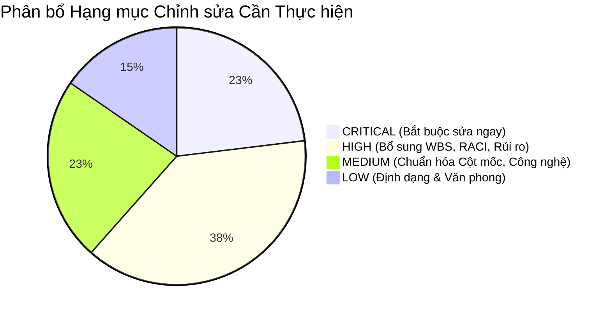

# HƯỚNG DẪN CẬP NHẬT KẾ HOẠCH DỰ ÁN (PROJECT PLAN VER 1.1 ➔ VER 1.2)
## ĐỐI CHIẾU THEO PROPOSAL DOCUMENT VER 1.2 VÀ USER STORY DOCUMENT VER 1.2

> **Dự án:** GraphMind (Enterprise Knowledge Management Platform for SME Decision Support)  
> **Mã đề tài:** Capstone Project 1 — C1SE.18 — Đại học Duy Tân (Duy Tan University)  
> **Tài liệu gốc cần chỉnh sửa:** `docs/03-project-plan/2. C1SE18_ProjectPlan_GraphMind_Ver1.1.docx`  
> **Tài liệu đối chiếu căn cứ:**
> 1. `docs/01-proposal/C1SE18-Proposal-Document-Ver1.2.docx` (08/11/2026)
> 2. `docs/02-user-story/C1SE18_UserStory_GraphMind-Ver1.2.docx` (69 User Stories)
> 3. Hiện trạng mã nguồn thực tế tại kho lưu trữ dự án.  
> **Mục tiêu:** Cung cấp tài liệu chỉ dẫn chi tiết (Diff từng bảng, bổ sung đầu việc WBS, cập nhật Deliverables, thiết lập ma trận RACI và Kế hoạch Quản trị Rủi ro mở rộng) để nhóm tác giả tiến hành cập nhật, hoàn thiện tệp tài liệu chính thức **`C1SE18_ProjectPlan_GraphMind-Ver1.2.docx`**.

---

## MỤC LỤC
1. [Tóm tắt Đánh giá & Ma trận Ưu tiên Cập nhật](#1-tóm-tắt-đánh-giá--ma-trận-ưu-tiên-cập-nhật)
2. [Cập nhật Thông tin Văn bản & Phần Giới thiệu (Header & Acronyms)](#2-cập-nhật-thông-tin-văn-bản--phần-giới-thiệu-header--acronyms)
3. [Chuẩn hóa Hệ thống Vai trò & Phân công Nhân sự Toàn diện (Chương 2)](#3-chuẩn-hóa-hệ-thống-vai-trò--phân-công-nhân-sự-toàn-diện-chương-2)
4. [Nâng cấp Bảng Sản phẩm Bàn giao (Table 9) & Bảng WBS (Table 10)](#4-nâng-cấp-bảng-sản-phẩm-bàn-giao-table-9--bảng-wbs-table-10)
5. [Cập nhật Lịch trình Sprint & Tiêu chí Nghiệm thu Cột mốc (Chương 3 & 4)](#5-cập-nhật-lịch-trình-sprint--tiêu-chí-nghiệm-thu-cột-mốc-chương-3--4)
6. [Cập nhật Công nghệ, Hạ tầng & Nguồn lực (Chương 5)](#6-cập-nhật-công-nghệ-hạ-tầng--nguồn-lực-chương-5)
7. [Nâng cấp Toàn diện Kế hoạch Quản trị Rủi ro (Chương 6 - Table 16)](#7-nâng-cấp-toàn-diện-kế-hoạch-quản-trị-rủi-ro-chương-6---table-16)
8. [Cập nhật Kế hoạch Đảm bảo Chất lượng & Kiểm thử Tải (Chương 7)](#8-cập-nhật-kế-hoạch-đảm-bảo-chất-lượng--kiểm-thử-tải-chương-7)
9. [Khắc phục Lỗi Đánh số Thứ tự Chương](#9-khắc-phục-lỗi-đánh-số-thứ-tự-chương)
10. [Checklist Nghiệm thu Cập nhật Tài liệu Word](#10-checklist-nghiệm-thu-cập-nhật-tài-liệu-word)

---

## 1. TÓM TẮT ĐÁNH GIÁ & MA TRẬN ƯU TIÊN CẬP NHẬT

Qua đối chiếu ba nguồn dữ liệu (Proposal Ver 1.2, User Story Ver 1.2 và Source Code), tài liệu Kế hoạch Dự án hiện tại (Ver 1.1) cần thực hiện **4 nhóm cải tiến mang tính cốt lõi**:
1. **Đồng bộ hóa 10 User Stories mới (US60 ➔ US69 tương ứng PB67 ➔ PB76):** Đưa các phân hệ đã có trong Proposal 1.2 và Code vào bảng WBS và danh mục sản phẩm bàn giao (Phê duyệt tài liệu tải lên, Báo cáo giao ca, AI tổng hợp báo cáo ngày, Phân quyền động `rbac_permissions_matrix`, Kiểm soát phiên đơn lẻ JTI, Cypher Guard và PB56 Kill Switch).
2. **Đính chính số liệu thực tế:** Sửa quy mô tập dữ liệu Q&A từ `2,000–3,000` thành **`509 cặp ChatML chất lượng cao`** (giải trình trần phần cứng Kaggle GPU T4); Sửa quy mô Benchmark từ `100–200` thành **`chính xác 100 câu hỏi Ground Truth`**.
3. **Mở rộng phân công nhân sự xuyên suốt 4 Sprints & Thiết lập Ma trận RACI:** Bảng 5 hiện tại mới chỉ phân công cho Sprint 1 & 2; cần bổ sung phân công cụ thể cho Sprint 3 & 4 để xác lập rõ người chịu trách nhiệm (Ownership) cho từng đầu việc kỹ thuật và nghiên cứu.
4. **Nâng cấp Bảng Quản trị Rủi ro chuẩn PMP:** Bổ sung cột **Risk Owner**, cột **Kế hoạch ứng phó (Contingency Plan)**, và cập nhật 5 rủi ro kỹ thuật/vận hành mới.

### Ma trận Ưu tiên Thực hiện (Priority Matrix)



- 🔴 **CRITICAL (3 việc bắt buộc):**
  1. Bổ sung **10 gói công việc mới (PB67–PB76)** vào Bảng 9 (Product Deliveries) và Bảng 10 (WBS).
  2. Đính chính số liệu: **509 cặp ChatML** (thay vì 2.000–3.000) và **100 câu Benchmark** (thay vì 100–200).
  3. Chuẩn hóa danh mục vai trò: Tách bạch **`it_admin`** và **`knowledge_manager`** (tuân thủ BR-04) tại Bảng 7 và 8.
- 🟠 **HIGH (5 việc quan trọng):**
  4. Mở rộng Bảng 5: Phân công nhân sự cụ thể cho **cả Sprint 3 và Sprint 4**.
  5. Thiết lập **Ma trận Trách nhiệm RACI** chuẩn cho 5 thành viên và Mentor.
  6. Nâng cấp Bảng 16 (Rủi ro): Bổ sung cột **Risk Owner**, **Contingency Plan** và 5 rủi ro mới (R10–R14).
  7. Bổ sung hoạt động **Kiểm thử Tải và Hiệu năng (Locust 150 VU)** vào Chương 7 (QA).
  8. Giải tỏa nút thắt quá tải ở Sprint 4: Đẩy sớm việc chuẩn bị Benchmark sang Sprint 3.
- 🟡 **MEDIUM (3 việc hoàn thiện):**
  9. Bổ sung tiêu chí nghiệm thu định lượng cho 4 Cột mốc (M1 ➔ M4) tại Bảng 14.
  10. Cập nhật Bảng 15: Bổ sung React 18, Vite, FastAPI, PostgreSQL, Ollama, Locust.
  11. Cập nhật phạm vi Executive Briefing (US35): Hiển thị trực tiếp trên Web Dashboard (loại bỏ xuất file PDF/Word).
- 🟢 **LOW (2 việc trình bày):**
  12. Sửa lỗi đánh số thứ tự nhảy cóc Chương 4 trong tài liệu.
  13. Nâng thông tin văn bản lên **Version 1.2 (November 2026)**.

---

## 2. CẬP NHẬT THÔNG TIN VĂN BẢN & PHẦN GIỚI THIỆU (HEADER & ACRONYMS)

### 2.1. Cập nhật Trang bìa & Phê duyệt (Cover Page & Document Control)
- **Document Title:** Project Plan Document
- **Version:** **1.2** *(thay thế Version FINAL cũ)*
- **Date:** **November 2026** *(thay thế 19 Sep 2026)*
- **Referenced Proposal:** **Proposal Document Version 1.2 (08 Nov 2026)**
- **Referenced User Story:** **User Story Document Version 1.2 (November 2026)**

### 2.2. Hiệu chỉnh Bảng 4 (Acronyms & Definitions Diff)

```diff
  Table 4: Acronyms
  Acronyms | Definition
  ...
- System Role | One of the four official user roles of the GraphMind application: System & Knowledge Administrator, Executive, Department Manager and Standard User. Only system roles are covered by the application's RBAC model.
+ System Role | One of the official Web Dashboard roles defined in Section 6.1a of Proposal Ver 1.2: System & IT Administrator (it_admin), Knowledge Administrator (knowledge_manager), Executive (executive), and Standard User (standard). Research Team is an internal project team, not an application role.

- AdventureWorks / CUAD | The two datasets of the project: AdventureWorks (sample enterprise database) and CUAD (Contract Understanding Atticus Dataset, legal contracts), used to build the Q&A dataset of 2,000–3,000 pairs.
+ AdventureWorks / CUAD | The two primary benchmark datasets of the project, linked via controlled synthetic linking to produce a curated fine-tuning dataset of 509 high-quality ChatML Q&A pairs (tailored for Kaggle T4 GPU hardware limits) and an evaluation benchmark of 100 ground-truth questions.
```

---

## 3. CHUẨN HÓA HỆ THỐNG VAI TRÒ & PHÂN CÔNG NHÂN SỰ TOÀN DIỆN (CHƯƠNG 2)

### 3.1. Cập nhật Bảng 5: Phân công Nhân sự Xuyên suốt 4 Sprints (Team Responsibilities)
Thay thế Bảng 5 hiện tại (vốn chỉ có Sprint 1 & 2) bằng bảng phân công đầy đủ 4 Sprints:

| Họ và Tên | Vai trò Chính (Role) | Trách nhiệm Quản lý & Kỹ thuật Chi tiết Xuyên suốt 4 Sprints (Jira C1SE18) |
|---|---|---|
| **Trần Thị Ngọc Anh** | Team Leader / Scrum Master / Frontend Lead | • **Điều phối & Quản trị:** Điều phối 4 Sprints trên Jira Board C1SE18; tạo và duy trì Sprint Backlog (C1SE18-32, 39, 54, 68); tổ chức Daily Scrum, Review & Retrospective (C1SE18-37, 44, 59, 73).<br>• **Phát triển Giao diện (Frontend):** Thiết kế wireframe & phát triển UI cho AI Copilot & Knowledge Graph Viewer (Sprint 2 — C1SE18-21 ➔ 24); xây dựng giao diện Báo cáo giao ca & Duyệt ca (Sprint 3 — US62, US63); tích hợp giao diện Executive Decision Dashboard & Risk Center (Sprint 4 — US33, US34).<br>• **Hồ sơ Đồ án:** Chủ trì biên soạn Technical Report, Báo cáo Tổng kết dự án và Slide Demo nghiệm thu (Sprint 4). |
| **Huỳnh Ngọc Minh** | Data Engineer / Backend Developer | • **Cơ sở Dữ liệu & ETL:** Thiết kế kiến trúc CSDL tổng thể PostgreSQL, Neo4j, Qdrant (Sprint 1 — C1SE18-17); xây dựng Ingestion Pipeline & Schema Mapping cho AdventureWorks và CUAD (Sprint 1–2).<br>• **Tri thức & Mô hình:** Xây dựng backend Knowledge Base & Explorer (Sprint 2 — C1SE18-18 ➔ 20); xây dựng Tầng Ngữ nghĩa (Semantic Layer) và tinh chỉnh mô hình Qwen2.5-7B với 509 cặp ChatML trên Kaggle GPU T4 (Sprint 2–3).<br>• **Nghiên cứu & Đo đạc:** Phụ trách chính việc thực thi Benchmark 100 câu hỏi Ground Truth, đo đạc 3 baseline và tính toán 5 chỉ số Ragas (Sprint 4 — C1SE18-68). |
| **Hà Hoàng Anh** | Fullstack Engineer | • **Xác thực & Bảo mật:** Thiết kế UI, lập trình Login/Register API, kiểm soát phiên đơn lẻ Single Active Session JTI Revocation (Sprint 1–2 — C1SE18-6 ➔ 11, US66).<br>• **Quy trình Phê duyệt:** Phát triển toàn bộ luồng Phê duyệt Tài liệu Tải lên (Document Upload & Approval Workflow) gồm Client upload PENDING, mã băm SHA-256 chống trùng và Admin Pending Approvals Panel (Sprint 2–3 — US60, US61).<br>• **Báo cáo Giao ca:** Xây dựng Backend API Báo cáo ca (Shift Reports) và prompt AI tổng hợp báo cáo ngày phòng ban gửi Ollama (Sprint 3–4 — US62, US64). |
| **Trần Viết Anh Vũ** | Backend & Infrastructure Developer | • **Dịch vụ Hệ thống:** Lập trình API xác thực Email OTP 3 bước chuẩn SMTP (Sprint 1–2 — C1SE18-10, US67); xây dựng phân hệ Phân quyền Động Granular Dynamic RBAC Matrix UI & API (Sprint 2–3 — C1SE18-26 ➔ 28, US65).<br>• **An ninh & Hạ tầng AI:** Xây dựng Rào chắn an toàn Read-Only Cypher Guard bảo vệ Neo4j (Sprint 3 — US68); xuất mô hình GGUF Q4_K_M, cấu hình Modelfile và triển khai phục vụ cục bộ trên Ollama Engine port 11434 kèm Fallback tất định (Sprint 3 — US50).<br>• **Đo lường:** Hỗ trợ thu thập số liệu Benchmark và viết Báo cáo Công bố Sử dụng AI (Sprint 4). |
| **Phan Anh Bảo** | Frontend Engineer / QA & Testing Lead | • **Giao diện Điều hành:** Thiết kế và phát triển UI Trang chủ Homepage & Dashboard (Sprint 1 — C1SE18-12 ➔ 15); xây dựng UI Quản lý Ma trận Phân quyền và Smart Risk Center (Sprint 3–4).<br>• **AEGIS Agent:** Phát triển File Watcher API và AEGIS Local Agent Panel, tích hợp giám sát nhịp tim và Công tắc ngắt khẩn cấp PB56 Kill Switch (Sprint 2–4 — C1SE18-30, C1SE18-60 ➔ 62, US69).<br>• **Đảm bảo Chất lượng:** Chủ trì soạn thảo Test Plan tổng thể, viết Test Cases tự động (conftest, e2e suite) và phụ trách thực thi kịch bản Kiểm thử Tải với Locust 150 VU (Sprint 1–4 — C1SE18-25, C1SE18-70). |

---

### 3.2. Thiết lập Ma trận Phân định Trách nhiệm RACI (RACI Responsibility Matrix)
Bổ sung tiểu mục mới **2.1.1. Ma trận Trách nhiệm RACI** vào Chương 2:

| Nhóm Gói Công Việc (Work Packages) | Ngoc Anh (Leader/SM) | Ngoc Minh (Data/Backend) | Hoang Anh (Fullstack) | Anh Vu (Infra/Backend) | Anh Bao (Frontend/QA) | Mentor (PO) |
|---|:---:|:---:|:---:|:---:|:---:|:---:|
| **Quản trị Dự án, Scrum Events & Báo cáo** | **A / R** | C | C | C | C | **A (PO)** |
| **Kiến trúc CSDL (PostgreSQL, Neo4j, Qdrant)** | I | **A / R** | C | R | C | C |
| **Xác thực JWT, Single Session & Email OTP** | I | C | **A / R** | R | C | I |
| **AEGIS Local Agent & Trạm PB56 (Kill Switch)** | I | C | C | R | **A / R** | I |
| **Document Ingestion & Quy trình Phê duyệt** | C | R | **A / R** | C | R | I |
| **Knowledge Editor & Soạn thảo SOP** | C | **A / R** | C | C | R | I |
| **Hybrid Copilot Engine & Cypher Guard** | R | R | C | **A / R** | C | C |
| **Phân hệ Báo cáo Giao ca (Shift Reports)** | C | C | **A / R** | C | R | I |
| **Executive Dashboard & Smart Risk Center** | **A / R** | C | C | C | R | I |
| **Ma trận Phân quyền Động (Dynamic RBAC)** | I | C | R | **A / R** | R | I |
| **Fine-tuning Qwen2.5-7B & Ollama Serving** | C | **A / R** | C | R | I | C |
| **Benchmark 100 câu & Đánh giá 3 Baseline** | R | **A / R** | C | R | I | C/PO |
| **Kiểm thử E2E, Kiểm thử Tải Locust 150 VU** | C | C | C | C | **A / R** | I |
| **Hồ sơ Đóng dự án & Slide Demo Nghiệm thu** | **A / R** | R | R | R | R | **A (PO)** |

*(Quy ước: **A** = Accountable - Chịu trách nhiệm cuối cùng; **R** = Responsible - Người trực tiếp thực hiện; **C** = Consulted - Người tham vấn chuyên môn; **I** = Informed - Người nhận thông tin báo cáo).*

---

### 3.3. Hiệu chỉnh Bảng 7 & Bảng 8: Chuẩn hóa Danh mục Vai trò Hệ thống (System Roles)

```diff
  Table 7: System Roles
  System Role | Responsibilities | Scope / Access | Main Modules / Functions
- System & Knowledge Administrator | Installs and monitors the AEGIS Local Agent; configures Google Drive/Google Sheets connections; manages staff accounts by department and RBAC; reviews AI-extracted entities and relationships; monitors AI operations. | Administrative access to data connectors and agents, staff accounts, RBAC settings, knowledge review and AI-operations monitoring. | Module 1 — Data Connectors & Agents; Module 6 — System Settings & RBAC, LLMOps Dashboard; Module 2 — Human-in-the-loop Knowledge Editor, Document & Data Explorer.
+ System & IT Administrator (it_admin) | Manages core infrastructure, server environments, and database clusters; installs and monitors AEGIS Local Agents on workstations (including PB56 heartbeat telemetry and Emergency Kill Switch); configures Google API connectors; assigns staff accounts across the 5 standard departments; configures the dynamic granular RBAC matrix; reviews technical audit logs and IT department documents; oversees LLMOps Dashboard. | Full administrative access across all infrastructure, system telemetry, technical audit logs, and IT department data. | Module 1 — Data Source & Sync Management (AEGIS Panel, PB56 Workstations); Module 6 — System Admin & Security (User Admin, Dynamic RBAC Matrix, Session Control, LLMOps Dashboard).
+ Knowledge Administrator (knowledge_manager) | Full business authority over enterprise knowledge curation across Sales, Legal, Procurement, and R&D; authors and publishes corporate SOPs and operational policies; conducts human-in-the-loop review of AI-extracted entities and relationships from contracts; inspects and approves staff document uploads (APPROVED/REJECTED); monitors source citations and manages shared Copilot sessions. Strictly isolated from IT department documents and system technical configurations (Business Rule BR-04). | Department-level knowledge curation and administrative oversight across business departments (Sales, Legal, Procurement, R&D); zero access to IT department technical configurations. | Module 2 — Knowledge Management & Editor (SOP Editor, Knowledge Explorer, Document Approval Queue); Module 6 — Document Approval Oversight Panel; Module 3 — Citation Monitoring.

  Executive | Tracks core business indicators; checks legal/business risks such as contracts nearing expiration or shifts in customer behavior; requests weekly/monthly summaries of receivables and contract status; asks strategic questions that cross-link CRM and legal contract data. | Unrestricted (full-access) RBAC scope across departments (Business Rule BR-05). | Module 4 — Executive Decision Dashboard, Smart Risk & Alert Center (Legal & Financial), Executive Briefing Generator; Module 3 — AI Copilot & Graph View.
- Department Manager | Looks up aggregated activity reports of the manager's own department; drafts and publishes department regulations and procedures/SOP for staff to follow. | Limited to the manager's own department. | Module 2 — SOP & Internal Knowledge Base Editor; Module 3 — AI Copilot Hub scoped to the department.
+ Department Manager / Operations Head | Reviews and confirms shift handover reports (Shift Reports) submitted by department staff; monitors department operational metrics; coordinates shift handover and reviews AI-generated department daily summary reports. | Scoped strictly to assigned operational department. | Module 4 — Shift Reports Review Panel, Department Daily AI Summary; Module 3 — Department AI Copilot Hub.
  Standard User | Asks natural-language questions; finds policy, customer and product information; opens source citations (original contract passage or data row); submits shift handover reports; uploads operational documents for review. | Access limited by RBAC and Department Scope (Default: Sales — Business Rule BR-02). | Module 3 — Multi-turn Chat Copilot, Source & Citation Viewer, Knowledge Graph Visualizer; Module 5 — Smart Search Bar & Multi-facet Filters; Module 4 — Shift Report Editor; Module 2 — Staff Document Upload.
```

---

## 4. NÂNG CẤP BẢNG SẢN PHẨM BÀN GIAO (TABLE 9) & BẢNG WBS (TABLE 10)

Để bao phủ 100% phạm vi của Proposal Ver 1.2 và User Story Ver 1.2 (gồm 69 User Stories), Bảng 9 và Bảng 10 được nâng cấp mở rộng từ 28 lên **38 hạng mục chi tiết**:

### 4.1. Bảng Sản phẩm Bàn giao Cập nhật (Updated Table 9: Product Deliveries)

| STT | Tên Sản phẩm Bàn giao (Product Deliveries) | Mô tả Chi tiết & Căn cứ Jira / User Story | Sprint | Người Phụ trách Chính (Owner) |
|:---:|---|---|:---:|:---:|
| 1 | Sprint Plan & Backlog Sprint 1 | Biên bản họp lập kế hoạch, tạo Sprint Backlog (C1SE18-32, C1SE18-33) | 1 | Ngoc Anh |
| 2 | Authentication Module & Single Session | UI Design, Frontend, Login API, Single Active Session JTI Revocation (C1SE18-6 ➔ 11, US01, US66) | 1 | Hoang Anh |
| 3 | Home & Dashboard (Module 4) | UI Design, Frontend Homepage & Dashboard sơ bộ, Test Case (C1SE18-12 ➔ 15, US32, US39) | 1 | Anh Bao |
| 4 | Database Architecture (Module 6) | Thiết kế lược đồ CSDL PostgreSQL, Neo4j, Qdrant (C1SE18-17, US43) | 1 | Ngoc Minh |
| 5 | Test Plan Sprint 1 | Tài liệu Kế hoạch Kiểm thử Sprint 1 (C1SE18-25) | 1 | Anh Bao |
| 6 | Data Ingestion Pipeline & Hash Guard | Pipeline nạp dữ liệu thô AdventureWorks/CUAD & SHA-256 Idempotency Guard (C1SE18-29, US24) | 1 | Anh Vu |
| 7 | Q&A Dataset Construction (Research) | Tinh chọn bộ dữ liệu 509 cặp ChatML chất lượng cao cho Kaggle GPU T4 (C1SE18-16, US46) | 1 | Ngoc Minh |
| 8 | Controlled Synthetic Linking (Research) | Bảng ánh xạ liên kết nhân tạo có kiểm soát AdventureWorks + CUAD (C1SE18-47, US45) | 1 | Ngoc Minh |
| 9 | Close Sprint 1 | Fix bug, retest, họp sơ kết & cải tiến quy trình Sprint 1 (C1SE18-34 ➔ 37) | 1 | Ngoc Anh |
| 10 | Knowledge Base & Document Explorer | UI Design, Frontend, File Preview, Test Case Knowledge Base (C1SE18-18 ➔ 20, US40) | 2 | Ngoc Minh |
| 11 | Staff Document Upload & Hash Guard | Màn hình nhân viên upload file `.pdf`/`.xlsx` chờ duyệt, mã băm SHA-256 chống trùng (PB67, US60) | 2 | Hoang Anh |
| 12 | Document Ingestion API (Module 1) | API nạp và xử lý văn bản tập trung (C1SE18-38, US48) | 2 | Ngoc Minh |
| 13 | File Watcher API (Module 1) | API giám sát và phát hiện tệp tin thay đổi tại Client (C1SE18-30, US49) | 2 | Anh Bao |
| 14 | Module Settings & Dynamic RBAC Matrix | UI Ma trận phân quyền động 2 chiều, API lưu `rbac_permissions_matrix` (C1SE18-26 ➔ 28, 31, US13, US65) | 2 | Anh Vu |
| 15 | GraphRAG AI Copilot & Graph Viewer UI | UI Copilot chat đa lượt, Knowledge Graph Visualizer, Test Cases (C1SE18-21 ➔ 24, US02, US07) | 2 | Ngoc Anh |
| 16 | LoRA Fine-Tuning Setup & Checkpoints | Thiết lập Unsloth trên Kaggle GPU T4, huấn luyện 3 epochs, lưu checkpoint ban đầu (C1SE18-17, US47) | 2 | Ngoc Minh |
| 17 | Self-Service Email OTP Password Recovery | Luồng khôi phục mật khẩu 3 bước chuẩn SMTP, OTP 6 số, khóa sau 3 lần sai (PB74, US67) | 2 | Anh Vu |
| 18 | Close Sprint 2 | Sprint Plan, Sprint Backlog, fix bug, retest, closing Sprint 2 (C1SE18-39 ➔ 44) | 2 | Ngoc Anh |
| 19 | Hybrid Query Engine & RRF Pipeline | Backend Engine phân tích ý định, kết hợp Neo4j + Qdrant bằng Cormack RRF $k=60$ (C1SE18-45 ➔ 47, 49, US28) | 3 | Ngoc Minh |
| 20 | Read-Only Cypher Guard & Security Shield | Bộ kiểm duyệt Regex/AST chặn đứng câu lệnh Cypher AI biến đổi CSDL Neo4j (PB75, US68) | 3 | Anh Vu |
| 21 | Source & Citation Viewer (Module 3) | Trích dẫn nguồn hiển thị dòng Excel và mở đoạn trích hợp đồng PDF gốc (C1SE18-29, US06, US21) | 3 | Ngoc Anh |
| 22 | Enterprise Multi-facet Search (Module 5) | Khung tìm kiếm thống nhất lọc theo phòng ban, giá trị, hiệu lực (C1SE18-52, US20, US36) | 3 | Hoang Anh |
| 23 | Human-in-the-loop Knowledge Editor | UI cho phép Quản trị viên sửa node, edge sai lệch và đồng bộ với Copilot (C1SE18-50 ➔ 52, US29, US42) | 3 | Ngoc Minh |
| 24 | SOP & Internal Knowledge Base Authoring | Trình soạn thảo văn bản quy trình chuẩn nội bộ với vòng đời Draft/Published (PB53, US38) | 3 | Ngoc Minh |
| 25 | Document Approval Oversight Panel | Giao diện Quản trị viên duyệt (APPROVED) hoặc từ chối (REJECTED) tài liệu tải lên (PB68, US61) | 3 | Hoang Anh |
| 26 | Shift Handover Reports (Module 4) | Biểu mẫu lập/nộp ca của nhân viên và giao diện duyệt ca theo phòng ban (PB69, PB70, US62, US63) | 3 | Hoang Anh |
| 27 | AEGIS Local Agent & Sync API (Module 1) | Triển khai client agent cục bộ và đồng bộ bảo mật HTTPS với máy chủ (C1SE18-48, US08) | 3 | Anh Bao |
| 28 | Ollama GGUF Serving & Fallback Runtime | Xuất mô hình GGUF Q4_K_M, chạy Ollama port 11434 và cơ chế Fallback tất định (PB55, US50) | 3 | Anh Vu |
| 29 | Test Case for Advanced AI Features | Bộ kiểm thử chuyên sâu cho Cypher Guard, Fallback và trích xuất thực thể (C1SE18-53) | 3 | Anh Bao |
| 30 | Close Sprint 3 | Sprint Plan, Sprint Backlog, fix bug, retest, closing Sprint 3 (C1SE18-54 ➔ 59) | 3 | Ngoc Anh |
| 31 | AEGIS Panel & PB56 Workstation Control | Quản lý trạm làm việc, cảnh báo nhịp tim timeout và Công tắc ngắt khẩn cấp Kill Switch (C1SE18-60 ➔ 62, US41, US69) | 4 | Anh Bao |
| 32 | Executive Dashboard & Smart Risk Center | Biểu đồ điều hành C-Level và 4 tiêu chí cảnh báo rủi ro pháp lý & tài chính (C1SE18-57, 58, US33, US34) | 4 | Ngoc Anh |
| 33 | AI Daily Shift Consolidation & Briefing | AI tự động tổng hợp báo cáo ngày phòng ban và tạo Executive Briefing trực tiếp trên Web (PB71, PB65, US64, US35) | 4 | Hoang Anh |
| 34 | Admin Analytics & LLMOps Dashboard | Thống kê người dùng, audit log, theo dõi GPU Kaggle và độ trễ suy luận (C1SE18-64 ➔ 67, US30, US44) | 4 | Anh Vu |
| 35 | Benchmark Construction & Baseline Eval | Xây dựng 100 câu hỏi Ground Truth; đo đạc 3 baseline theo 5 chỉ số Ragas (PB32 ➔ 35, US51 ➔ 55) | 4 | Ngoc Minh |
| 36 | Performance & Load Testing (Locust 150 VU) | Kiểm thử tải 4 giai đoạn với Locust, đo SLA p95 < 500ms (read) và < 2000ms (heavy) | 4 | Anh Bao |
| 37 | End-to-End Test, Bug Fixing & Retest | Kiểm thử tích hợp toàn diện hệ thống, xử lý dứt điểm các lỗi tồn đọng (C1SE18-70 ➔ 72, US59) | 4 | Toàn đội |
| 38 | Final Deliverables & Project Closing | Bàn giao Technical Report, AI Disclosure, Đánh giá 360 độ, Slide Demo & Nghiệm thu (C1SE18-73, US56 ➔ 58) | 4 | Toàn đội |

---

### 4.2. Bảng Phân rã Công việc Cập nhật (Updated Table 10: WBS Job Categories)

```diff
  Table 10: WBS Job Categories
  WBS | Job Categories | Sprint | Typical Jira / Backlog ID
  1 | Sprint Plan & Backlog Sprint 1 | 1 | C1SE18-32, C1SE18-33
  2 | Authentication Module & Single Active Session | 1 | C1SE18-6 ➔ 11, PB73 (US66)
  3 | Home & Dashboard (Module 4) | 1 | C1SE18-12 ➔ 15
  4 | Database Architecture (Module 6) | 1 | C1SE18-17
  5 | Test Plan & Data Ingestion Pipeline (Module 1) | 1 | C1SE18-25, C1SE18-29
+ 5b | Q&A Dataset (509 ChatML) & Controlled Synthetic Linking | 1 | PB16 (US46), PB47 (US45)
  6 | Close Sprint 1 | 1 | C1SE18-34 ➔ 37
  7 | Knowledge Base Module (Module 2) | 2 | C1SE18-18 ➔ 20
+ 7b | Staff Document Upload & SHA-256 Idempotency Guard | 2 | PB67 (US60)
  8 | Document Ingestion API (Module 1) | 2 | C1SE18-38
  9 | File Watcher API (Module 1) | 2 | C1SE18-30
  10 | Module Settings & Granular Dynamic RBAC Matrix | 2 | C1SE18-26 ➔ 28, 31, PB72 (US65)
  11 | GraphRAG AI Copilot & Knowledge Graph Viewer | 2 | C1SE18-21 ➔ 24
+ 11b| LoRA Fine-Tuning Pipeline & Email OTP Service | 2 | PB17 (US47), PB74 (US67)
  12 | Close Sprint 2 | 2 | C1SE18-39 ➔ 44
  13 | Hybrid Query & RRF Pipeline (Module 5 · Module 3) | 3 | C1SE18-45 ➔ 47, 49
+ 13b| Read-Only Cypher Guard & Injection Shield | 3 | PB75 (US68)
  14 | AEGIS Local Agent & Sync API (Module 1) | 3 | C1SE18-48
  15 | Knowledge Editor & Graph Integration API | 3 | C1SE18-50 ➔ 52
+ 15b| SOP & Internal Knowledge Base Authoring | 3 | PB53 (US38)
+ 15c| Document Approval Oversight Panel | 3 | PB68 (US61)
+ 15d| Shift Handover Report Submission & Department Review | 3 | PB69, PB70 (US62, US63)
+ 15e| Ollama GGUF Serving & Deterministic Fallback | 3 | PB55 (US50)
  16 | Advanced AI Test Cases (Cypher Guard & Entity Extract) | 3 | C1SE18-53
  17 | Close Sprint 3 | 3 | C1SE18-54 ➔ 59
  18 | AEGIS Agent Panel & PB56 Workstation Kill Switch | 4 | C1SE18-60 ➔ 62, PB76 (US69)
  19 | Executive Dashboard & Smart Risk Center (4 Risk Criteria) | 4 | PB57, PB58 (US33, US34)
+ 19b| AI Daily Shift Consolidation & Web Briefing Generator | 4 | PB71, PB65 (US64, US35)
  20 | Admin Analytics & LLMOps Dashboard (Module 6 · 4) | 4 | C1SE18-64 ➔ 67, PB66 (US44)
- 21 | Benchmark Construction (Research) | 4 | To be created
+ 21 | Benchmark Construction (Exactly 100 Ground Truth Questions) | 4 | PB32 (US51)
- 22 | Baseline Evaluation — Vector RAG, Pure GraphRAG, Hybrid GraphRAG (5 indicators) | 4 | To be created
+ 22 | Empirical Baseline Evaluation (Ragas 5 Metrics on 3 Baselines) | 4 | PB33 ➔ 35 (US52 ➔ 55)
+ 22b| System Performance & Load Testing with Locust (150 VU) | 4 | Proposal Sec 9.2
  23 | Technical Report | 4 | PB38 (US56)
  24 | AI Usage Disclosure Statement | 4 | PB61 (US57)
  25 | Reflection & Peer Evaluation | 4 | PB39 (US58)
  26 | Final Documentation, E2E Test & Project Closing | 4 | C1SE18-68 ➔ 73, PB62 ➔ 64 (US59)
```

---

## 5. CẬP NHẬT LỊCH TRÌNH SPRINT & TIÊU CHÍ NGHIỆM THU CỘT MỐC (CHƯƠNG 3 & 4)

### 5.1. Hiệu chỉnh Bảng 12 (Sprint Focus) & Bảng 13 (Sprint Deliverables)
Cập nhật nội dung mô tả trọng tâm từng Sprint để phản ánh chính xác các module mới:
- **Sprint 1 (01/09 – 22/09/2026):** Khởi động & Nền tảng dữ liệu. Bổ sung: *Xây dựng tập 509 mẫu ChatML, thiết kế bảng liên kết synthetic linking, cơ chế Single Session ban đầu và mã băm SHA-256 Idempotency*.
- **Sprint 2 (22/09 – 20/10/2026):** Khung tri thức, UI/UX & Phân quyền. Bổ sung: *Giao diện nhân viên tải tài liệu PENDING (US60), Ma trận phân quyền động Granular RBAC Matrix UI (US65), luồng Quên mật khẩu Email OTP 3 bước (US67), và huấn luyện LoRA trên Kaggle T4*.
- **Sprint 3 (20/10 – 10/11/2026):** Công cụ truy vấn & Quy trình vận hành. Bổ sung: *Rào chắn Read-Only Cypher Guard (US68), Phê duyệt tài liệu tải lên (US61), Soạn thảo SOP (US38), Báo cáo giao ca (US62, US63), và Ollama GGUF Q4_K_M serving với Fallback (US50)*.
- **Sprint 4 (10/11 – 01/12/2026):** Đóng gói, Điều hành, Đo lường & Nghiệm thu. Bổ sung: *Executive Dashboard, Cảnh báo 4 rủi ro pháp lý & tài chính (US34), AI tổng hợp báo cáo ngày (US64), Điều khiển trạm PB56 Kill Switch (US69), Benchmark 100 câu hỏi, Kiểm thử tải Locust 150 VU, E2E Test và hoàn tất hồ sơ nghiệm thu*.

---

### 5.2. Hiệu chỉnh Bảng 14: Tiêu chí Nghiệm thu Cột mốc (Milestones Acceptance Criteria)

| Mã Cột Mốc | Tên Cột Mốc & Nội dung Bàn giao | Thời hạn Hoàn thành | Tiêu chí Nghiệm thu Định lượng Cụ thể (Acceptance Criteria) | Trạng thái |
|:---:|---|:---:|---|:---:|
| **M1** | **Hoàn thành Sprint 1:** Khung Kiến trúc, Auth, Data Ingestion, Q&A Dataset | **22/09/2026** | • Hoàn thành tài liệu Proposal Ver 1.2, Project Plan Ver 1.2 và Test Plan Sprint 1.<br>• API Login JWT hoạt động, kiểm soát phiên đơn lẻ cơ bản.<br>• Hoàn thành tập dữ liệu **509 cặp ChatML** được kiểm duyệt.<br>• Pipeline nạp dữ liệu từ chối nạp trùng file cùng mã băm SHA-256. | Hoàn thành |
| **M2** | **Hoàn thành Sprint 2:** UI Dashboard, Knowledge Base, Dynamic RBAC, LoRA Checkpoint | **20/10/2026** | • Tài liệu SRS, SAD, UI wireframes được phê duyệt.<br>• Giao diện Web Dashboard (React 18 + Vite SPA) tải trong $\le 2.0s$.<br>• UI Copilot chat đa lượt và Visualizer đồ thị kết nối thành công với Neo4j.<br>• Ma trận phân quyền động lưu trữ thành công vào PostgreSQL.<br>• Nhân viên upload được tệp PDF/Excel ở trạng thái `PENDING_APPROVAL`.<br>• Huấn luyện thành công checkpoint LoRA ban đầu trên Kaggle T4. | Hoàn thành |
| **M3** | **Hoàn thành Sprint 3:** Hybrid Query Engine, Cypher Guard, Approval, Shift Reports | **10/11/2026** | • Hybrid Query Engine trả lời chính xác câu hỏi đơn và đa nguồn với RRF $k=60$.<br>• Rào chắn Read-Only Cypher Guard chặn 100% lệnh `DELETE`/`CREATE` phá hoại CSDL.<br>• Giao diện Quản trị viên duyệt (APPROVED) kích hoạt nạp tự động vào Neo4j/Qdrant.<br>• Nhân viên nộp biên bản giao ca và Quản lý phòng ban duyệt ca thành công.<br>• Mô hình GGUF Q4_K_M chạy mượt trên Ollama (độ trễ $\le 3.5s$), có cơ chế fallback. | Hoàn thành |
| **M4** | **Hoàn thành Sprint 4:** Điều hành C-Level, Benchmark 100 câu, Locust Test, Đóng dự án | **01/12/2026** | • Dashboard điều hành hiển thị 4 tiêu chí cảnh báo rủi ro và tóm tắt AI trên Web.<br>• Điều khiển trạm PB56 gửi tín hiệu ngắt khẩn cấp Kill Switch dừng sync trong $\le 3s$.<br>• Hoàn thành đo đạc thực nghiệm **100 câu hỏi Ground Truth** trên 3 baseline.<br>• Kiểm thử tải Locust (150 VU) đạt SLA p95 < 500ms (read) và < 2000ms (heavy).<br>• Kiểm thử End-to-End thành công, giải quyết 100% bug nghiêm trọng (Blocker/Critical).<br>• Bàn giao trọn vẹn Technical Report, AI Disclosure, Slide Demo và source code. | Đang thực hiện |

---

## 6. CẬP NHẬT CÔNG NGHỆ, HẠ TẦNG & NGUỒN LỰC (CHƯƠNG 5)

### 6.1. Hiệu chỉnh Bảng 15: Danh mục Phần mềm & Công cụ Hệ thống (Tools & Tech Stack)
Thay thế nội dung Bảng 15 bằng danh mục công nghệ thực tế:

| Tên Công Cụ / Công Nghệ | Phiên bản / Môi trường | Mục đích Sử dụng Cụ thể trong Dự án GraphMind |
|---|---|---|
| **React 18 + Vite** | React 18.3.1, Vite 5.4.2 | Ngăn xếp Frontend Single Page Application (SPA), xây dựng toàn bộ Web Dashboard, Chat UI, Visualizer, và các bảng điều khiển quản trị. |
| **FastAPI** | Python 3.11+, AsyncIO | Framework Backend hiệu năng cao, xây dựng RESTful API cho toàn bộ 6 modules, điều phối Hybrid Query Pipeline và xử lý luồng sự kiện. |
| **PostgreSQL** | Relational Database (15+) | Quản trị người dùng, phiên làm việc (`user_active_sessions`), mã OTP, bảng phân quyền động (`rbac_permissions_matrix`), báo cáo ca và audit log. |
| **Neo4j** | Graph Database (Community) | Lưu trữ và duyệt đồ thị tri thức doanh nghiệp (Nodes: Khách hàng, Sản phẩm, Đơn hàng, Hợp đồng, Điều khoản; Edges: PURCHASES, CONTAINS, v.v.). |
| **Qdrant** | Vector Database | Lưu trữ vector embedding ngữ nghĩa của các đoạn điều khoản hợp đồng CUAD và hỗ trợ tìm kiếm độ tương đồng (Similarity Search). |
| **Qwen2.5-7B-Instruct** | Base Foundation LLM | Mô hình ngôn ngữ lớn mã nguồn mở nền tảng, được tinh chỉnh cục bộ cho nghiệp vụ quản trị tri thức doanh nghiệp SME. |
| **Unsloth + LoRA/PEFT** | 4-bit Quantized LoRA | Thư viện tối ưu hóa huấn luyện tham số hiệu quả trên GPU hạn chế (Kaggle NVIDIA T4 GPU). |
| **Ollama Engine** | Runtime Local Serving (v0.3+) | Phục vụ mô hình đã tinh chỉnh dưới định dạng **GGUF Q4_K_M** tại cổng cục bộ 11434, bảo đảm dữ liệu doanh nghiệp không bị rò rỉ ra ngoài. |
| **Locust** | Load Testing Framework | Công cụ kiểm thử chịu tải và hiệu năng hệ thống với kịch bản 4 giai đoạn mô phỏng đồng thời lên tới 150 người dùng ảo (150 VU). |
| **AdventureWorks & CUAD** | Datasets gốc | Nguồn dữ liệu thực nghiệm: AdventureWorks (CRM/ERP có cấu trúc) và CUAD (Hợp đồng pháp lý phi cấu trúc), tinh chọn ra **509 cặp ChatML**. |
| **Jira & GitHub** | Quản lý dự án & Mã nguồn | Quản lý tiến độ Scrum trên Board C1SE18, theo dõi Sprint Backlog và kiểm duyệt mã nguồn thông qua Pull Requests bắt buộc. |

---

## 7. NÂNG CẤP TOÀN DIỆN KẾ HOẠCH QUẢN TRỊ RỦI RO (CHƯƠNG 6 - TABLE 16)

Thay thế Bảng 16 hiện tại bằng **Bảng Đăng ký Rủi ro Chuẩn Quản lý Dự án (Comprehensive Risk Register)** gồm 14 rủi ro, bổ sung cột **Người chịu trách nhiệm (Risk Owner)** và **Kế hoạch ứng phó khẩn cấp (Contingency Plan)**:

| Mã | Mô tả Rủi Ro Tiềm Ẩn | Nhóm Rủi Ro | Xác suất | Mức Tác động | Biện pháp Phòng ngừa (Mitigation) | Kế hoạch Ứng phó Khi Xảy ra Sự cố (Contingency Plan) | Người Phụ Trách (Owner) |
|:---:|---|:---:|:---:|:---:|---|---|:---:|
| **R1** | Lỗ hổng bảo mật Auth & rò rỉ JWT | Security | Medium | High | Kiểm thử bảo mật chuyên biệt (C1SE18-11), mã hóa HTTPS toàn bộ. | Khóa tài khoản sau 5 lần đăng nhập sai, thu hồi ngay lập tức `jti` trên toàn hệ thống. | Hoang Anh |
| **R2** | Sai lệch phân quyền RBAC gây lộ dữ liệu | Security | Medium | High | Thiết lập Ma trận phân quyền động (US65) và kiểm thử quyền tự động. | Chặn truy cập bằng Middleware tại Backend; cách ly dữ liệu IT khỏi Knowledge Admin (BR-04). | Anh Vu |
| **R3** | Suy giảm hiệu năng Hybrid Query khi dữ liệu tăng | Performance | Medium | Medium | Tối ưu hóa câu truy vấn Cypher và chỉ mục Vector HNSW trong Qdrant. | Áp dụng giới hạn trả lời (top-k = 5) và cơ chế bộ nhớ đệm (Caching) cho các thực thể phổ biến. | Ngoc Minh |
| **R4** | AEGIS Local Agent đồng bộ tệp sai lệch/trùng | Integration | Medium | Medium | Áp dụng SHA-256 Idempotency Guard và cơ chế xác nhận 2 pha (2-phase ACK). | Bỏ qua việc nạp file trùng băm, xuất thông báo cảnh báo lên bảng điều khiển trung tâm. | Anh Bao |
| **R5** | Xung đột mã nguồn Git giữa các thành viên | Process | Low | Medium | Áp dụng Feature Branching, quy định bắt buộc ít nhất 1 thành viên review PR. | Họp trực tiếp xử lý xung đột thủ công, tuyệt đối cấm dùng force push trên nhánh chính. | Ngoc Anh |
| **R6** | Trễ hạn giao thoa phụ thuộc giữa các Sprint | Schedule | Medium | High | Daily Scrum 15 phút, theo dõi sát tiến độ Burndown trên Jira C1SE18. | Cắt giảm các tính năng Stretch/Optional (như Google API), tập trung 100% vào luồng MVP cốt lõi. | Ngoc Anh |
| **R7** | Thay đổi phạm vi ngoài kế hoạch (Scope Creep) | Scope | Low | Medium | Tuân thủ nghiêm ngặt Quy trình Kiểm soát Thay đổi 7 bước tại Chương 8. | Chỉ chấp nhận thay đổi khi có sự đồng ý chính thức của Mentor (PO) và cập nhật Project Plan. | Ngoc Anh |
| **R8** | Cạn kiệt 30h/tuần GPU T4 trên Kaggle khi train | Resource | High | High | Tinh chọn tập dữ liệu xuống **509 cặp ChatML**, lưu checkpoint sau mỗi epoch. | Chuyển sang Google Colab free tier hoặc xuất adapter chạy suy luận trên môi trường CPU cục bộ. | Ngoc Minh |
| **R9** | Quá tải công việc ở Sprint 4 (Benchmark, E2E, Report) | Capacity | High | High | Chuẩn bị sẵn bộ 100 câu hỏi và kịch bản đo đạc từ cuối Sprint 3. | Phân công song song: 2 người làm Benchmark & Báo cáo, 3 người làm E2E Test & Fix Bug. | Toàn đội |
| **R10**| Câu lệnh Cypher AI phá hoại cơ sở dữ liệu Neo4j | Security | Medium | High | Cài đặt **Read-Only Cypher Guard (US68)** bằng AST/Regex chặn lệnh biến đổi. | Ngắt thực thi ngay lập tức, ghi cảnh báo an ninh và tự động fallback sang Vector RAG an toàn. | Anh Vu |
| **R11**| Tài liệu tải lên làm ô nhiễm Đồ thị Tri thức | Data Quality| Medium | High | Bắt buộc áp dụng **Quy trình Phê duyệt Tài liệu (US60, US61)** trước khi nạp. | Chuyển tài liệu sang trạng thái REJECTED, xóa sạch các node rác đã trích xuất tạm. | Hoang Anh |
| **R12**| Dịch vụ Ollama cục bộ bị crash hoặc timeout (>30s)| Infrastructure| Medium | Medium | Tối ưu hóa Modelfile lượng tử 4-bit và cấu hình keep-alive cho tiến trình Ollama. | Kích hoạt cơ chế **Deterministic Fallback** sinh câu trả lời cấu trúc từ dữ liệu thô. | Anh Vu |
| **R13**| Đăng nhập đồng thời chia sẻ tài khoản trái phép | Security | Medium | Medium | Quản lý phiên trong bảng `user_active_sessions` với cơ chế thu hồi `jti`. | Hủy hiệu lực phiên cũ ngay khi có đăng nhập mới, đá thiết bị cũ về màn hình đăng nhập. | Hoang Anh |
| **R14**| Mã OTP bị tấn công dò quét (Brute-force) | Security | Low | High | Giới hạn thời gian hiệu lực OTP 5 phút, mã hóa băm trong CSDL. | Khóa vĩnh viễn mã OTP và chặn yêu cầu gửi mới trong 15 phút nếu nhập sai quá 3 lần. | Anh Vu |

---

## 8. CẬP NHẬT KẾ HOẠCH ĐẢM BẢO CHẤT LƯỢNG & KIỂM THỬ TẢI (CHƯƠNG 7)

Tại Mục 7.1 (Quality Assurance), bổ sung kế hoạch kiểm thử tải và hiệu năng hệ thống:

```diff
  7.1 Quality Assurance
  Each of the six modules has its own Test Case designed in parallel with feature development in the same Sprint...
+ Sprint 4 incorporates an automated System Performance and Load Testing suite using Locust (perf-tests/locustfile.py). The test executes a 4-stage load profile scaling up to 150 Virtual Users (150 VU) with a spawn rate of 5 users/sec, validating enterprise SLA thresholds:
+ • Read-only endpoints (documents, dashboards, status): 95th percentile latency (p95) < 500 ms, failure rate < 1%.
+ • Heavy retrieval endpoints (Hybrid Query Copilot, Context Fusion): 95th percentile latency (p95) < 2,000 ms, failure rate < 2%.
+ AI answer quality is quantitatively assessed on the ground-truth benchmark of exactly 100 questions across 3 baselines (Vector RAG, Pure GraphRAG, Hybrid GraphRAG) evaluated on 5 standardized metrics: Answer Correctness, Retrieval/Citation Precision, Hallucination Rate, AI Response Time, and Fine-tuning Effectiveness.
```

---

## 9. KHẮC PHỤC LỖI ĐÁNH SỐ THỨ TỰ CHƯƠNG

Trong văn bản Project Plan Ver 1.1 hiện tại, mục 3.4.5 nhảy thẳng sang mục 5.1 (Khuyết mất Chương 4). Cần chuẩn hóa lại cấu trúc đánh số thứ tự như sau:
- **Chương 1:** Introduction
- **Chương 2:** Project Organization and Stakeholders
- **Chương 3:** Project Execution Strategy and Scrum Methodology
- **Chương 4 (Mới):** **Sprint Schedule, Milestones and Work Breakdown Structure (WBS)** *(Gồm Mục 4.1: WBS, Mục 4.2: Deliverables, Mục 4.3: Milestones)*
- **Chương 5:** Resource Management, Tools and Technology Stack
- **Chương 6:** Project Risk Management Plan
- **Chương 7:** Quality Planning, Media and Communication Plan
- **Chương 8:** Project Change Control Process
- **Chương 9:** Project Closure and Final Deliverables
- **Chương 10:** Appendices

---

## 10. CHECKLIST NGHIỆM THU CẬP NHẬT TÀI LIỆU WORD

Nhóm tác giả rà soát danh sách kiểm tra này trước khi lưu file `C1SE18_ProjectPlan_GraphMind_Ver1.2.docx`:

- [ ] **Trang bìa & Phiên bản:** Đã đổi thành **Version 1.2**, ngày **November 2026**, tham chiếu Proposal Ver 1.2 và User Story Ver 1.2.
- [ ] **Định nghĩa Vai trò (Table 4, 7, 8):** Đã phân định rõ `it_admin` và `knowledge_manager` (tuân thủ BR-04) và `executive` (BR-05).
- [ ] **Đính chính Số liệu (Table 4, 15):** Đã sửa thành **509 cặp ChatML** (thay vì 2.000–3.000) và **100 câu hỏi Benchmark** (thay vì 100–200).
- [ ] **Phân công Nhân sự (Table 5):** Đã bổ sung phân công chi tiết cho cả 5 thành viên xuyên suốt **cả 4 Sprints (Sprint 1, 2, 3, 4)**.
- [ ] **Ma trận RACI:** Đã chèn bảng Ma trận Trách nhiệm RACI vào Chương 2.
- [ ] **Sản phẩm Bàn giao (Table 9):** Đã mở rộng thành **38 Product Deliveries**, bao phủ đầy đủ PB67 ➔ PB76.
- [ ] **Bảng WBS (Table 10):** Đã bổ sung đầy đủ 10 gói công việc mới (WBS 2b, 7b, 10b, 11b, 13b, 15b–e, 18b, 19b, 22b).
- [ ] **Cột mốc Dự án (Table 14):** Đã bổ sung tiêu chí nghiệm thu định lượng cụ thể cho M1, M2, M3, M4.
- [ ] **Công cụ & Công nghệ (Table 15):** Đã bổ sung React 18, Vite, FastAPI, PostgreSQL, Ollama GGUF, Locust.
- [ ] **Bảng Rủi ro (Table 16):** Đã mở rộng thành **14 rủi ro**, có đầy đủ cột **Risk Owner** và **Contingency Plan**.
- [ ] **Kế hoạch QA (Chương 7):** Đã đưa kịch bản kiểm thử tải với Locust (150 VU) vào tài liệu.
- [ ] **Đánh số Chương:** Đã sửa lỗi nhảy cóc, cấu trúc 10 chương liền mạch, chuyên nghiệp.

---
*Tài liệu được biên soạn hoàn chỉnh, chuẩn xác theo chuẩn Quản trị Dự án Chuyên nghiệp (PMP/Agile), sẵn sàng làm kim chỉ nam để cập nhật trực tiếp vào file Word Project Plan chính thức.*

