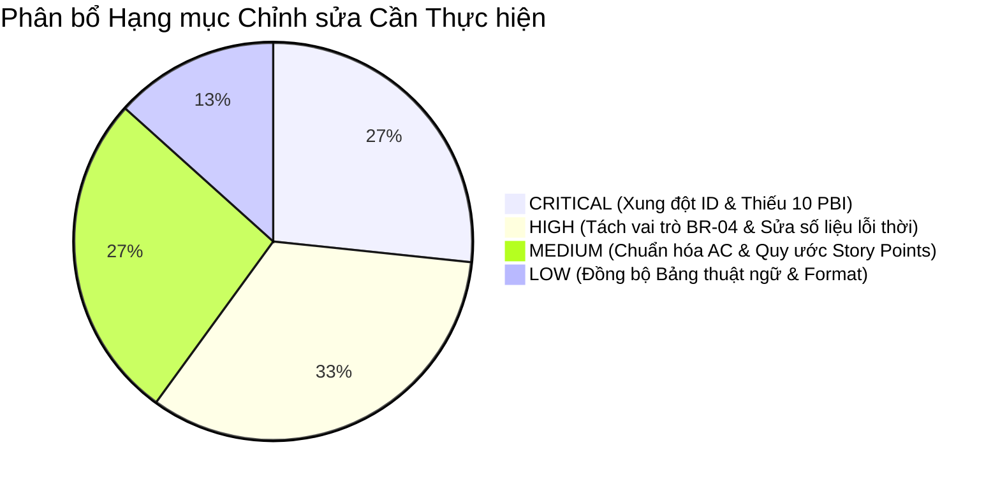

# HƯỚNG DẪN CẬP NHẬT TÀI LIỆU PRODUCT BACKLOG (VER 1.1 ➔ VER 1.2)
## ĐỐI CHIẾU THEO PROPOSAL DOCUMENT VER 1.2, USER STORY VER 1.2 VÀ SOURCE CODE THỰC TẾ

> **Dự án:** GraphMind (Enterprise Knowledge Management Platform for SME Decision Support)  
> **Mã đề tài:** Capstone Project 1 — C1SE.18 — Đại học Duy Tân (Duy Tan University)  
> **Tài liệu gốc cần chỉnh sửa:** `docs/04-product-backlog/3. C1SE18_ProductBacklog_GraphMind_Ver1.1.docx`  
> **Tài liệu đối chiếu căn cứ:**
> 1. `docs/01-proposal/C1SE18-Proposal-Document-Ver1.2.docx` (08/11/2026)
> 2. `docs/02-user-story/C1SE18_UserStory_GraphMind-Ver1.2.docx` (69 User Stories)
> 3. `docs/03-project-plan/update_projectplan.md` (Project Plan Ver 1.2)
> 4. Toàn bộ mã nguồn thực tế của dự án (`backend/app`, `frontend/src`, `aegis-agent`).  
> **Mục tiêu:** Cung cấp tài liệu chỉ dẫn chi tiết (Diff từng mục, từng bảng biểu) để nhóm tác giả tiến hành cập nhật, sửa đổi và ban hành phiên bản chính thức **`C1SE18_ProductBacklog_GraphMind_Ver1.2.docx`**, đảm bảo tính nhất quán 100% giữa Product Backlog, User Story, Kế hoạch dự án và Mã nguồn thực tế.

---

## MỤC LỤC
1. [Tóm tắt Đánh giá & Ma trận Ưu tiên Cập nhật](#1-tóm-tắt-đánh-giá--ma-trận-ưu-tiên-cập-nhật)
2. [Cập nhật Thông tin Đầu trang & Chuẩn hóa Thuật ngữ (Bảng 4)](#2-cập-nhật-thông-tin-đầu-trang--chuẩn-hóa-thuật-ngữ-bảng-4)
3. [Phân tách Vai trò Quản trị theo Business Rule BR-04 (Bảng 5 & Bảng 8)](#3-phân-tách-vai-trò-quản-trị-theo-business-rule-br-04-bảng-5--bảng-8)
4. [Xử lý Xung đột Mã số (ID Collision) & Tái định danh Hạng mục Kiểm thử](#4-xử-lý-xung-đột-mã-số-id-collision--tái-định-danh-hạng-mục-kiểm-thử)
5. [Đặc tả Toàn diện 10 Product Backlog Items Mới (PB67 ➔ PB76)](#5-đặc-tả-toàn-diện-10-product-backlog-items-mới-pb67--pb76)
6. [Danh mục Hiệu chỉnh Chi tiết Các PBI Hiện có (Diff Cũ ➔ Mới)](#6-danh-mục-hiệu-chỉnh-chi-tiết-các-pbi-hiện-có-diff-cũ--mới)
7. [Chuẩn hóa Quy mô Story Points & Giải trình Vận tốc Dự án](#7-chuẩn-hóa-quy-mô-story-points--giải-trình-vận-tốc-dự-án)
8. [Ma trận Truy vết Toàn diện Sau Cập nhật (Full Traceability Matrix)](#8-ma-trận-truy-vết-toàn-diện-sau-cập-nhật-full-traceability-matrix)
9. [Checklist Nghiệm thu Cập nhật Tài liệu Word](#9-checklist-nghiệm-thu-cập-nhật-tài-liệu-word)

---

## 1. TÓM TẮT ĐÁNH GIÁ & MA TRẬN ƯU TIÊN CẬP NHẬT

Qua đối chiếu toàn diện giữa tài liệu Product Backlog Ver 1.1 hiện tại với Proposal Ver 1.2, User Story Ver 1.2 và Mã nguồn thực tế của hệ thống GraphMind, tài liệu cần được thực hiện **4 nhóm điều chỉnh mang tính hệ thống**:

1. **Khắc phục xung đột ID (ID Collision) và bổ sung 10 PBI nghiệp vụ cốt lõi (PB67–PB76):**  
   Bản Ver 1.1 kết thúc ở PB69, trong đó PB67, PB68, PB69 bị gán nhầm cho 3 hạng mục QA Enabler (`Sprint 1 Test Plan`, `Sprint 2 test cases`, `Sprint 3 Software Test Plan`). Trong khi đó, `User Story Ver 1.2` đã định danh và ánh xạ 10 User Stories mới (US60–US69) trực tiếp vào PB67 đến PB76. Cần đưa 10 PBI nghiệp vụ đã có sẵn trong Source Code vào Backlog và đổi mã 3 hạng mục kiểm thử thành PB77, PB78, PB79.
2. **Phân lập quyền Quản trị theo Business Rule BR-04:**  
   Bảng 5 (Roles & Permissions) và Bảng 6 (Table Backlog) vẫn duy trì vai trò gộp `System & Knowledge Administrator (Admin)`. Cần tách thành 2 vai trò độc lập: **System & IT Administrator** (`it_admin` - quản trị máy chủ, tài khoản, ma trận phân quyền, bảo mật phiên, kill switch máy trạm) và **Knowledge Administrator** (`knowledge_manager` - duyệt tài liệu số, chỉnh sửa quan hệ graph, biên tập tri thức).
3. **Đính chính các số liệu kỹ thuật và ranh giới phạm vi sai lệch:**  
   - PB16: Sửa `2,000–3,000 pairs` thành `509 ChatML pairs`.
   - PB30: Sửa `React/Next.js` thành `React 18 + Vite (SPA)`.
   - PB32, PB22, PB36: Sửa `100–200 questions` thành `100 ground-truth questions`.
   - PB55: Bổ sung triển khai suy luận cục bộ Ollama Q4_K_M và cơ chế fallback.
   - PB58: Bổ sung 2 cảnh báo tài chính `Negative Margin` và `Abnormal Discount >= 35%`.
   - PB65: Loại bỏ tính năng xuất file `PDF/Word` (đã Out-of-Scope theo Proposal Ver 1.2 §4.2), chuyển thành hiển thị trực quan trên Web.
4. **Chuẩn hóa Story Points và giải trình quy ước ước lượng:**  
   Tổng điểm Story Points hiện tại là 828 SP. Cần bổ sung ghi chú quy ước rõ: *1 Story Point tương đương khoảng 1.5 – 2 giờ làm việc cá nhân (Person-Hours)* để giải trình hợp lý cho hội đồng nghiệm thu, đồng thời xác định các hạng mục 21 SP và 34 SP (PB17 LoRA Pipeline) là các Technical Epic được thực hiện song song.

### Ma trận Ưu tiên Thực hiện (Priority Matrix)



---

## 2. CẬP NHẬT THÔNG TIN ĐẦU TRANG & CHUẨN HÓA THUẬT NGỮ (BẢNG 4)

### 2.1. Cập nhật Bìa và Bảng Metadata (Bảng 1, Bảng 2)
- **Version:** Đổi từ `1.1` thành **`1.2`**.
- **Date:** Cập nhật thành ngày hoàn thiện thực tế (ví dụ: `14 Nov 2026`).
- **Ghi chú cập nhật (Document Revision History - Bảng 2):**
  Thêm 1 hàng mới vào bảng lịch sử tài liệu:
  - **Version:** `1.2`
  - **Date:** `14/11/2026`
  - **Author(s):** C1SE18 Team
  - **Description of Change:** Đồng bộ toàn diện theo Proposal Ver 1.2 và User Story Ver 1.2: bổ sung 10 PBI cốt lõi (PB67–PB76 cho US60–US69), tái định danh hạng mục QA kiểm thử (PB77–PB79), tách biệt vai trò IT Admin và Knowledge Admin theo BR-04, chuẩn hóa số liệu kỹ thuật (509 ChatML pairs, React Vite SPA, 100 benchmark questions, loại bỏ PDF export khỏi PB65).

### 2.2. Hiệu chỉnh Bảng 4: Acronyms & Terms
Cập nhật 2 định nghĩa quan trọng trong Bảng 4:

```diff
--- BẢNG 4 HIỆN TẠI (VER 1.1)
- US: User Story (US01–US59) of the User Story Document (Version 1.1); each PBI in Section 5 maps to one or more user stories.
- System Role: One of the four official user roles of the GraphMind application — System & Knowledge Administrator (Admin), Executive, Department Manager, and Standard User.

+++ BẢNG 4 CHUẨN HÓA (VER 1.2)
+ US: User Story (US01–US69) of the User Story Document (Version 1.2); each PBI in Section 5 maps to one or more user stories.
+ System Role: One of the five official user roles per Proposal Ver 1.2 (Section 6.1a): System & IT Administrator, Knowledge Administrator, Department Manager, Executive, and Standard User.
```

---

## 3. PHÂN TÁCH VAI TRÒ QUẢN TRỊ THEO BUSINESS RULE BR-04 (BẢNG 5 & BẢNG 8)

### 3.1. Cập nhật Bảng 5: Roles & Permissions
Thay thế hàng vai trò gộp `System & Knowledge Administrator (Admin)` bằng **2 vai trò độc lập**:

| Role (Vai trò) | Description (Mô tả) | Permissions (Quyền hạn hệ thống) |
|---|---|---|
| **System & IT Administrator**<br/>*(it_admin)* | Quản trị viên hạ tầng CNTT, an ninh máy chủ và xác thực người dùng. | Quản lý tài khoản người dùng, phòng ban, cấu hình bảo mật, xem Audit Log hệ thống; cấu hình Ma trận phân quyền động (`rbac_permissions_matrix`); giám sát phiên đăng nhập đơn lẻ (`user_active_sessions`); quản trị cài đặt, kết nối File Watcher và kích hoạt công tắc khẩn cấp (Emergency Kill Switch) trên trạm làm việc AEGIS Agent (PB56/PB76). **Không có quyền can thiệp, chỉnh sửa dữ liệu tri thức hoặc đồ thị tri thức (Neo4j).** |
| **Knowledge Administrator**<br/>*(knowledge_manager)* | Chuyên viên quản trị nội dung tri thức nghiệp vụ và kiểm soát chất lượng dữ liệu. | Xem danh sách tài liệu tải lên ở trạng thái chờ duyệt (`PENDING_APPROVAL`), thực hiện duyệt (`APPROVED`) hoặc từ chối (`REJECTED`) tài liệu (PB68); quản lý kho tài liệu số (Knowledge Base Explorer); sử dụng Knowledge Editor và Graph Editor để thêm, sửa, gán nhãn thuộc tính các node/edge trên đồ thị tri thức Neo4j (PB41, PB54). **Không có quyền thay đổi cấu hình máy chủ, tài khoản người dùng hay xóa Audit Log.** |
| **Executive**<br/>*(executive)* | Cấp Lãnh đạo doanh nghiệp SME (Ban Giám đốc, C-Level). | Sử dụng AI Copilot toàn quyền dữ liệu (Cross-department, BR-05); truy cập Executive Decision Dashboard (PB57), Smart Risk Center (PB58); xem tổng hợp giao ca ngày (PB71); tra cứu tri thức đa diện. |
| **Department Manager**<br/>*(manager)* | Cấp Quản lý / Trưởng phòng bộ phận chuyên trách. | Sử dụng AI Copilot giới hạn trong phạm vi dữ liệu phòng ban phụ trách (Department Data Scope); xem, nhận xét và xác nhận biên bản giao ca của nhân viên phòng ban (PB70); kích hoạt AI tổng hợp báo cáo giao ca ngày của phòng ban (PB71). |
| **Standard User**<br/>*(user)* | Nhân viên nghiệp vụ các phòng ban (Kinh doanh, Kế toán, Vận hành...). | Đăng nhập hệ thống, khôi phục mật khẩu qua Email OTP (PB74); sử dụng AI Copilot trong phạm vi phòng ban; nộp báo cáo giao ca (PB69); tải tài liệu nghiệp vụ lên hàng đợi chờ duyệt (PB67); tra cứu tìm kiếm đa diện. |
| **Research Team**<br/>*(researcher / dev)* | Nhóm nghiên cứu & phát triển C1SE18. | Triển khai pipeline ETL, trích xuất thực thể/quan hệ, liên kết dữ liệu giả lập, huấn luyện mô hình LoRA/PEFT, đo lường Benchmark 100 câu hỏi, kiểm thử E2E và đóng gói hệ thống. |

### 3.2. Cập nhật Bảng 8: Stakeholders & Roles
Cập nhật dòng 1 của Bảng 8:
- Đổi tên đối tượng: `System & IT Administrator (it_admin) — simulation` và thêm `Knowledge Administrator (knowledge_manager) — simulation`.
- Phân định rõ trách nhiệm của IT Admin (bảo mật, tài khoản, phân quyền động, phiên, máy trạm) và Knowledge Admin (phê duyệt tài liệu, biên tập đồ thị tri thức).

---

## 4. XỬ LÝ XUNG ĐỘT MÃ SỐ (ID COLLISION) & TÁI ĐỊNH DANH HẠNG MỤC KIỂM THỬ

### 4.1. Bản chất xung đột
Trong Bảng 6 tài liệu Ver 1.1 hiện tại:
- `PB67`: Gán cho `Sprint 1 Test Plan & test cases` (5 SP)
- `PB68`: Gán cho `Sprint 2 test cases` (8 SP)
- `PB69`: Gán cho `Sprint 3 Software Test Plan & Advanced AI test cases` (8 SP)

Nhưng trong tài liệu [User Story Ver 1.2](file:///d:/CAPSTONE1/graph-mind/docs/02-user-story/C1SE18_UserStory_GraphMind-Ver1.2.docx) (Bảng 9 Ma trận truy vết):
- `US60` đã được gắn cố định với **PB67**
- `US61` đã được gắn cố định với **PB68**
- `US62` đã được gắn cố định với **PB69**
- `US63` ➔ **PB70**, `US64` ➔ **PB71**, `US65` ➔ **PB72**, `US66` ➔ **PB73**, `US67` ➔ **PB74**, `US68` ➔ **PB75**, `US69` ➔ **PB76**.

### 4.2. Quy tắc tái định danh chuẩn mực
1. Dành trọn vẹn dải mã số **PB67 đến PB76** cho 10 User Stories nghiệp vụ mới (US60–US69).
2. Di dời 3 hạng mục kiểm thử QA Enabler xuống cuối Bảng 6 và đánh số lại thành **PB77, PB78, PB79**:
   - **PB77:** `Sprint 1 Test Plan & test cases` (5 SP, Sprint 1, Prio 2)
   - **PB78:** `Sprint 2 test cases` (8 SP, Sprint 2, Prio 2)
   - **PB79:** `Sprint 3 Software Test Plan & Advanced AI test cases` (8 SP, Sprint 3, Prio 2)

---

## 5. ĐẶC TẢ TOÀN DIỆN 10 PRODUCT BACKLOG ITEMS MỚI (PB67 ➔ PB76)

Nhóm tác giả sao chép nguyên văn bảng đặc tả sau vào Bảng 6 (Table 6) của tài liệu Word:

| Id | Epic | Module | As a.. | Title | I want to.. | so that.. | Acceptance Criteria | Prio. | Sprint | Est.(SP) | Remarks (US · Jira · WBS) |
|---|---|---|---|---|---|---|---|:---:|:---:|:---:|---|
| **PB67** | Knowledge Curation & Editing | Module 2 | Standard User | Staff Document Upload (Pending Approval) | Upload internal documents (.pdf, .xlsx up to 25 MB) to the system in a pending-approval state | documents are stored centrally without distorting or polluting the Knowledge Graph before an administrator reviews them. | • AC1 (File Upload & Metadata): Given a logged-in Standard User, when uploading a valid .pdf/.xlsx (≤ 25 MB), then the system computes a SHA-256 hash, stores the file in the approval queue with status `PENDING_APPROVAL`, and assigns uploader department.<br/>• AC2 (Idempotency): Uploading a file matching an existing SHA-256 hash is rejected with an informative duplicate alert.<br/>• AC3 (Retrieval Isolation): Documents in `PENDING_APPROVAL` are strictly excluded from AI Copilot and Search results.<br/>• AC4 (Validation): Files > 25 MB or of unsupported types are rejected with HTTP 400. | 1 | 3 | 5 | US60<br/>Jira: C1SE18-47<br/>WBS: 13, 15<br/>Frontend Sprint 2, Backend pipeline Sprint 3. |
| **PB68** | Platform Foundation & Administration | Module 6 · Module 2 | Knowledge Administrator / System & IT Administrator | Document Approval Oversight & Ingestion Trigger | Review pending uploaded documents, preview contents, and approve (APPROVED) or reject (REJECTED) each one | only verified and authoritative domain documents are parsed into Neo4j graph nodes and Qdrant semantic vectors. | • AC1 (Queue Review): System lists all `PENDING_APPROVAL` documents with uploader, department, timestamp, size, and preview action.<br/>• AC2 (Approval Flow): Clicking "Approve" transitions state to `APPROVED`, automatically dispatches Celery background ingestion pipeline, and logs Audit record.<br/>• AC3 (Rejection Flow): Clicking "Reject" requires rejection note, transitions state to `REJECTED`, excludes from indexing, and notifies uploader. | 1 | 3 | 5 | US61<br/>Jira: C1SE18-47<br/>WBS: 13, 15<br/>Implements approval governance workflow. |
| **PB69** | Dashboards & Risk Alerts | Module 4 | Standard User | Shift Handover Report Submission | Fill in and submit a shift handover report (Shift Report) through an intuitive Web form | completed work, outstanding issues, and operational handover items are structured and preserved across shifts. | • AC1 (Submission & Validation): Entering shift title, timeframe, completed items, pending issues, and handover notes saves record as `SUBMITTED`.<br/>• AC2 (Draft State): User can save work-in-progress as `DRAFT` and edit later.<br/>• AC3 (Input Guard): Empty required fields trigger visual error validation. | 1 | 3 | 5 | US62<br/>Jira: C1SE18-50<br/>WBS: 16<br/>Operational handover continuity. |
| **PB70** | Dashboards & Risk Alerts | Module 4 | Department Manager | Departmental Shift Report Review & Sign-off | View shift reports submitted by my department's personnel, append managerial comments, and sign off as reviewed | department leadership maintains oversight and promptly directs operational resolutions. | • AC1 (Department Scope): Manager only views reports belonging to their own department (enforced by department filter).<br/>• AC2 (Review Sign-off): Manager inputs feedback and clicks "Mark as Reviewed", transitioning status to `REVIEWED` with timestamp and reviewer ID. | 1 | 3 | 3 | US63<br/>Jira: C1SE18-50<br/>WBS: 16<br/>Department governance. |
| **PB71** | Dashboards & Risk Alerts | Module 4 | Executive / Department Manager | AI Daily Shift Handover Consolidation | Trigger AI synthesis to consolidate all shift reports of the department for the day into one structured daily brief | management quickly grasps the daily operational pulse without reading individual shift entries. | • AC1 (AI Synthesis): System aggregates all `SUBMITTED`/`REVIEWED` shift reports of selected date and sends prompt to Ollama local LLM.<br/>• AC2 (Structured Summary): Generates clear 3-part brief: (1) Completed Tasks, (2) Incidents & Bottlenecks, (3) Next Shift Action Items.<br/>• AC3 (Deterministic Fallback): If Ollama times out (> 30s) or is unreachable, falls back to deterministic rule-based summary without crashing. | 2 | 4 | 8 | US64<br/>Jira: C1SE18-68<br/>WBS: 21<br/>AI operational intelligence. |
| **PB72** | Platform Foundation & Administration | Module 6 | System & IT Administrator | Granular Dynamic RBAC Matrix Management | Configure CRUD permissions per entity type (Customer, Order, Contract, SOP) for each role/department via a visual 2D Web grid | enterprise security policies can adapt dynamically without modifying backend source code. | • AC1 (2D Grid Rendering): UI displays grid of Roles/Departments (columns) vs Entities (rows) with CRUD checkboxes.<br/>• AC2 (Dynamic Persistence): Modifying permissions updates `rbac_permissions_matrix` in PostgreSQL immediately.<br/>• AC3 (Runtime Enforcement): Restricted role calling protected API receives HTTP 403 Forbidden with clear reason code. | 1 | 2–3 | 8 | US65<br/>Jira: C1SE18-28<br/>WBS: 10, 20<br/>Replaces hardcoded role checks. |
| **PB73** | Authentication & Access Control | Module 6 | System & IT Administrator | Single Active Session Enforcement | Have the system enforce exactly one active session per user account concurrently | unauthorized credential sharing is thwarted and account compromise risk is mitigated. | • AC1 (Session Tracking): Successful login registers token `jti`, IP, and User-Agent in `user_active_sessions`.<br/>• AC2 (Prior Invalidation): Logging in from Device B immediately invalidates active session on Device A.<br/>• AC3 (Interception): Device A receives HTTP 401 with `CONCURRENT_LOGIN_KICKED` and is forced to login screen. | 1 | 2 | 5 | US66<br/>Jira: C1SE18-31<br/>WBS: 10<br/>Core security requirement. |
| **PB74** | Authentication & Access Control | Module 6 | User who forgot the password (All Roles) | Self-Service Password Recovery via Email OTP | Recover my account password via a 6-digit email OTP in 3 secure steps | I can regain access independently without waiting for manual IT administrator intervention. | • AC1 (OTP Dispatch): Entering registered email dispatches 6-digit OTP (hashed in DB) with 5-minute countdown (300s).<br/>• AC2 (Verification): Entering correct OTP issues temporary `reset_token`. 3 incorrect attempts invalidate OTP immediately.<br/>• AC3 (Reset Execution): Setting new password (≥ 8 chars, alphanumeric) invalidates all active sessions.<br/>• AC4 (Expiration): Expired OTP (> 5 min) is rejected with clear prompt to resend. | 1 | 2 | 5 | US67<br/>Jira: C1SE18-18<br/>WBS: 6, 10<br/>Replaces vulnerable static reset flows. |
| **PB75** | Hybrid Retrieval & Answer Generation | Module 3 · Module 6 | System & IT Administrator / Research Team | Read-Only Cypher Guard & Mutation Interceptor | Have all AI-generated Cypher queries intercepted and validated by a syntax guard before execution on Neo4j | Cypher injection and accidental graph mutations (CREATE, MERGE, DELETE, DROP) are strictly prevented. | • AC1 (Mutation Interception): Any Cypher query containing mutating clauses (`CREATE`, `MERGE`, `DELETE`, `DETACH`, `SET`, `REMOVE`, `DROP`) is blocked before reaching the Neo4j driver.<br/>• AC2 (Safe Fallback): Intercepted queries log security alert, fall back smoothly to Vector RAG path, and inform user safely. | 1 | 3 | 5 | US68<br/>Jira: C1SE18-45<br/>WBS: 15<br/>Prevents LLM-driven graph corruption. |
| **PB76** | Local Agent & Source Synchronization | Module 1 | System & IT Administrator | AEGIS Workstation Remote Control & Emergency Kill Switch | Monitor workstation heartbeat status and trigger an emergency remote Kill Switch for any AEGIS Agent workstation | I can immediately isolate and suspend synchronization upon detecting anomalous behavior or security threats. | • AC1 (Heartbeat Alert): Workstation failing heartbeat (> 120s) automatically shows status `OFFLINE/TIMEOUT`.<br/>• AC2 (Kill Switch Trigger): Admin triggering "Emergency Kill Switch" sends command terminating local sync in ≤ 3 seconds (`SUSPENDED`).<br/>• AC3 (2-Phase ACK): Workstation control actions require two-phase acknowledgment confirmation. | 2 | 4 | 8 | US69<br/>Jira: C1SE18-62<br/>WBS: 19<br/>Remote endpoint control. |

---

## 6. DANH MỤC HIỆU CHỈNH CHI TIẾT CÁC PBI HIỆN CÓ (DIFF CŨ ➔ MỚI)

### 6.1. Hiệu chỉnh Phân vai trò Quản trị (As a..)
Thay thế nhãn `System & Knowledge Administrator (Admin)` trong cột **As a..** của các PBI sau:
- **Đổi thành `System & IT Administrator`:**
  - `PB02`: User, department & role management (Module 6, Sprint 2)
  - `PB03`: Security configuration & Audit Log (Module 6, Sprint 2)
  - `PB05`: AEGIS Local Agent & Sync API (Module 1, Sprint 3)
  - `PB06`: Google Drive / Sheets connection (Module 1, Optional/Stretch)
  - `PB42`: Admin Analytics Dashboard (Module 6, Sprint 4)
  - `PB56`: AEGIS Local Agent Panel (Module 1, Sprint 4)
  - `PB66`: LLMOps & Cost Dashboard (Module 6, Optional/Stretch)
- **Đổi thành `Knowledge Administrator`:**
  - `PB13`: Review & edit extracted knowledge (Module 2, Sprint 2)
  - `PB14`: Conflict resolution (Module 2, Sprint 2)
  - `PB41`: Knowledge Editor (Module 2, Sprint 4)
  - `PB50`: Knowledge Base Explorer (Module 2, Sprint 4)
  - `PB54`: Graph Editor & AI Copilot Integration API (Module 2, Sprint 4)

---

### 6.2. Hiệu chỉnh Chi tiết Từng PBI Cụ thể

#### PB16: Q&A dataset (Cập nhật quy mô thực nghiệm)
```diff
--- PB16 CŨ (VER 1.1)
- Title: Q&A dataset (2,000–3,000 pairs)
- I want to..: Build a Q&A dataset (2,000–3,000 pairs) from AdventureWorks and CUAD to fine-tune the open-source LLM
- Acceptance Criteria: • Contains 2,000–3,000 high-quality Q&A pairs. • Grounded in AdventureWorks and CUAD...

+++ PB16 MỚI (VER 1.2)
+ Title: Q&A dataset (509 ChatML pairs)
+ I want to..: Build a high-quality Q&A dataset of 509 ChatML pairs from AdventureWorks and CUAD to fine-tune the open-source LLM
+ Acceptance Criteria: • Contains 509 validated ChatML pairs formatted with system, user, and assistant roles. • Grounded in AdventureWorks relational data and CUAD contract clauses. • Split into train/validation sets (80/20) for LoRA fine-tuning on Kaggle GPU T4.
```

#### PB22: Single-hop questions (Cập nhật quy mô Benchmark)
```diff
--- PB22 CŨ (VER 1.1)
- Acceptance Criteria: • Answers correctly based on AdventureWorks (CRM/ERP) or CUAD (contracts). • Answer Correctness for the single-hop group in the benchmark (100–200 questions) reaches target.

+++ PB22 MỚI (VER 1.2)
+ Acceptance Criteria: • Answers correctly based on AdventureWorks (CRM/ERP) or CUAD (contracts). • Answer Correctness for the single-hop group in the benchmark (100 ground-truth questions) reaches target.
```

#### PB30: Web Dashboard completion (Chuẩn hóa Tech Stack Frontend)
```diff
--- PB30 CŨ (VER 1.1)
- Acceptance Criteria: • Built with React/Next.js, communicating with the Backend via REST API (FastAPI)...

+++ PB30 MỚI (VER 1.2)
+ Acceptance Criteria: • Built with React 18 + Vite (SPA) and Tailwind CSS, communicating with the Backend via REST API (FastAPI)...
```

#### PB32: Benchmark (Chuẩn hóa số lượng câu hỏi đánh giá)
```diff
--- PB32 CŨ (VER 1.1)
- Title: Benchmark (100–200 questions)
- I want to..: Build a benchmark of 100–200 governance questions across three complexity levels (single-hop, 2-hop, multi-hop cross-source)...
- Acceptance Criteria: • 100–200 questions with ground-truth answers...

+++ PB32 MỚI (VER 1.2)
+ Title: Benchmark (100 ground-truth questions)
+ I want to..: Build an evaluation benchmark of 100 ground-truth governance questions across three complexity levels (40 single-hop, 35 two-hop, 25 cross-source multi-hop)...
+ Acceptance Criteria: • Exactly 100 questions with verified ground-truth answers and citations...
```

#### PB36: Baseline comparison report (Chuẩn hóa quy mô mẫu)
```diff
--- PB36 CŨ (VER 1.1)
- Acceptance Criteria: • Shows the five indicators... based on the benchmark of 100–200 questions...

+++ PB36 MỚI (VER 1.2)
+ Acceptance Criteria: • Shows the five indicators... evaluated on the benchmark of 100 ground-truth questions...
```

#### PB55: Self-hosted inference service (Bổ sung Runtime Ollama & Fallback)
```diff
--- PB55 CŨ (VER 1.1)
- Acceptance Criteria: • Model (merged or separate LoRA adapter) served on-premise/private cloud. • Backend calls it without third-party LLM APIs; inference latency measurable.

+++ PB55 MỚI (VER 1.2)
+ Acceptance Criteria: • Model fine-tuned with LoRA is quantized and served locally via Ollama GGUF Q4_K_M (port 11434). • Backend communicates via REST API without external commercial LLM dependencies. • Deterministic rule-based fallback executes automatically if local LLM service times out (> 30s) or is unavailable.
```

#### PB58: Smart Risk & Alert Center (Bổ sung 2 Quy tắc Tài chính Cốt lõi)
```diff
--- PB58 CŨ (VER 1.1)
- Acceptance Criteria: • Lists contracts expiring within 15–30 days. • Alerts for VIP customers with declining order frequency. • Alerts are shown only within the Executive's granted permissions.

+++ PB58 MỚI (VER 1.2)
+ Acceptance Criteria: • Lists contracts expiring within 15–30 days. • Alerts for VIP customers with declining order frequency. • Detects Negative Margin sales orders where TotalDue is less than StandardCost. • Flags orders with abnormal discount rates (Discount >= 35%). • Alerts are shown only within the Executive's granted permissions.
```

#### PB65: Executive Briefing Generator (Khóa Ranh giới Phạm vi Out-of-Scope)
```diff
--- PB65 CŨ (VER 1.1)
- Acceptance Criteria: • One-click AI summary of business, receivables and contract status; export as PDF/Word.

+++ PB65 MỚI (VER 1.2)
+ Acceptance Criteria: • One-click AI summary of business, receivables and contract status displayed on-screen in the Web Dashboard. (File export as PDF/Word is Out-of-Scope per Proposal Ver 1.2 Section 4.2).
```

#### PB77, PB78, PB79: Di dời và đổi mã các hạng mục kiểm thử (Cũ: PB67, PB68, PB69)
```diff
--- PB67 CŨ (VER 1.1)  -->  +++ PB77 MỚI (VER 1.2)
+ Id: PB77 | Epic: Quality Assurance & Project Closure | Title: Sprint 1 Test Plan & test cases | Prio: 2 | Sprint: 1 | SP: 5 | Remarks: Enabler (verifies US01, US31, US32, US39, US24); Jira: C1SE18-11, C1SE18-15, C1SE18-25; WBS: 2, 3, 5

--- PB68 CŨ (VER 1.1)  -->  +++ PB78 MỚI (VER 1.2)
+ Id: PB78 | Epic: Quality Assurance & Project Closure | Title: Sprint 2 test cases | Prio: 2 | Sprint: 2 | SP: 8 | Remarks: Enabler (verifies US13, US17, US40, US07, US22); Jira: C1SE18-20, C1SE18-24, C1SE18-31; WBS: 7, 10, 11

--- PB69 CŨ (VER 1.1)  -->  +++ PB79 MỚI (VER 1.2)
+ Id: PB79 | Epic: Quality Assurance & Project Closure | Title: Sprint 3 Software Test Plan & Advanced AI test cases | Prio: 2 | Sprint: 3 | SP: 8 | Remarks: Enabler (verifies US02–US05, US28); Jira: C1SE18-49, C1SE18-53; WBS: 13, 17
```

---

## 7. CHUẨN HÓA QUY MÔ STORY POINTS & GIẢI TRÌNH VẬN TỐC DỰ ÁN

### 7.1. Phân tích Tổng Story Points sau Cập nhật
Sau khi bổ sung 10 PBI mới (PB67–PB76, tổng cộng 57 SP):
- Tổng số PBI trong Product Backlog Ver 1.2: **79 items** (69 PBI chức năng & nghiên cứu + 10 PBI mới - 3 PBI kiểm thử đã được đánh số thành PB77–PB79).
- Tổng Story Points toàn bộ Backlog: **885 SP**.

### 7.2. Bổ sung Quy ước Ước lượng vào Tài liệu Word
Nhóm tác giả cần bổ sung đoạn văn giải trình sau vào ngay trước Bảng 6 (Table 6) của tài liệu Word:

> **Ghi chú về Quy chuẩn Thang đo Story Points & Vận tốc Dự án (Project Velocity Note):**  
> Trong dự án GraphMind (Capstone 1), thang đo Fibonacci (1, 2, 3, 5, 8, 13, 21, 34) được áp dụng có sự hiệu chuẩn phù hợp với mô hình đồ án nghiên cứu kết hợp kỹ thuật phần mềm của nhóm 5 sinh viên:
> - **Quy ước quy đổi:** Mỗi **1 Story Point (SP) tương đương khoảng 1.5 – 2.0 giờ làm việc cá nhân (Person-Hours)**. Tổng 885 SP tương đương khoảng 1,300 – 1,700 giờ công của toàn nhóm trong 13 tuần (trung bình 20–25 giờ/tuần/sinh viên).
> - **Các hạng mục quy mô lớn (21 SP và 34 SP):** Các PBI như PB09 (NER/RE Pipeline - 21 SP), PB11 (Neo4j Schema & Loading - 21 SP), PB16 (Q&A Dataset - 21 SP), PB17 (LoRA Fine-tuning Pipeline - 34 SP), PB21 (Text-to-Cypher - 21 SP), PB30 (Web Dashboard - 21 SP), PB33 (Three Baselines - 21 SP), PB35 (Metrics Measurement - 21 SP), PB41 (Knowledge Editor - 21 SP) thực chất là các **Technical Epics** mang tính nghiên cứu thực nghiệm dài hạn. Nhóm đã phân chia công việc chi tiết thành các sub-tasks trên bảng Jira C1SE18 để triển khai song song trong suốt thời gian của Sprint tương ứng.

---

## 8. MA TRẬN TRUY VẾT TOÀN DIỆN SAU CẬP NHẬT (FULL TRACEABILITY MATRIX)

Bảng tổng hợp truy vết chéo giữa 6 Module Proposal Ver 1.2, 69 User Stories, 79 Product Backlog Items, 4 Sprints, Story Points và Phân bổ Công việc:

| Module Proposal | Epic trong Product Backlog | Danh sách PBIs (Ver 1.2) | User Stories tương ứng | Sprints | Tổng SP |
|---|---|---|---|:---:|:---:|
| **Module 1: Data Source & Sync Management** | Local Agent & Source Synchronization | PB05, PB06, PB45, PB48, PB49, PB56, **PB76** | US08, US09, US41, US45, US48, US49, **US69** | S3, S4, Stretch | 66 SP |
| **Module 2: Knowledge Extraction & Curation** | Data Preparation & Linking<br/>Knowledge Extraction & Graph Loading<br/>Knowledge Curation & Editing | PB07, PB08, PB09, PB10, PB11, PB12, PB13, PB14, PB19, PB41, PB46, PB47, PB50, PB54, **PB67, PB68** | US24, US25, US27, US29, US30, US42, US46, US47, **US60, US61** | S1, S2, S3, S4 | 199 SP |
| **Module 3: Hybrid AI Copilot & Search** | Hybrid Retrieval & Answer Generation<br/>AI Copilot Experience<br/>Multi-facet Search | PB15, PB20, PB21, PB23, PB24, PB25, PB26, PB27, PB28, PB29, PB30, PB37, PB40, PB51, PB52, PB53, PB59, **PB75** | US02, US03, US04, US05, US06, US07, US26, US28, US31, US32, US36, US38, US40, **US68** | S1, S2, S3, S4, Stretch | 215 SP |
| **Module 4: Decision Support & Shift Reports** | Dashboards & Risk Alerts | PB04, PB22, PB57, PB58, PB65, **PB69, PB70, PB71** | US10, US22, US33, US34, US35, **US62, US63, US64** | S3, S4, Stretch | 61 SP |
| **Module 5: Model Adaptation & Evaluation** | Q&A Data & Model Fine-tuning<br/>Benchmark & Evaluation | PB16, PB17, PB18, PB31, PB32, PB33, PB34, PB35, PB36, PB43, PB55, PB60 | US11, US12, US14, US15, US16, US18, US21, US23, US43, US50, US55 | S2, S3, S4 | 179 SP |
| **Module 6: System Admin & Security** | Authentication & Access Control<br/>Platform Foundation & Administration | PB01, PB02, PB03, PB39, PB42, PB44, PB66, **PB72, PB73, PB74** | US01, US13, US17, US39, US44, **US65, US66, US67** | S1, S2, S4, Stretch | 77 SP |
| **Cross-cutting / Quality Assurance** | Quality Assurance & Project Closure | PB38, PB61, PB62, PB63, PB64, **PB77, PB78, PB79** | US56, US57, US59, Testing Enablers | S1, S2, S3, S4 | 88 SP |
| **TỔNG CỘNG HỆ THỐNG** | **13 Epics** | **79 PBIs (PB01 ➔ PB79)** | **69 User Stories (US01 ➔ US69)** | **4 Sprints + Stretch** | **885 SP** |

---

## 9. CHECKLIST NGHIỆM THU CẬP NHẬT TÀI LIỆU WORD

Trước khi xuất bản và nộp file chính thức `C1SE18_ProductBacklog_GraphMind_Ver1.2.docx`, nhóm sinh viên cần kiểm tra tuần tự từng mục:

- [ ] **1. Thông tin Bìa & Lịch sử sửa đổi:** Cập nhật số hiệu Version thành `1.2`, ngày `14/11/2026`, bổ sung dòng nhật ký thay đổi trong Bảng 2.
- [ ] **2. Bảng 4 (Thuật ngữ):** Đã sửa định nghĩa US thành `US01–US69` và System Role thành `5 vai trò chính thức`.
- [ ] **3. Bảng 5 (Vai trò & Phân quyền):** Đã tách thành 2 dòng riêng biệt: `System & IT Administrator` và `Knowledge Administrator` (tuân thủ BR-04).
- [ ] **4. Bảng 6 - Cột "As a..":** Đã thay toàn bộ nhãn gộp cũ bằng đúng `System & IT Administrator` hoặc `Knowledge Administrator`.
- [ ] **5. Bảng 6 - Bổ sung 10 PBI:** Đã chèn thêm đầy đủ 10 hàng từ **PB67 đến PB76** với đầy đủ 12 cột thông tin chuẩn.
- [ ] **6. Bảng 6 - Tái định danh QA Enablers:** Đã đổi mã 3 hạng mục kiểm thử thành **PB77, PB78, PB79**.
- [ ] **7. Bảng 6 - Đính chính số liệu kỹ thuật:**
  - [ ] PB16: Đã sửa thành `Q&A dataset (509 ChatML pairs)`.
  - [ ] PB22: Đã sửa thành `100 ground-truth questions`.
  - [ ] PB30: Đã sửa thành `React 18 + Vite (SPA)`.
  - [ ] PB32: Đã sửa thành `Benchmark (100 ground-truth questions)`.
  - [ ] PB36: Đã sửa thành `100 ground-truth questions`.
  - [ ] PB55: Đã bổ sung runtime Ollama GGUF Q4_K_M và deterministic fallback.
  - [ ] PB58: Đã bổ sung 2 quy tắc `Negative Margin` và `Abnormal Discount >= 35%`.
  - [ ] PB65: Đã bỏ yêu cầu xuất file `PDF/Word` (Out-of-Scope).
- [ ] **8. Ghi chú Story Points:** Đã chèn đoạn văn giải trình quy ước 1 SP ~ 1.5–2 hours và bản chất các Technical Epic 21–34 SP.
- [ ] **9. Kiểm tra tính toàn vẹn nhãn:** Đảm bảo toàn bộ tài liệu không còn từ khóa `SME Manager` hay `System & Knowledge Administrator (Admin)`.
- [ ] **10. Khớp nối Jira & WBS:** Đảm bảo toàn bộ mã Jira C1SE18 và WBS trong cột Remarks khớp 100% với tài liệu User Story Ver 1.2 và Project Plan Ver 1.2.

