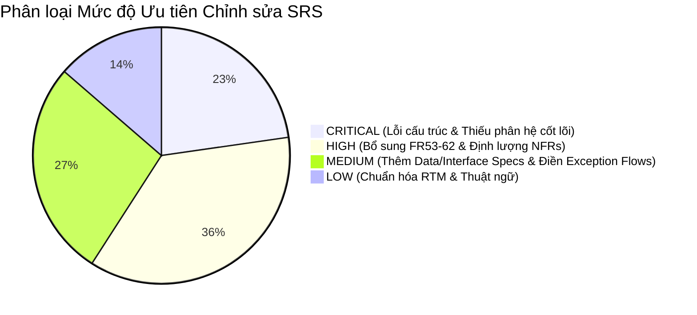

# BÁO CÁO KIỂM TRA VÀ ĐÁNH GIÁ TOÀN DIỆN TÀI LIỆU SRS (SRS AUDIT REPORT)
**Dự án:** GraphMind — Enterprise Knowledge Management Platform for SME Decision Support  
**Mã đề tài:** Capstone Project 1 — C1SE.18 — Đại học Duy Tân (Duy Tan University)  
**Tài liệu kiểm định:** `docs/05-srs/5. C1SE18_SRS_GraphMind_Ver1.1.docx` (Version 1.1, 19/09/2026)  
**Căn cứ đối chiếu chuẩn hóa:**
1. `docs/01-proposal/C1SE18-Proposal-Document-Ver1.2.docx` (Proposal Ver 1.2 — 08/11/2026)
2. `docs/02-user-story/C1SE18_UserStory_GraphMind-Ver1.2.docx` (User Story Ver 1.2 — 69 User Stories)
3. `docs/03-project-plan/C1SE18_ProjectPlan_GraphMind-Ver1.2.docx` (Project Plan Ver 1.2 — 40 WBS, 43 Deliverables)
4. `docs/04-product-backlog/C1SE18_ProductBacklog_GraphMind_Ver1.2.docx` (Product Backlog Ver 1.2 — 79 PBIs)
5. Toàn bộ mã nguồn thực tế tại kho lưu trữ hệ thống GraphMind (`backend`, `frontend`, `aegis-agent`)  
**Tiêu chuẩn kỹ thuật áp dụng:** ISO/IEC/IEEE 29148:2018 (Systems and software engineering — Life cycle processes — Requirements engineering)

---

## 1. TỔNG QUAN ĐÁNH GIÁ (EXECUTIVE SUMMARY)

### 1.1. Bảng điểm đánh giá chất lượng tổng thể

| Trục Đánh giá (Evaluation Dimension) | Trọng số | Điểm số (Thang 100) | Điểm quy đổi | Nhận định tóm tắt từ Chuyên gia BA / SRS Reviewer |
|---|:---:|:---:|:---:|---|
| **1. Độ bao phủ Yêu cầu (Scope & Requirement Coverage)** | 25% | **62 / 100** | 15.5 | **Thiếu hoàn toàn 10 User Stories cốt lõi (US60–US69)**; bỏ sót phân hệ Báo cáo giao ca, Duyệt tài liệu, Ma trận phân quyền động, Single Session, OTP và Cypher Guard. |
| **2. Tính nhất quán Kiến trúc & Vai trò (Roles & Rules)** | 15% | **65 / 100** | 9.75 | Gộp chung vai trò Admin (vi phạm trực tiếp quy tắc bảo mật BR-04); thiếu vai trò Department Manager; thiếu quy tắc Idempotency Guard BR-06. |
| **3. Độ chính xác Dữ liệu & Công nghệ (Technical Accuracy)** | 15% | **60 / 100** | 9.0 | Tồn tại hàng loạt số liệu sai lệch: 2,000–3,000 Q&A pairs (FR37), React/Next.js (FR34), 100–200 questions (FR47), PDF export ngoài phạm vi (FR44), thiếu 2 cảnh báo rủi ro (FR42). |
| **4. Đặc tả Yêu cầu Chức năng & Use Cases** | 15% | **72 / 100** | 10.8 | Có 52 FRs và 22 Use Cases với BFD/Activity/Sequence diagrams; tuy nhiên **100% Exception Flows trong các Use Case đều để trống**; các FR mới chưa có Use Case. |
| **5. Yêu cầu Phi chức năng & Định lượng (NFRs & Testability)** | 10% | **58 / 100** | 5.8 | Bảng NFRs (Bảng 8) cực kỳ sơ sài (chỉ 6 gạch đầu dòng định tính); thiếu chỉ số SLA, thiếu tiêu chuẩn kiểm thử tải Locust 150 VU ($p95 < 500\text{ms}$ / $< 2000\text{ms}$). |
| **6. Đặc tả Dữ liệu & Giao diện (Data & Interface Specs)** | 10% | **64 / 100** | 6.4 | Thiếu chương Data Requirements chuyên biệt; External Interface Requirements chỉ có 5 dòng tóm tắt, hoàn toàn không có Data Dictionary, Schema hay API payloads. |
| **7. Cấu trúc Tài liệu & Tiêu chuẩn IEEE 29148** | 10% | **70 / 100** | 7.0 | Lỗi biên tập nghiêm trọng: **Trùng lặp 2 Chương mang tên "Overall Description" (Chương 2 và 3)**; trùng lặp mục `3.2` hai lần; RTM (Bảng 34) bỏ trống cột Test Case & Status. |
| **TỔNG ĐIỂM CHẤT LƯỢNG SRS** | **100%** | **64.25 / 100** | **64.25** | **MỨC TRUNG BÌNH YẾU (GRADE D) — BẮT BUỘC PHẢI TÁI THIẾT KẾ LÊN VER 1.2** |

---

### 1.2. Nhận định Tổng quan từ Senior Business Analyst & Requirements Engineer

Tài liệu SRS hiện tại (`5. C1SE18_SRS_GraphMind_Ver1.1.docx`, kích thước 5.7 MB) được nhóm đầu tư rất lớn về mặt biểu đồ mô hình hóa (UML Use Case Diagrams, BFD, 22 Activity Diagrams, 22 Sequence Diagrams và 1 Class Diagram). Các chức năng cốt lõi của đề tài nghiên cứu (ETL AdventureWorks/CUAD, Neo4j Graph, Qdrant Vector, Hybrid Query Engine RRF, Multi-hop reasoning, LoRA fine-tuning Qwen2.5-7B) đều được định hình.

Tuy nhiên, khi đối chiếu nghiêm ngặt theo tiêu chuẩn **ISO/IEC/IEEE 29148:2018** và 4 tài liệu căn cứ phiên bản 1.2 (`Proposal Ver 1.2`, `User Story Ver 1.2`, `Project Plan Ver 1.2`, `Product Backlog Ver 1.2`) cùng **Source Code thực tế**, tài liệu SRS Ver 1.1 bộc lộ **5 khiếm khuyết mang tính sống còn**:

1. **Khoảng trống chức năng nghiêm trọng (Missing 10 Core Functional Features):**  
   Tài liệu dừng lại ở 52 Functional Requirements (FR1–FR52) và 22 Use Cases (UC.01–UC.22). Toàn bộ 10 tính năng mới thuộc US60–US69 (PB67–PB76) đã được viết code hoàn chỉnh trong backend và frontend **hoàn toàn vắng bóng trong SRS**:
   - Quy trình nộp tài liệu chờ duyệt (Staff Document Upload - US60).
   - Phân hệ phê duyệt tài liệu nội bộ (Document Approval Oversight - US61).
   - Phân hệ bàn giao ca làm việc (Shift Handover Report Submission - US62).
   - Quản lý duyệt báo cáo ca (Departmental Shift Report Review - US63).
   - AI tổng hợp báo cáo giao ca ngày tự động (AI Daily Shift Consolidation - US64).
   - Ma trận phân quyền động 2D Web grid (`rbac_permissions_matrix` - US65).
   - Kiểm soát phiên làm việc đơn lẻ (Single Active Session / JTI kick - US66).
   - Khôi phục mật khẩu tự phục vụ qua Email OTP 3 bước (US67).
   - Rào chắn bảo vệ Cypher chỉ đọc (Read-Only Cypher Guard & Mutation Blocker - US68).
   - Bảng điều khiển từ xa & Công tắc khẩn cấp trạm AEGIS (PB56 Workstation Kill Switch - US69).
2. **Vi phạm Nguyên tắc An toàn Thông tin & Phân quyền (Business Rule BR-04):**  
   Bảng 6 (User Characteristics) và các yêu cầu FR5, FR10, FR11, FR24 vẫn dùng vai trò gộp `Admin (System & Knowledge Administrator)`. Điều này vi phạm trực tiếp Quy tắc nghiệp vụ BR-04 trong Proposal Ver 1.2: IT Admin không được phép sửa đổi tri thức nghiệp vụ, và Knowledge Manager không được phép can thiệp cấu hình hệ thống, tài khoản hay Audit Log.
3. **Số liệu Kỹ thuật và Ranh giới Phạm vi Sai lệch hoàn toàn:**  
   - FR37 vẫn yêu cầu huấn luyện trên `2,000–3,000 Q&A pairs` (trong khi trần phần cứng Kaggle T4 chỉ cho phép chốt tập dữ liệu tinh chọn **509 ChatML pairs**).
   - FR34 ghi nhận Frontend là `React/Next.js` (trong khi mã nguồn thực tế là **React 18 + Vite SPA**).
   - FR47 ghi nhận đánh giá trên `100–200 questions` (trong khi tập Ground Truth chốt đúng **100 câu hỏi**).
   - FR44 vẫn đặc tả chức năng `export PDF/Word files` (trong khi Proposal Ver 1.2 §4.2 đã chính thức loại việc xuất file ra khỏi phạm vi đề tài, chỉ giữ hiển thị trực quan tóm tắt trên Web Dashboard).
   - FR42 bỏ sót 2 tiêu chí cảnh báo tài chính cốt lõi: Đơn hàng âm lợi nhuận (`TotalDue < StandardCost`) và Chiết khấu bất thường (`Discount >= 35%`).
4. **Chất lượng Đặc tả Use Case chưa đạt chuẩn kiểm thử:**  
   Trong 22 bảng Use Case Specification (Bảng 10 đến Bảng 31), **100% các mục Exception Flow (Luồng ngoại lệ) đều bị bỏ trống**. Khi hệ thống gặp lỗi mạng, cơ sở dữ liệu ngắt kết nối, token hết hạn, câu Cypher bị lỗi hoặc mô hình AI timeout (> 30s), tài liệu hoàn toàn không có đặc tả ứng xử của hệ thống.
5. **Lỗi Cấu trúc và Đánh số Chương (Structural Defects):**  
   Xuất hiện 2 chương liên tiếp cùng mang tên "Overall Description" (Chương 2: *2. Overall Description*, Chương 3: *3. Overall Description*). Trong Chương 3, mục `3.2` bị đặt trùng tên 2 lần (*3.2 System Context Diagram* và *3.2 Product Functions*). Bảng RTM (Bảng 34) để trống toàn bộ cột Test Case ID và Status.

---

## 2. ĐÁNH GIÁ CẤU TRÚC TÀI LIỆU SRS (SRS STRUCTURE ASSESSMENT)

### 2.1. So sánh Cấu trúc Hiện tại với Chuẩn ISO/IEC/IEEE 29148:2018

```mermaid
flowchart TD
    subgraph Current["Cấu trúc SRS Ver 1.1 Hiện tại"]
        C1["1. Introduction"]
        C2["2. Overall Description (Bị trùng tên)"]
        C3["3. Overall Description (Bị trùng tên)"]
        C4["4. Specific Requirements (Chỉ có FR & tóm tắt NFR)"]
        C5["5. System Models (BFD, Use Cases, Activity, Sequence, Class)"]
        C6["6. Other Requirements (Business Rules, Constraints)"]
        C7["Appendix A (Glossary), Appendix B (RTM)"]
    end

    subgraph Standard["Cấu trúc Khuyến nghị ISO/IEC/IEEE 29148"]
        S1["1. Introduction (Purpose, Scope, Definitions, References, Overview)"]
        S2["2. Overall Description (Perspective, Functions, Users, Operating Env, Constraints, Assumptions)"]
        S3["3. Specific Requirements"]
        S31["3.1 External Interface Requirements (UI, API, Hardware, Software, Comm)"]
        S32["3.2 System Features & Functional Requirements (FR01 - FR62)"]
        S33["3.3 Non-functional Requirements (Performance SLAs, Security, Reliability, Usability)"]
        S34["3.4 Data Requirements & Schema Specifications (Postgres, Neo4j, Qdrant)"]
        S35["3.5 Business Rules (BR-01 to BR-06)"]
        S4["4. System Models & Use Case Specifications (UC.01 - UC.27)"]
        S5["5. Verification & Traceability Matrix (5-Way RTM)"]
        S6["Appendix (Glossary, Change Log)"]
    end

    Current -.->|Cần tái cấu trúc| Standard
```



### 2.2. Chi tiết các Khiếm khuyết Cấu trúc (Structural Defects)
1. **Lỗi nhân bản tiêu đề Chương 2 và Chương 3:**  
   Chương 2 ghi: `2. Overall Description` (chỉ chứa 2.1 Purpose of the System, 2.2 Scope of the System, Bảng 5 Module). Ngay sau đó, Chương 3 lại ghi: `3. Overall Description` (chứa 3.1 Product Perspective, 3.2 Context Diagram, 3.2 Product Functions, 3.3 User Characteristics).  
   *Giải pháp:* Hợp nhất Chương 2 và Chương 3 thành một Chương 2 duy nhất mang tên **"2. Overall Description"** theo đúng chuẩn IEEE 29148.
2. **Lỗi trùng lặp số mục con 3.2:**  
   Trong Chương 3 hiện tại, đoạn P98 mang tiêu đề `3.2 System Context Diagram`, và đoạn P108 lại mang tiêu đề `3.2 Product Functions`.  
   *Giải pháp:* Đánh số lại thành `2.2 System Context Diagram` và `2.3 Product Functions`.
3. **Thiếu hoàn toàn mục "Data Requirements" trong Chương 4:**  
   Một hệ thống AI phức tạp kết nối đồng thời 3 cơ sở dữ liệu (PostgreSQL, Neo4j Graph DB, Qdrant Vector DB) nhưng tài liệu SRS lại không có mục đặc tả thực thể dữ liệu (Data Entities), cấu trúc trường, khóa chính/ngoại, kiểu dữ liệu hay ràng buộc toàn vẹn.
4. **Mục External Interface Requirements quá nghèo nàn:**  
   Mục 4.3 chỉ gồm 5 đoạn văn ngắn gọn (P141–P145), không có danh mục API endpoint, cấu trúc JSON Request/Response mẫu, mã lỗi HTTP, hay giao thức kết nối chi tiết giữa Agent và Cloud.

---

## 3. PHÂN TÍCH ĐỘ BAO PHỦ YÊU CẦU (REQUIREMENT COVERAGE ANALYSIS)

### 3.1. Ma trận Bao phủ theo từng Phân hệ (Module-by-Module Coverage)

| Phân hệ / Module | Phạm vi Proposal Ver 1.2 | User Story Ver 1.2 | PB Ver 1.2 | FR trong SRS Ver 1.1 | Tình trạng Bao phủ trong SRS | Đánh giá & Khoảng trống |
|---|---|---|---|---|:---:|---|
| **Module 1: Data Source & Sync Management** | File Watcher, Webhook, SHA-256 Hash Guard, Agent Panel, Kill Switch. | US08, US09, US41, US45, US48, US49, **US69** | PB05, PB06, PB45, PB48, PB49, PB56, **PB76** | FR13, FR14, FR15, FR16, FR19 | **THIẾU YÊU CẦU CỐT LÕI** | **Thiếu FR đặc tả Remote Emergency Kill Switch** và Heartbeat alert threshold (> 120s) của trạm làm việc PB56 (US69). |
| **Module 2: Knowledge Extraction & Curation** | AdventureWorks ETL, CUAD preprocessing, Neo4j, Qdrant, Graph Editor, Document Approval. | US24, US25, US27, US29, US30, US42, US46, US47, **US60, US61** | PB07–PB14, PB19, PB41, PB46, PB47, PB50, PB54, **PB67, PB68** | FR17, FR18, FR20, FR21, FR22, FR23, FR24, FR25, FR26 | **THIẾU 2 QUY TRÌNH NGHIỆP VỤ** | **Thiếu hoàn toàn quy trình tải tài liệu chờ duyệt (US60)** và **Quy trình phê duyệt tài liệu số của Knowledge Admin (US61)**. |
| **Module 3: Hybrid AI Copilot & Search** | NL2Cypher, Vector Search, RRF Fusion ($k=60$), Chat UI, Citations, Multi-facet Search, Cypher Guard. | US02–US07, US26, US28, US31, US32, US36, US38, US40, **US68** | PB15, PB20, PB21, PB23–PB28, PB30, PB37, PB40, PB51, PB52, PB53, PB59, **PB75** | FR27, FR28, FR29, FR30, FR31, FR32, FR33, FR34, FR35, FR38, FR39 | **THIẾU BẢO MẬT & SAI CÔNG NGHỆ** | **Thiếu Read-Only Cypher Guard (US68)**; FR34 ghi sai công nghệ Frontend (Next.js thay vì React 18 Vite). |
| **Module 4: Decision Support & Shift Reports** | Executive Dashboard, Risk Center (4 criteria), Shift Reports, Daily AI Consolidation, Web Briefing. | US10, US22, US33, US34, US35, **US62, US63, US64** | PB04, PB22, PB57, PB58, PB65, **PB69, PB70, PB71** | FR40, FR41, FR42, FR43, FR44 | **THIẾU TOÀN BỘ PHÂN HỆ GIAO CA** | **Thiếu nộp báo cáo ca (US62), duyệt ca (US63), AI tổng hợp ca ngày (US64)**; FR42 thiếu 2 cảnh báo tài chính; FR44 sai phạm vi xuất PDF. |
| **Module 5: Model Adaptation & Evaluation** | Qwen2.5-7B LoRA, 509 ChatML, 100 Benchmark QA, 3 Baselines, 5 Indicators. | US11, US12, US14, US15, US16, US18, US21, US23, US43, US50, US55 | PB16, PB17, PB18, PB31–PB36, PB43, PB55, PB60 | FR36, FR37, FR47, FR48, FR49, FR50, FR51, FR52 | **SAI LỆCH THÔNG SỐ NGHIÊM TRỌNG** | FR37 sai số lượng Q&A (ghi 2,000–3,000); FR47 sai số câu hỏi Benchmark (ghi 100–200). |
| **Module 6: System Admin & Security** | JWT, RBAC tĩnh, Dynamic Matrix, Single Active Session, Audit Log, Forgot PW OTP. | US01, US13, US17, US39, US44, **US65, US66, US67** | PB01, PB02, PB03, PB39, PB42, PB44, PB66, **PB72, PB73, PB74** | FR1, FR2, FR3, FR4, FR5, FR6, FR7, FR8, FR9, FR10, FR11, FR12 | **THIẾU AN NINH & VI PHẠM BR-04** | Gộp vai trò Admin; **thiếu Dynamic RBAC Matrix (US65), thiếu Single Session JTI (US66), thiếu Email OTP 3 bước (US67)**. |

---

## 4. ĐÁNH GIÁ YÊU CẦU CHỨC NĂNG (FUNCTIONAL REQUIREMENTS ASSESSMENT)

### 4.1. Bảng phân loại hiện trạng 52 Functional Requirements hiện có

```
+----------------------------------------------------------------------------------------------------+
| [GOOD] Đạt yêu cầu kỹ thuật (26 FRs):                                                               |
| FR1, FR6, FR7, FR8, FR13, FR15, FR17, FR18, FR20, FR21, FR22, FR27, FR28, FR29, FR30, FR31,         |
| FR32, FR33, FR40, FR41, FR45, FR46, FR48, FR49, FR50, FR51, FR52.                                 |
|                                                                                                    |
| [NEEDS REFINEMENT] Chưa đầy đủ / Thiếu kịch bản / Cần chuẩn hóa Actor (12 FRs):                    |
| FR2, FR3, FR5, FR9, FR10, FR11, FR12, FR14, FR16, FR23, FR24, FR25, FR26.                         |
|                                                                                                    |
| [INCORRECT / OUTDATED] Sai lệch số liệu / Sai công nghệ / Vượt phạm vi (5 FRs):                     |
| FR34 (Sai Frontend Next.js), FR37 (Sai số lượng Q&A 2,000–3,000), FR42 (Thiếu 2 cảnh báo rủi ro),  |
| FR44 (Sai phạm vi xuất PDF/Word), FR47 (Sai số câu hỏi Benchmark 100–200).                          |
|                                                                                                    |
| [MISSING] Cần bổ sung mới hoàn toàn (10 FRs mới: FR53 ➔ FR62 tương ứng US60 ➔ US69):              |
| FR53 (US60), FR54 (US61), FR55 (US62), FR56 (US63), FR57 (US64), FR58 (US65), FR59 (US66),        |
| FR60 (US67), FR61 (US68), FR62 (US69).                                                             |
+----------------------------------------------------------------------------------------------------+
```

### 4.2. Chi tiết 10 Functional Requirements Mới cần Bổ sung (FR53 ➔ FR62)

Nhóm tác giả cần bổ sung 10 yêu cầu chức năng sau vào Bảng 7 (Table 7) của tài liệu SRS:

#### 1. FR53: Tải tài liệu nội bộ chờ duyệt (Staff Document Upload in Pending State)
- **Mã yêu cầu:** `FR53` | **Ưu tiên:** High | **Nguồn truy vết:** US60, PB67, WBS 7b.
- **Mô tả hành vi hệ thống:** Hệ thống cho phép nhân viên nghiệp vụ (Standard User) tải lên các tệp tài liệu nội bộ (.pdf, .xlsx dung lượng $\le 25\text{ MB}$). Hệ thống tự động tính toán mã băm SHA-256 để kiểm tra trùng lặp (SHA-256 Idempotency Guard). Nếu tệp chưa từng tồn tại, hệ thống lưu trữ tệp vào hàng đợi phê duyệt với trạng thái `PENDING_APPROVAL`, gán nhãn phòng ban của người tải. Tài liệu ở trạng thái này bị cô lập tuyệt đối khỏi phạm vi tìm kiếm của AI Copilot và Multi-facet Search cho đến khi được duyệt.
- **Tiêu chuẩn kiểm chứng:** Tải tệp hợp lệ $\le 25\text{ MB}$ tạo bản ghi `PENDING_APPROVAL`; tải tệp trùng SHA-256 bị từ chối với thông báo lỗi rõ ràng; truy vấn Copilot không xuất hiện dữ liệu của tệp pending.

#### 2. FR54: Phê duyệt và kích hoạt nạp tài liệu số (Document Approval Oversight & Pipeline Ingestion)
- **Mã yêu cầu:** `FR54` | **Ưu tiên:** High | **Nguồn truy vết:** US61, PB68, WBS 15c.
- **Mô tả hành vi hệ thống:** Hệ thống cung cấp bảng điều khiển "Pending Approvals" dành riêng cho Knowledge Administrator (và IT Admin). Cho phép xem danh sách, lọc theo phòng ban, xem trước nội dung tệp (Preview) và thực hiện tác vụ Duyệt (`APPROVED`) hoặc Từ chối (`REJECTED`). Khi duyệt, hệ thống tự động kích hoạt pipeline Celery trích xuất thực thể nạp vào Neo4j và tạo vector nạp vào Qdrant, đồng thời ghi nhật ký Audit Log. Khi từ chối, người duyệt bắt buộc phải nhập lý do từ chối để phản hồi cho người nộp.
- **Tiêu chuẩn kiểm chứng:** Thao tác "Approve" chuyển trạng thái sang `APPROVED` và kích hoạt pipeline ETL; thao tác "Reject" yêu cầu ghi chú lý do và loại bỏ tệp khỏi hàng đợi nạp.

#### 3. FR55: Lập và nộp báo cáo giao ca (Shift Handover Report Submission)
- **Mã yêu cầu:** `FR55` | **Ưu tiên:** High | **Nguồn truy vết:** US62, PB69, WBS 15d.
- **Mô tả hành vi hệ thống:** Hệ thống cung cấp biểu mẫu điện tử trên Web Dashboard để nhân viên (Standard User) nhập và nộp báo cáo giao ca (Shift Report). Dữ liệu bao gồm: tiêu đề ca, thời gian làm việc, các vụ việc xử lý trong ca (CaseRow: thời gian, khách hàng, vấn đề, giải pháp, mã tham chiếu), sự cố tồn đọng và đề xuất bàn giao ca sau. Hệ thống hỗ trợ lưu nháp (`DRAFT`) để chỉnh sửa nhiều lần và nộp chính thức (`SUBMITTED`).
- **Tiêu chuẩn kiểm chứng:** Form validate đầy đủ các trường bắt buộc; hỗ trợ chuyển đổi trạng thái giữa `DRAFT` và `SUBMITTED`; lưu trữ toàn vẹn trong bảng `shift_reports` PostgreSQL.

#### 4. FR56: Thẩm định và ký duyệt báo cáo giao ca phòng ban (Departmental Shift Report Review & Sign-off)
- **Mã yêu cầu:** `FR56` | **Ưu tiên:** High | **Nguồn truy vết:** US63, PB70, WBS 15d.
- **Mô tả hành vi hệ thống:** Hệ thống hiển thị danh sách các báo cáo ca của nhân viên thuộc phòng ban phụ trách cho Trưởng phòng (Department Manager). Trưởng phòng xem chi tiết nội dung, bổ sung nhận xét chỉ đạo và thực hiện ký duyệt ("Mark as Reviewed"), chuyển trạng thái báo cáo sang `REVIEWED` kèm định danh người duyệt và dấu thời gian hệ thống. Trưởng phòng không được phép duyệt báo cáo ca của phòng ban khác (Department Data Scope).
- **Tiêu chuẩn kiểm chứng:** Người dùng có role `manager` chỉ thấy báo cáo thuộc phòng ban mình; thao tác ký duyệt cập nhật trạng thái `REVIEWED` và lưu vết Audit Log.

#### 5. FR57: AI tổng hợp báo cáo giao ca ngày tự động (AI Daily Shift Consolidation)
- **Mã yêu cầu:** `FR57` | **Ưu tiên:** Medium | **Nguồn truy vết:** US64, PB71, WBS 19b.
- **Mô tả hành vi hệ thống:** Hệ thống cho phép Lãnh đạo (Executive) hoặc Trưởng phòng (Department Manager) chọn ngày và kích hoạt AI tổng hợp toàn bộ các báo cáo ca (`SUBMITTED`/`REVIEWED`) trong ngày của phòng ban thành một bản tóm tắt duy nhất. Hệ thống gửi prompt tới mô hình Ollama cục bộ để tạo báo cáo 3 phần: (1) Công việc trọng tâm đã hoàn thành, (2) Sự cố và điểm nghẽn tồn đọng, (3) Kiến nghị ưu tiên cho ca ngày hôm sau. Nếu Ollama timeout (> 30s) hoặc mất kết nối, hệ thống tự động kích hoạt cơ chế Deterministic Fallback trích xuất trực tiếp danh sách sự cố từ cơ sở dữ liệu mà không làm gián đoạn màn hình người dùng.
- **Tiêu chuẩn kiểm chứng:** Bản tóm tắt hiển thị đúng cấu trúc 3 phần trong $\le 5.0\text{s}$; ngắt service Ollama kiểm thử cơ chế fallback trả về kết quả quy tắc thành công.

#### 6. FR58: Quản trị ma trận phân quyền động 2 chiều (Granular Dynamic RBAC Matrix Management)
- **Mã yêu cầu:** `FR58` | **Ưu tiên:** High | **Nguồn truy vết:** US65, PB72, WBS 10.
- **Mô tả hành vi hệ thống:** Hệ thống cung cấp giao diện lưới 2 chiều (2D Web Matrix Grid) cho phép System & IT Administrator cấu hình chi tiết 4 quyền CRUD (Create, Read, Update, Delete) trên từng thực thể dữ liệu nghiệp vụ (Customer, Order, Contract, SOP) đối với từng vai trò và phòng ban. Mọi thay đổi quyền được lưu lập tức vào bảng `rbac_permissions_matrix` trong PostgreSQL và có hiệu lực runtime ngay lập tức mà không cần khởi động lại máy chủ hoặc sửa mã nguồn backend. Người dùng bị giới hạn quyền khi gọi API bị chặn bằng mã HTTP 403 Forbidden.
- **Tiêu chuẩn kiểm chứng:** Chỉnh sửa bỏ quyền Read của role Sales trên thực thể Contract; gọi API lấy hợp đồng trả về ngay lập tức HTTP 403 Forbidden.

#### 7. FR59: Kiểm soát phiên làm việc đơn lẻ (Single Active Session Enforcement)
- **Mã yêu cầu:** `FR59` | **Ưu tiên:** High | **Nguồn truy vết:** US66, PB73, WBS 2.
- **Mô tả hành vi hệ thống:** Hệ thống thực thi cơ chế duy nhất một phiên làm việc hoạt động đồng thời (Single Active Session) cho mỗi tài khoản người dùng. Khi đăng nhập thành công, mã định danh JWT ID (`jti`) cùng IP và User-Agent được lưu vào bảng `user_active_sessions`. Nếu tài khoản đăng nhập thành công trên Thiết bị B, hệ thống lập tức thu hồi phiên của Thiết bị A. Mọi yêu cầu API tiếp theo từ Thiết bị A bị chặn với HTTP 401 Unauthorized kèm mã lỗi `CONCURRENT_LOGIN_KICKED`, buộc trình duyệt chuyển về màn hình đăng nhập.
- **Tiêu chuẩn kiểm chứng:** Đăng nhập tài khoản trên Trình duyệt 1, sau đó đăng nhập trên Trình duyệt 2; Trình duyệt 1 gửi request nhận HTTP 401 `CONCURRENT_LOGIN_KICKED` và bị đăng xuất.

#### 8. FR60: Tự phục hồi mật khẩu qua Email OTP 3 bước (Self-Service Password Recovery via Email OTP)
- **Mã yêu cầu:** `FR60` | **Ưu tiên:** High | **Nguồn truy vết:** US67, PB74, WBS 11b.
- **Mô tả hành vi hệ thống:** Hệ thống cung cấp luồng khôi phục mật khẩu 3 bước bảo mật cho người dùng quên mật khẩu:
  - *Bước 1 (Gửi OTP):* Nhập email đã đăng ký, hệ thống sinh mã OTP ngẫu nhiên 6 chữ số, mã hóa băm trong DB, gửi qua giao thức SMTP và kích hoạt bộ đếm ngược 5 phút (300 giây).
  - *Bước 2 (Xác thực OTP):* Nhập mã OTP trong vòng 5 phút; nhập sai quá 3 lần lập tức vô hiệu hóa mã OTP để chống tấn công brute-force; nhập đúng cấp mã `reset_token` tạm thời.
  - *Bước 3 (Đổi mật khẩu):* Nhập mật khẩu mới (tối thiểu 8 ký tự, gồm chữ và số), hệ thống băm bcrypt lưu vào DB, thu hồi toàn bộ các phiên làm việc cũ và chuyển hướng về màn hình đăng nhập.
- **Tiêu chuẩn kiểm chứng:** Nhập sai OTP 3 lần bị khóa mã; nhập OTP quá 5 phút bị từ chối; đặt mật khẩu thành công hủy toàn bộ phiên cũ.

#### 9. FR61: Rào chắn bảo vệ Cypher chỉ đọc (Read-Only Cypher Guard & Mutation Blocker)
- **Mã yêu cầu:** `FR61` | **Ưu tiên:** High | **Nguồn truy vết:** US68, PB75, WBS 13b.
- **Mô tả hành vi hệ thống:** Hệ thống tích hợp middleware bảo mật Read-Only Cypher Guard chặn trước tầng driver Neo4j. Mọi câu lệnh Cypher do AI hoặc NL2Cypher engine sinh ra đều được phân tích cú pháp (Regex & AST parsing). Nếu câu truy vấn chứa bất kỳ từ khóa làm biến đổi hoặc xóa dữ liệu (`CREATE`, `MERGE`, `DELETE`, `DETACH`, `SET`, `REMOVE`, `DROP`, `ALTER`), câu lệnh bị chặn ngay lập tức. Hệ thống ghi nhật ký cảnh báo an ninh, tự động chuyển hướng truy vấn sang nhánh tìm kiếm an toàn Vector RAG (Qdrant) và trả về câu trả lời trung thực cho người dùng mà không làm sập hệ thống.
- **Tiêu chuẩn kiểm chứng:** Gửi câu hỏi kích thích sinh lệnh `MATCH (c:Customer) DETACH DELETE c`; Cypher Guard chặn thành công, ghi log bảo mật và trả lời qua Vector RAG.

#### 10. FR62: Điều khiển trạm làm việc & Công tắc khẩn cấp AEGIS (Workstation Control & Emergency Kill Switch)
- **Mã yêu cầu:** `FR62` | **Ưu tiên:** Medium | **Nguồn truy vết:** US69, PB76, WBS 18.
- **Mô tả hành vi hệ thống:** Bảng điều khiển AEGIS Local Agent Panel cho phép System & IT Administrator giám sát tín hiệu nhịp tim (Heartbeat) của từng máy trạm chạy Agent. Nếu quá ngưỡng cấu hình (> 120 giây) không có nhịp tim, máy trạm tự động chuyển trạng thái `OFFLINE/TIMEOUT`. Khi phát hiện sự cố rò rỉ dữ liệu hoặc mã độc, Quản trị viên kích hoạt nút "Emergency Kill Switch" từ xa. Máy chủ gửi tín hiệu dừng đồng bộ, File Watcher trên máy trạm lập tức ngừng quét và ngắt kết nối trong vòng $\le 3\text{ giây}$ (chuyển sang trạng thái `SUSPENDED`), thực thi theo giao thức xác thực 2 pha (2-phase ACK).
- **Tiêu chuẩn kiểm chứng:** Nhấn Kill Switch trên web console; tiến trình File Watcher máy trạm dừng đồng bộ trong $\le 3\text{s}$; web nhận mã phản hồi ACK thành công.

---

## 5. ĐÁNH GIÁ YÊU CẦU PHI CHỨC NĂNG (NON-FUNCTIONAL REQUIREMENTS ASSESSMENT)

### 5.1. Khiếm khuyết của Bảng NFRs hiện tại (Bảng 8)
Bảng 8 trong SRS Ver 1.1 hoàn toàn mang tính chất **mô tả định tính (Qualitative statements)**, vi phạm nghiêm trọng nguyên tắc **Verifiability (Khả năng kiểm chứng)** của ISO/IEC/IEEE 29148. Các yêu cầu như *"AI Response Time is automatically measured"* hay *"Web interface is easy to use"* không có bất kỳ ngưỡng giá trị đo lường nào để nghiệm thu phần mềm.

### 5.2. Bảng Chuẩn hóa Định lượng Yêu cầu Phi chức năng (Target NFRs for Ver 1.2)

| Mã NFR | Hạng mục NFR | Đặc tả Định lượng & Tiêu chuẩn Đo lường (Measurable Metrics) | Phương pháp Kiểm chứng (Verification Method) |
|---|---|---|:---:|
| **NFR-PERF-01** | Thời gian phản hồi Web | Giao diện Web Dashboard (React 18 + Vite SPA) tải trang hoàn tất trong thời gian **$\le 2.0\text{ giây}$** trong điều kiện mạng nội bộ tiêu chuẩn (tuân thủ US12 / PB30). | Testing (Lighthouse / Chrome DevTools) |
| **NFR-PERF-02** | Thông lượng & Độ trễ API | Khi kiểm thử tải bằng **Locust với tải trọng tối đa 150 người dùng ảo đồng thời (Virtual Users)**:<br/>• Điểm cuối đọc dữ liệu nhẹ (Read endpoints): độ trễ **$p95 < 500\text{ ms}$**.<br/>• Điểm cuối tổng hợp nặng (Hybrid Copilot Query, Context Fusion): độ trễ **$p95 < 2,000\text{ ms}$**. | Testing (Locust Load Test Suite) |
| **NFR-PERF-03** | Độ trễ suy luận AI Cục bộ | Mô hình Qwen2.5-7B GGUF Q4_K_M phục vụ cục bộ qua Ollama (port 11434) đạt thời gian suy luận trung bình **$\le 3.5\text{ giây/câu hỏi}$**; tác vụ tóm tắt Executive Briefing hoàn thành trong **$\le 5.0\text{ giây}$**. | Testing (Benchmark Test Harness) |
| **NFR-SEC-01** | Kiểm soát Phiên đồng thời | Mỗi tài khoản chỉ tồn tại duy nhất 1 phiên hoạt động. Đăng nhập mới kích hoạt hủy phiên cũ trong vòng **$< 500\text{ ms}$**; phiên cũ bị chặn với mã HTTP 401 `CONCURRENT_LOGIN_KICKED`. | Automated Test (`test_concurrent_login.py`) |
| **NFR-SEC-02** | Hiệu lực & Giới hạn OTP | Mã OTP gửi qua email có thời gian sống chính xác **300 giây (5 phút)**. Tự động khóa mã sau **3 lần thử sai liên tiếp**. | Automated Test (`test_user_admin_api.py`) |
| **NFR-SEC-03** | Rào chắn Cypher Guard | 100% câu truy vấn Cypher phát sinh từ AI được kiểm tra trước khi thực thi. Tỷ lệ phát hiện và chặn các câu lệnh biến đổi dữ liệu (CREATE, MERGE, DELETE, DROP) đạt **100%**. | Automated Test (`test_safety_guard.py`) |
| **NFR-SEC-04** | Thời gian đáp ứng Kill Switch | Lệnh ngắt khẩn cấp Emergency Kill Switch từ web console đình chỉ hoạt động quét tệp của AEGIS File Watcher trong vòng **$\le 3.0\text{ giây}$**. | Automated Test (`test_pb56_workstations.py`) |
| **NFR-REL-01** | Độ chịu lỗi Suy luận AI | Nếu dịch vụ Ollama gặp sự cố hoặc timeout quá **30 giây**, hệ thống tự động kích hoạt Deterministic Rule Fallback trong vòng **$< 1.0\text{ giây}$**, tỷ lệ sập ứng dụng Copilot bằng **0%**. | Fault Injection Testing |
| **NFR-REL-02** | Toàn vẹn & Chống trùng lặp | 100% tệp tải lên hoặc đồng bộ qua Agent được kiểm tra mã băm SHA-256. Tỷ lệ phát hiện trùng lặp đạt **100%**, ngăn chặn ô nhiễm dữ liệu đồ thị tri thức. | Automated Test (`test_pr1_doc_identity.py`) |
| **NFR-AVAIL-01** | Tính sẵn sàng Hybrid | Khi mất kết nối mạng giữa trạm làm việc và máy chủ đám mây, các truy vấn trên dữ liệu đã đồng bộ trước đó vẫn hoạt động bình thường 100%. | Inspection & Disconnect Testing |

---

## 6. ĐÁNH GIÁ QUY TẮC NGHIỆP VỤ (BUSINESS RULES ASSESSMENT)

### 6.1. Khiếm khuyết của Bảng 32 (Business Rules hiện tại)
Bảng 32 trong SRS Ver 1.1 chỉ có 5 quy tắc nghiệp vụ (BR-01 đến BR-05), trong đó:
- `BR-03` hiện tại gộp chung quyền cấu hình Agent và duyệt tri thức cho "System & Knowledge Administrators", hoàn toàn trái ngược với Proposal Ver 1.2.
- `BR-04` hiện tại chỉ nói về việc Trưởng phòng soạn SOP.
- Hoàn toàn **thiếu quy tắc phân lập quyền quản trị BR-04** của Proposal Ver 1.2.
- Hoàn toàn **thiếu quy tắc kiểm tra tính bất biến và chống trùng lặp bằng mã băm SHA-256 (BR-06)**.

### 6.2. Bộ 6 Quy tắc Nghiệp vụ Chuẩn hóa (Aligned with Proposal Ver 1.2)

Nhóm tác giả cần thay thế Bảng 32 bằng bộ 6 quy tắc chuẩn sau:

| Mã Quy tắc | Tên Quy tắc Nghiệp vụ | Nội dung Đặc tả Chuẩn mực (Ver 1.2) |
|---|---|---|
| **BR-01** | Liên kết Dữ liệu Giả lập có Kiểm soát<br/>*(Controlled Synthetic Linking)* | Mỗi khách hàng (Customer) trong AdventureWorks được gán cố định cho từ 1 đến 3 hợp đồng mẫu trong tập dữ liệu CUAD thông qua một bảng tra cứu độc lập (`customer_contract_lookup`), tạo cơ sở dữ liệu nền cho các câu hỏi suy luận đa bước đa nguồn. |
| **BR-02** | Phân quyền & Giới hạn Phòng ban<br/>*(Department Data Scope)* | Quyền truy cập thông tin khách hàng, đơn hàng, hợp đồng và tài liệu SOP của nhân viên nghiệp vụ (Standard User) bị giới hạn nghiêm ngặt theo phòng ban được phân bổ (mặc định: Sales). Nhân viên phòng này không được xem dữ liệu nghiệp vụ nhạy cảm của phòng khác trừ khi được cấp quyền qua ma trận phân quyền. |
| **BR-03** | Tính Bất khả xâm phạm của Audit Log<br/>*(Audit Log Immutability)* | Mọi câu truy vấn gửi tới AI Copilot, các thao tác quản trị tài khoản, thay đổi ma trận phân quyền, phê duyệt tài liệu và lệnh điều khiển máy trạm đều phải được ghi lại trong bảng `audit_logs`. Nhật ký này là chỉ đọc (Append-only), không một vai trò nào (kể cả IT Admin) được phép chỉnh sửa hay xóa bỏ. |
| **BR-04** | Phân lập Tuyệt đối giữa Quản trị Hạ tầng và Tri thức<br/>*(Role Separation)* | **Tách biệt tuyệt đối quyền hạn giữa System & IT Administrator và Knowledge Administrator.** IT Admin quản trị máy chủ, tài khoản, ma trận phân quyền và máy trạm AEGIS, nhưng tuyệt đối không có quyền chỉnh sửa đồ thị tri thức hay phê duyệt nội dung nghiệp vụ. Knowledge Admin có toàn quyền duyệt tài liệu, biên tập thuộc tính graph và quản lý SOP, nhưng bị cô lập hoàn toàn khỏi cấu hình máy chủ, tài khoản và log bảo mật. |
| **BR-05** | Quyền Tra cứu Chiến lược của Cấp Lãnh đạo<br/>*(Executive Strategic Full Access)* | Cấp Lãnh đạo doanh nghiệp (Executive / C-Level) có quyền truy cập không giới hạn (Full Access Scope) đối với toàn bộ dữ liệu đa phòng ban trên toàn doanh nghiệp để phục vụ phân tích quyết sách chiến lược, xem toàn bộ 4 cảnh báo rủi ro và nhận báo cáo tóm tắt trên Web Dashboard. |
| **BR-06** | Kiểm soát Trùng lặp bằng Mã băm<br/>*(SHA-256 Idempotency Guard)* | Mọi tệp dữ liệu đồng bộ từ trạm làm việc qua File Watcher hoặc tải lên bởi nhân viên đều phải được tính toán mã băm SHA-256. Nếu mã băm trùng khớp với tệp đã có trong hệ thống, hệ thống lập tức từ chối nạp lại và đưa ra cảnh báo trùng lặp, bảo vệ đồ thị tri thức Neo4j và kho vector Qdrant khỏi hiện tượng rác và sai lệch dữ liệu. |

---

## 7. ĐÁNH GIÁ ĐẶC TẢ DỮ LIỆU (DATA REQUIREMENTS ASSESSMENT)

Hiện tại, tài liệu SRS Ver 1.1 **hoàn toàn không có chương mục dành riêng cho Data Requirements**. Một hệ thống tích hợp 3 cơ sở dữ liệu đòi hỏi phải bổ sung Mục **`3.4 Data Requirements`** với các đặc tả chi tiết sau:

### 7.1. Cơ sở dữ liệu Quan hệ (PostgreSQL 16)
Cần đặc tả chi tiết 8 bảng cơ sở dữ liệu cốt lõi đã có trong source code:
1. `users`: Quản lý tài khoản người dùng (`id`, `email`, `hashed_password`, `full_name`, `department`, `role`, `is_active`, `created_at`).
2. `user_active_sessions`: Quản lý phiên làm việc đơn lẻ (`id`, `user_id`, `jti`, `ip_address`, `user_agent`, `last_activity`, `is_revoked`).
3. `otps`: Quản lý mã OTP khôi phục mật khẩu (`id`, `email`, `otp_hash`, `expires_at`, `attempts`, `is_used`).
4. `rbac_permissions_matrix`: Ma trận phân quyền động (`id`, `role`, `department`, `entity_type`, `can_create`, `can_read`, `can_update`, `can_delete`, `updated_at`).
5. `sop_documents`: Tài liệu quy trình chuẩn (`id`, `title`, `department`, `content`, `status` [DRAFT/PUBLISHED], `author_id`, `created_at`, `published_at`).
6. `document_approvals`: Hàng đợi phê duyệt tài liệu số (`id`, `file_name`, `file_hash` [SHA-256], `uploader_id`, `department`, `status` [PENDING/APPROVED/REJECTED], `rejection_reason`, `created_at`).
7. `shift_reports`: Báo cáo bàn giao ca (`id`, `shift_title`, `department`, `author_id`, `work_completed`, `pending_issues`, `handover_proposals`, `cases_json`, `status` [DRAFT/SUBMITTED/REVIEWED], `reviewer_id`, `reviewed_at`).
8. `audit_logs`: Nhật ký kiểm toán an ninh bất biến (`id`, `user_id`, `action`, `resource`, `ip_address`, `timestamp`, `details`).

### 7.2. Cơ sở dữ liệu Đồ thị Tri thức (Neo4j Community Edition)
Đặc tả Ontology đồ thị tri thức:
- **Node Labels:**
  - `:Customer` (`customerId`, `name`, `territory`, `customerType`, `accountNumber`)
  - `:SalesOrder` (`orderId`, `orderDate`, `totalDue`, `standardCost`, `discountPct`, `status`)
  - `:Product` (`productId`, `name`, `productNumber`, `listPrice`, `standardCost`, `category`)
  - `:Contract` (`contractId`, `title`, `agreementDate`, `expirationDate`, `governingLaw`, `effectiveDate`)
  - `:Clause` (`clauseId`, `clauseType`, `textSnippet`, `pageNumber`, `hasUncappedLiability`)
  - `:SOP` (`sopId`, `title`, `department`, `version`, `effectiveDate`)
- **Relationship Types:**
  - `(:Customer)-[:PLACED]->(:SalesOrder)`
  - `(:SalesOrder)-[:CONTAINS]->(:Product)`
  - `(:Customer)-[:BOUND_BY]->(:Contract)` *(tạo bởi Controlled Synthetic Linking)*
  - `(:Contract)-[:HAS_CLAUSE]->(:Clause)`
  - `(:Department)-[:GOVERNED_BY]->(:SOP)`

### 7.3. Cơ sở dữ liệu Vector (Qdrant)
Đặc tả Collection vector:
- **Collection Name:** `graphmind_knowledge_vectors`
- **Vector Dimension:** 384 chiều (mô hình `all-MiniLM-L6-v2`) hoặc 1024 chiều (mô hình `bge-large-en-v1.5`).
- **Distance Metric:** Cosine Similarity.
- **Payload Schema:** `doc_id`, `chunk_id`, `department`, `source_type` (CONTRACT / SOP / MANUAL), `text_content`, `created_at`.

---

## 8. ĐÁNH GIÁ ĐẶC TẢ GIAO DIỆN (INTERFACE REQUIREMENTS ASSESSMENT)

Mục 4.3 trong SRS hiện tại cần được mở rộng thành một chương mục hoàn chỉnh:

### 8.1. Giao diện Người dùng (User Interface - UI)
- Framework: React 18 + Vite (SPA), Tailwind CSS.
- Các phân hệ màn hình chính:
  1. *Authentication Screens:* Đăng nhập JWT, Quên mật khẩu OTP 3 bước, Thông báo bị thu hồi phiên do đăng nhập đồng thời (`ConcurrentLoginKickModal`).
  2. *AI Copilot Workspace:* Khung chat hội thoại đa lượt, bộ xem trích dẫn nguồn (Source & Citation Drawer), khung hiển thị đồ thị tương tác Neo4j Graph Visualizer (sử dụng Vis.js / React Flow).
  3. *Knowledge Base Explorer:* Trình duyệt tài liệu, modal tải tệp cho nhân viên, danh sách tệp chờ duyệt (`PendingApprovalsPanel`).
  4. *Shift Report Center:* Trình soạn thảo báo cáo ca, bảng xét duyệt của Trưởng phòng, màn hình kích hoạt AI tổng hợp báo cáo ngày.
  5. *Management Dashboards:* Executive Decision Dashboard, Smart Risk & Alert Center (4 loại rủi ro), Ma trận phân quyền động 2D Web Grid, Bảng điều khiển máy trạm AEGIS Panel với nút Emergency Kill Switch.

### 8.2. Danh mục Giao diện Lập trình Ứng dụng (API Specifications)
Cần bổ sung bảng danh mục endpoint RESTful tiêu chuẩn (FastAPI):

| Nhóm API | Phương thức & URI | Chức năng nghiệp vụ | Quyền truy cập |
|---|---|---|:---:|
| **Auth** | `POST /api/v1/auth/login` | Xác thực đăng nhập JWT, đăng ký JTI phiên | All |
| **Auth** | `POST /api/v1/auth/forgot-password/otp` | Gửi mã OTP 6 số qua email SMTP | All |
| **Auth** | `POST /api/v1/auth/forgot-password/reset` | Xác thực OTP và đặt lại mật khẩu | All |
| **RBAC** | `GET /api/v1/rbac/matrix` | Lấy dữ liệu ma trận phân quyền 2D | IT Admin |
| **RBAC** | `PUT /api/v1/rbac/matrix` | Cập nhật quyền động theo entity/role | IT Admin |
| **Docs** | `POST /api/v1/documents/upload` | Tải tệp lên hàng đợi PENDING_APPROVAL | Standard User |
| **Docs** | `GET /api/v1/documents/pending` | Xem danh sách tài liệu chờ duyệt | Knowledge Admin |
| **Docs** | `POST /api/v1/documents/{id}/approve` | Duyệt tệp và kích hoạt ingestion | Knowledge Admin |
| **Docs** | `POST /api/v1/documents/{id}/reject` | Từ chối tệp kèm lý do bắt buộc | Knowledge Admin |
| **Shift** | `POST /api/v1/shift-reports` | Lưu nháp hoặc nộp báo cáo ca | Standard User |
| **Shift** | `POST /api/v1/shift-reports/{id}/review` | Trưởng phòng ký duyệt báo cáo ca | Dept Manager |
| **Shift** | `POST /api/v1/shift-reports/consolidate` | Kích hoạt AI tổng hợp báo cáo ngày | Executive / Manager |
| **Agent** | `POST /api/v1/workstations/kill-switch` | Lệnh ngắt khẩn cấp máy trạm AEGIS | IT Admin |
| **Copilot**| `POST /api/v1/copilot/query` | Truy vấn Hybrid RAG kèm Cypher Guard | Logged-in Users |

---

## 9. ĐÁNH GIÁ USE CASE VÀ MÔ HÌNH HÓA (USE CASE & WORKFLOW AUDIT)

### 9.1. Các vấn đề cốt lõi của 22 Use Cases hiện tại
1. **100% Exception Flows bị bỏ trống:** Từ Bảng 10 (UC.01) đến Bảng 31 (UC.22), dòng *Exception Flow* đều hoàn toàn không có nội dung.
2. **Thiếu 5 Use Cases mới tương ứng với các phân hệ mới:**
   - `UC.23`: Upload tài liệu và Phê duyệt tài liệu số (US60, US61).
   - `UC.24`: Lập và Ký duyệt báo cáo bàn giao ca (US62, US63).
   - `UC.25`: AI tổng hợp báo cáo giao ca ngày tự động (US64).
   - `UC.26`: Cấu hình ma trận phân quyền động 2D (US65).
   - `UC.27`: Điều khiển trạm làm việc & Kích hoạt Kill Switch khẩn cấp (US69).
3. **Actor trong các Use Case quản trị bị sai lệch:** UC.02, UC.03, UC.04, UC.05, UC.06, UC.07, UC.08, UC.09, UC.13 đều gán Actor là `System & Knowledge Administrator`. Cần phân định lại:
   - IT Admin: UC.02, UC.03, UC.04, UC.05, UC.06, UC.07, UC.08, UC.09, UC.26, UC.27.
   - Knowledge Admin: UC.12, UC.13, UC.14, UC.23.

---

## 10. ĐÁNH GIÁ CHẤT LƯỢNG YÊU CẦU THEO ISO/IEC/IEEE 29148

| Tiêu chí Đánh giá | Mức độ Đạt | Phân tích chi tiết hiện trạng SRS Ver 1.1 |
|---|:---:|---|
| **1. Completeness** (Đầy đủ) | **POOR** | Thiếu 10 User Stories mới (US60–US69), thiếu Exception Flows trong Use Cases, thiếu đặc tả schema dữ liệu và API payloads. |
| **2. Correctness** (Chính xác) | **POOR** | Tồn tại 5 sai lệch thông số kỹ thuật (Next.js, 2,000–3,000 Q&A pairs, 100–200 questions, xuất PDF, thiếu 2 cảnh báo rủi ro). |
| **3. Consistency** (Nhất quán) | **NEEDS IMPROVEMENT** | Mâu thuẫn về phân vai trò (gộp Admin trái với BR-04); mâu thuẫn ranh giới phạm vi với Proposal Ver 1.2. |
| **4. Unambiguity** (Không mơ hồ) | **NEEDS IMPROVEMENT** | Nhiều NFR sử dụng từ ngữ định tính: "easy to use", "good IT skills", "appropriate", "efficient" mà không có chỉ số đo lường. |
| **5. Verifiability** (Kiểm chứng được) | **NEEDS IMPROVEMENT** | Các FR cốt lõi kiểm thử được, nhưng NFRs trong Bảng 8 hoàn toàn không thể nghiệm thu nếu không định lượng hóa. |
| **6. Modifiability** (Dễ cập nhật) | **NEEDS IMPROVEMENT** | Bảng FRs thiết kế đơn giản, tuy nhiên bảng RTM (Bảng 34) không liên kết mã US/PBI nên rất khó bảo trì. |
| **7. Traceability** (Truy vết được) | **POOR** | Bảng RTM (Bảng 34) chỉ có 18 dòng, để trống Test Case và Status, không có liên kết chéo tới User Story hay WBS Project Plan. |
| **8. Feasibility** (Khả thi kỹ thuật) | **GOOD** | Kiến trúc Hybrid GraphRAG, Neo4j, Qdrant và Ollama hoàn toàn khả thi và đã được chứng minh trong mã nguồn thực tế. |
| **9. Atomicity** (Tính đơn nhất) | **NEEDS IMPROVEMENT** | Một số FR bị gộp nhiều hành vi độc lập (ví dụ FR2 gộp cả Đăng ký, Quên mật khẩu và OTP). |
| **10. Testability** (Khả năng kiểm thử) | **NEEDS IMPROVEMENT** | Đa số Use Cases không có tiêu chuẩn kết quả mong đợi cho luồng thất bại do Exception Flow bị bỏ trống. |

---

## 11. ĐỐI CHIẾU MÃ NGUỒN THỰC TẾ (SOURCE CODE CONSISTENCY)

| Phân hệ mã nguồn | Tệp mã nguồn thực tế | Hiện trạng trong Source Code | Hiện trạng trong SRS Ver 1.1 | Đánh giá Sai lệch |
|---|---|---|---|:---:|
| **Single Active Session** | `backend/app/main.py`<br/>`m6_admin_security/session_service.py` | Bắt `ConcurrentLoginException`, trả mã HTTP 401 `CONCURRENT_LOGIN_KICKED`. | Không có bất kỳ dòng nào nhắc đến Single Session hay JTI. | **Implementation Ahead of Spec** (Code đã chạy, SRS chưa viết). |
| **Cypher Safety Guard** | `m3_hybrid_copilot/query_engine/text_to_cypher.py` | Chặn `CREATE, MERGE, DELETE, DROP, SET, DETACH`, fallback Vector RAG. | FR31 chỉ nói về sinh Cypher, không có cơ chế Guard bảo vệ. | **Implementation Ahead of Spec** (Thiếu yêu cầu an ninh). |
| **Document Approval** | `m6_admin_security/document_approval_router.py` | Hàng đợi upload PENDING, duyệt, từ chối, cô lập truy vấn. | Chỉ có FR16 nạp file và FR23 duyệt file, không có quy trình duyệt. | **Implementation Ahead of Spec** (Thiếu quy trình nghiệp vụ). |
| **Shift Reports** | `api/v1/shift_reports.py`<br/>`models/shift_report.py` | Vòng đời DRAFT $\to$ SUBMITTED $\to$ REVIEWED, tổng hợp AI qua Ollama. | Hoàn toàn không có bất kỳ dòng nào về Shift Report. | **Implementation Ahead of Spec** (Bỏ sót toàn bộ phân hệ). |
| **Dynamic RBAC Matrix** | `m6_admin_security/rbac_matrix_router.py` | API CRUD ma trận phân quyền động trên bảng `rbac_permissions_matrix`. | FR3/FR5 chỉ nói chung chung về phân quyền tĩnh 4 roles. | **Implementation Ahead of Spec** (Thiếu kiến trúc phân quyền động). |
| **Smart Risk Alerts** | `api/v1/dashboard.py` | Đủ 4 cảnh báo: Expiry, VIP drop, Negative Margin, Abnormal Discount $\ge 35\%$. | FR42 chỉ liệt kê hợp đồng hết hạn và khách VIP giảm đơn. | **Incomplete Spec** (Đặc tả thiếu 2 quy tắc tài chính). |
| **Frontend Stack** | `frontend/package.json` | `react: ^18.2.0`, `vite: ^5.0.0`, Tailwind CSS. | FR34 ghi `React/Next.js`. | **Incorrect Spec** (Sai lệch công nghệ xây dựng giao diện). |

---

## 12. DANH SÁCH KHẮC PHỤC THEO THỨ TỰ ƯU TIÊN (PRIORITY FIX LIST)



### Mức độ 1: CRITICAL (Bắt buộc phải sửa ngay)
1. **Hợp nhất Chương 2 và Chương 3:** Khắc phục lỗi nhân bản tiêu đề `Overall Description` và lỗi trùng số mục `3.2`.
2. **Phân lập vai trò Quản trị (BR-04):** Tách `System & IT Administrator` và `Knowledge Administrator` trong Bảng 6, Bảng 7 và các Use Cases.
3. **Bổ sung 10 Functional Requirements mới (FR53–FR62):** Bao phủ 10 User Stories (US60–US69) đã có trong code.
4. **Sửa đổi số liệu kỹ thuật lỗi thời:** Đính chính FR37 thành `509 ChatML pairs`, FR34 thành `React 18 + Vite (SPA)`, FR47 thành `100 ground-truth questions`.
5. **Khóa ranh giới phạm vi FR44:** Loại bỏ xuất file PDF/Word, ghi rõ hiển thị tóm tắt trực quan trên Web Dashboard.

### Mức độ 2: HIGH (Ảnh hưởng đến kiểm thử và nghiệm thu)
6. **Bổ sung 2 tiêu chí cảnh báo tài chính vào FR42:** Thêm `Negative Margin orders` và `Abnormal Discount >= 35%`.
7. **Định lượng hóa toàn bộ Bảng NFRs (Bảng 8):** Bổ sung SLA thời gian phản hồi, thông lượng Locust 150 VU ($p95 < 500\text{ms}$ / $< 2000\text{ms}$), độ trễ Ollama $\le 3.5\text{s}$.
8. **Bổ sung 5 Use Cases mới (UC.23–UC.27):** Đặc tả quy trình cho Document Approval, Shift Reports, AI Consolidation, Dynamic RBAC và Kill Switch.
9. **Điền đầy đủ Exception Flows cho toàn bộ Use Cases:** Xác định rõ ứng xử hệ thống khi gặp lỗi kết nối, token hết hạn hoặc timeout AI.
10. **Cập nhật Bảng Quy tắc Nghiệp vụ (Bảng 32):** Thay thế bằng bộ 6 quy tắc BR-01 đến BR-06 chuẩn Proposal Ver 1.2.

### Mức độ 3: MEDIUM (Hoàn thiện hồ sơ kỹ thuật)
11. **Bổ sung Mục 3.4 Data Requirements:** Đặc tả 8 bảng PostgreSQL, Ontology Neo4j và Collection Qdrant.
12. **Mở rộng Mục 3.1 External Interface Requirements:** Bổ sung danh mục API endpoints, JSON schemas và status codes.
13. **Tách nhỏ các FR bị gộp:** Tách FR2 thành Đăng ký riêng và Quên mật khẩu riêng; tách FR5 thành quản lý tài khoản và phân quyền động.

### Mức độ 4: LOW (Chuẩn hóa định dạng)
14. **Nâng cấp Bảng RTM (Bảng 34):** Mở rộng từ 18 dòng thành bảng ma trận 5 chiều đầy đủ liên kết Proposal $\to$ US $\to$ PB $\to$ SRS $\to$ WBS.
15. **Đồng bộ hóa Bảng thuật ngữ (Glossary):** Cập nhật định nghĩa US01–US69 và 5 vai trò hệ thống.

---

## 13. CHECKLIST NGHIỆM THU TÀI LIỆU SRS VER 1.2 (FINAL CHECKLIST)

- [ ] **1. Cấu trúc chương mục:** Đã hợp nhất thành 1 chương "2. Overall Description" duy nhất, không còn trùng lặp mục 3.2.
- [ ] **2. Phân vai trò BR-04:** Bảng 6, Bảng 7 và các Use Cases tách biệt rõ ràng IT Admin và Knowledge Admin.
- [ ] **3. Bao phủ 10 User Stories mới:** Bảng 7 có đủ 10 yêu cầu chức năng mới từ FR53 đến FR62.
- [ ] **4. Số liệu Q&A Dataset:** FR37 ghi chính xác `509 ChatML pairs` phục vụ fine-tuning trên Kaggle T4.
- [ ] **5. Công nghệ Frontend:** FR34 ghi chính xác `React 18 + Vite (SPA) và Tailwind CSS`.
- [ ] **6. Số câu hỏi Benchmark:** FR47 ghi chính xác `100 câu hỏi Ground Truth`.
- [ ] **7. Tiêu chí cảnh báo rủi ro:** FR42 có đủ 4 tiêu chí (Hạn hợp đồng, VIP sụt giảm, Negative Margin, Chiết khấu $\ge 35\%$).
- [ ] **8. Ranh giới phạm vi xuất file:** FR44 đã loại bỏ xuất file PDF/Word, xác nhận hiển thị trên Web Dashboard.
- [ ] **9. Định lượng NFRs:** Bảng 8 có đầy đủ các chỉ số SLA, thời gian phản hồi và ngưỡng tải Locust 150 VU.
- [ ] **10. Bộ Quy tắc Nghiệp vụ:** Bảng 32 có đầy đủ 6 quy tắc từ BR-01 đến BR-06.
- [ ] **11. Luồng ngoại lệ Use Case:** 100% Use Cases (UC.01 đến UC.27) có đầy đủ Exception Flows chi tiết.
- [ ] **12. Đặc tả Dữ liệu & API:** Bổ sung đầy đủ lược đồ 8 bảng Postgres, Graph Ontology và danh mục API RESTful.
- [ ] **13. Ma trận Truy vết (RTM):** Bảng RTM liên kết đầy đủ 5 chiều và điền trạng thái kiểm thử cho từng yêu cầu.
