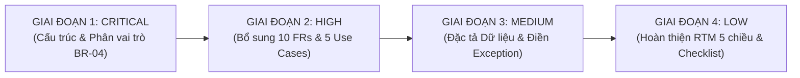

# KẾ HOẠCH HÀNH ĐỘNG VÀ CHECKLIST CẢI TIẾN TÀI LIỆU SRS (SRS IMPROVEMENT CHECKLIST)
## HƯỚNG DẪN NÂNG CẤP TÀI LIỆU SRS TỪ VERSION 1.1 LÊN VERSION 1.2
**Dự án:** GraphMind — Capstone Project 1 — C1SE.18  
**Tài liệu gốc cần chỉnh sửa:** `docs/05-srs/5. C1SE18_SRS_GraphMind_Ver1.1.docx`  
**Tài liệu đích cần ban hành:** `docs/05-srs/C1SE18_SRS_GraphMind_Ver1.2.docx`

---

## MỤC LỤC
1. [Lộ trình Triển khai Cải tiến theo 4 Giai đoạn](#1-lộ-trình-triển-khai-cải-tiến-theo-4-giai-đoạn)
2. [Chi tiết Đầu việc Giai đoạn 1: Khắc phục Lỗi Cốt lõi (CRITICAL)](#2-chi-tiết-đầu-việc-giai-đoạn-1-khắc-phục-lỗi-cốt-lõi-critical)
3. [Chi tiết Đầu việc Giai đoạn 2: Nâng cấp Yêu cầu & Use Cases (HIGH)](#3-chi-tiết-đầu-việc-giai-đoạn-2-nâng-cấp-yêu-cầu--use-cases-high)
4. [Chi tiết Đầu việc Giai đoạn 3: Bổ sung Đặc tả Dữ liệu & Giao diện (MEDIUM)](#4-chi-tiết-đầu-việc-giai-đoạn-3-bổ-sung-đặc-tả-dữ-liệu--giao-diện-medium)
5. [Chi tiết Đầu việc Giai đoạn 4: Hoàn thiện Phụ lục & Truy vết (LOW)](#5-chi-tiết-đầu-việc-giai-đoạn-4-hoàn-thiện-phụ-lục--truy-vết-low)
6. [Checklist Nghiệm thu Toàn diện Trước khi Xuất bản Ver 1.2](#6-checklist-nghiệm-thu-toàn-diện-trước-khi-xuất-bản-ver-12)

---

## 1. LỘ TRÌNH TRIỂN KHAI CẢI TIẾN THEO 4 GIAI ĐOẠN

---

## 2. CHI TIẾT ĐẦU VIỆC GIAI ĐOẠN 1: KHẮC PHỤC LỖI CỐT LÕI (CRITICAL)

### Mục tiêu: Sửa lỗi cấu trúc văn bản, phân tách vai trò theo BR-04 và sửa các thông số kỹ thuật sai lệch lớn.

- [ ] **Task 1.1: Hợp nhất tiêu đề Chương 2 và Chương 3**
  - *Vị trí:* Đoạn P74 (`2. Overall Description`) và đoạn P91 (`3. Overall Description`).
  - *Hành động:* Hợp nhất nội dung thành một chương duy nhất mang tên **"2. Overall Description"** theo cấu trúc ISO/IEC/IEEE 29148.
  - *Sửa tiêu đề con:* Đổi `3.2 System Context Diagram` (P98) thành `2.2 System Context Diagram`; đổi `3.2 Product Functions` (P108) thành `2.3 Product Functions`.
- [ ] **Task 1.2: Phân lập vai trò Quản trị (Business Rule BR-04)**
  - *Vị trí:* Bảng 6 (User Characteristics), Bảng 7 (FR5, FR10, FR11, FR24), Bảng 9–31 (Use Cases).
  - *Hành động:* Tách vai trò gộp cũ thành:
    1. **`System & IT Administrator` (`it_admin`):** Quản trị hạ tầng, tài khoản, ma trận phân quyền, phiên đăng nhập, Audit Log, máy trạm AEGIS.
    2. **`Knowledge Administrator` (`knowledge_manager`):** Duyệt/Từ chối tài liệu số, biên tập đồ thị tri thức Neo4j, quản trị kho văn bản SOP.
  - *Bổ sung:* Thêm vai trò **`Department Manager` (`manager`)** vào Bảng 6.
- [ ] **Task 1.3: Cập nhật Bảng Quy tắc Nghiệp vụ (Bảng 32)**
  - *Vị trí:* Mục 6.1 — Bảng 32 (Business Rules).
  - *Hành động:* Cập nhật chuẩn hóa bộ 6 quy tắc nghiệp vụ theo Proposal Ver 1.2:
    - `BR-01`: Controlled Synthetic Linking (1–3 hợp đồng / khách hàng).
    - `BR-02`: Department Data Scope (giới hạn phòng ban).
    - `BR-03`: Audit Log Immutability (nhật ký kiểm toán chỉ đọc).
    - `BR-04`: Role Separation (phân lập tuyệt đối giữa IT Admin và Knowledge Admin).
    - `BR-05`: Executive Strategic Full Access (quyền tra cứu toàn diện của lãnh đạo).
    - `BR-06`: SHA-256 Idempotency Guard (kiểm soát tệp trùng lặp bằng mã băm SHA-256).
- [ ] **Task 1.4: Đính chính các số liệu kỹ thuật lỗi thời**
  - *FR37:* Sửa từ `2,000–3,000 Q&A pairs` thành **`509 ChatML pairs`** (tỷ lệ train/val 80/20 trên Kaggle GPU T4).
  - *FR34 & P141:* Sửa từ `React/Next.js` thành **`React 18 + Vite (SPA) và Tailwind CSS`**.
  - *FR47 & FR28:* Sửa từ `100–200 questions` thành **`100 ground-truth questions`** (30 đơn, 30 hai bước, 40 đa bước đa nguồn).
  - *FR44 & UC.21:* Bỏ xuất file `PDF/Word` (Out-of-Scope per Proposal Ver 1.2 §4.2); ghi rõ **hiển thị tóm tắt trực quan trên Web Dashboard**.
  - *FR42 & UC.20:* Bổ sung đủ 4 cảnh báo: Hạn hợp đồng 15–30 ngày, VIP sụt giảm, **Đơn hàng âm lợi nhuận (`TotalDue < StandardCost`)**, **Chiết khấu bất thường (`Discount >= 35%`)**.

---

## 3. CHI TIẾT ĐẦU VIỆC GIAI ĐOẠN 2: NÂNG CẤP YÊU CẦU & USE CASES (HIGH)

### Mục tiêu: Bổ sung 10 yêu cầu chức năng mới (FR53–FR62), 5 Use Cases mới và định lượng hóa NFRs.

- [ ] **Task 2.1: Chèn 10 Functional Requirements mới vào Bảng 7**
  - [ ] **FR53:** Staff Document Upload in Pending State (US60, PB67, WBS 7b).
  - [ ] **FR54:** Document Approval Oversight & Ingestion Trigger (US61, PB68, WBS 15c).
  - [ ] **FR55:** Shift Handover Report Submission (US62, PB69, WBS 15d).
  - [ ] **FR56:** Departmental Shift Report Review & Sign-off (US63, PB70, WBS 15d).
  - [ ] **FR57:** AI Daily Shift Handover Consolidation (US64, PB71, WBS 19b).
  - [ ] **FR58:** Granular Dynamic RBAC Matrix Management (US65, PB72, WBS 10).
  - [ ] **FR59:** Single Active Session Enforcement (US66, PB73, WBS 2).
  - [ ] **FR60:** Self-Service Password Recovery via Email OTP 3-Step (US67, PB74, WBS 11b).
  - [ ] **FR61:** Read-Only Cypher Guard & Mutation Interceptor (US68, PB75, WBS 13b).
  - [ ] **FR62:** AEGIS Workstation Remote Control & Emergency Kill Switch (US69, PB76, WBS 18).
- [ ] **Task 2.2: Bổ sung 5 Use Cases mới vào Danh mục (Bảng 9) và Đặc tả Chi tiết**
  - [ ] **UC.23:** Upload tài liệu và Phê duyệt tài liệu số (Standard User nộp PENDING, Knowledge Admin duyệt APPROVED).
  - [ ] **UC.24:** Lập và Ký duyệt báo cáo bàn giao ca (Standard User lập biểu mẫu/lưu nháp, Trưởng phòng ký REVIEWED).
  - [ ] **UC.25:** AI tự động tổng hợp báo cáo giao ca ngày (Ollama consolidation, fallback khi timeout).
  - [ ] **UC.26:** Cấu hình ma trận phân quyền động 2 chiều (Lưới 2D CRUD trên từng Entity, cập nhật bảng `rbac_permissions_matrix`).
  - [ ] **UC.27:** Điều khiển trạm làm việc & Kích hoạt Emergency Kill Switch (Giám sát nhịp tim, ngắt kết nối trong $\le 3\text{s}$, 2-phase ACK).
- [ ] **Task 2.3: Định lượng hóa Bảng Yêu cầu Phi chức năng (Bảng 8)**
  - [ ] Bổ sung SLA thời gian tải trang Web Dashboard: $\le 2.0\text{ giây}$.
  - [ ] Bổ sung ngưỡng tải kiểm thử Locust 150 VU: Điểm cuối đọc nhẹ $p95 < 500\text{ ms}$; Điểm cuối tổng hợp nặng $p95 < 2,000\text{ ms}$.
  - [ ] Bổ sung thời gian suy luận Ollama GGUF Q4_K_M: $\le 3.5\text{ giây/câu hỏi}$; tóm tắt briefing $\le 5.0\text{ giây}$.
  - [ ] Bổ sung tiêu chuẩn thu hồi phiên đồng thời ($< 500\text{ ms}$) và hiệu lực OTP (300 giây, khóa sau 3 lần sai).
  - [ ] Bổ sung thời gian chuyển mạch dự phòng (Fallback) khi Ollama offline/timeout: $< 1.0\text{ giây}$.

---

## 4. CHI TIẾT ĐẦU VIỆC GIAI ĐOẠN 3: BỔ SUNG ĐẶC TẢ DỮ LIỆU & GIAO DIỆN (MEDIUM)

### Mục tiêu: Bổ sung mục Data Requirements, mở rộng Interface Requirements và điền luồng ngoại lệ.

- [ ] **Task 3.1: Bổ sung Mục "3.4 Data Requirements" vào Tài liệu**
  - [ ] Đặc tả lược đồ 8 bảng cơ sở dữ liệu PostgreSQL: `users`, `user_active_sessions`, `otps`, `rbac_permissions_matrix`, `sop_documents`, `document_approvals`, `shift_reports`, `audit_logs` (tên trường, kiểu dữ liệu, khóa chính, ràng buộc).
  - [ ] Đặc tả Ontology đồ thị tri thức Neo4j: Các nhãn nút (`:Customer`, `:SalesOrder`, `:Product`, `:Contract`, `:Clause`, `:SOP`) và quan hệ (`:PLACED`, `:CONTAINS`, `:BOUND_BY`, `:HAS_CLAUSE`, `:GOVERNED_BY`).
  - [ ] Đặc tả Collection vector Qdrant: Tên collection, kích thước chiều vector (384/1024-dim), hàm khoảng cách Cosine, lược đồ trường metadata.
- [ ] **Task 3.2: Mở rộng Mục "3.1 External Interface Requirements"**
  - [ ] Bổ sung danh mục API RESTful FastAPI: Phương thức HTTP, URI, tham số đầu vào, cấu trúc JSON đầu ra mẫu, mã trạng thái HTTP (200, 201, 400, 401, 403, 404, 422, 500).
  - [ ] Bổ sung giao thức HTTPS/TLS 1.3 và cơ chế gửi nhịp tim/lệnh Kill Switch qua 2-phase ACK giữa trạm làm việc AEGIS và máy chủ Cloud.
- [ ] **Task 3.3: Hoàn thiện Luồng Ngoại lệ (Exception Flows) cho toàn bộ Use Cases**
  - [ ] Điền cụ thể kịch bản ngoại lệ cho Bảng 10 đến Bảng 31: Xử lý khi sai mật khẩu, khi phiên bị hủy do đăng nhập nơi khác, khi tệp tải lên trùng SHA-256, khi câu Cypher bị Guard chặn, khi dịch vụ Ollama timeout.

---

## 5. CHI TIẾT ĐẦU VIỆC GIAI ĐOẠN 4: HOÀN THIỆN PHỤ LỤC & TRUY VẾT (LOW)

### Mục tiêu: Cập nhật Bảng thuật ngữ, thay thế Bảng RTM 5 chiều và rà soát biên tập.

- [ ] **Task 4.1: Cập nhật Bảng Phụ lục A (Glossary)**
  - [ ] Cập nhật định nghĩa US: `User Story (US01–US69) of the User Story Document (Version 1.2)`.
  - [ ] Bổ sung thuật ngữ: *Controlled Synthetic Linking, Single Active Session, Read-Only Cypher Guard, Deterministic Fallback, 2-Phase ACK, ChatML*.
- [ ] **Task 4.2: Thay thế Bảng Phụ lục B (Requirement Traceability Matrix - Bảng 34)**
  - [ ] Thay thế bảng 18 dòng cũ bằng Bảng Ma trận Truy vết 5 chiều đầy đủ 56 mục logic (từ tệp `GraphMind-SRS-Traceability-Matrix.md`), liên kết Proposal $\to$ US $\to$ PB $\to$ SRS $\to$ WBS.
- [ ] **Task 4.3: Rà soát Định dạng & Lịch sử Sửa đổi**
  - [ ] Bảng 1, Bảng 2: Cập nhật số hiệu `Version: 1.2`, ngày `November 2026`.
  - [ ] Bảng 3: Bổ sung dòng lịch sử thay đổi phiên bản 1.2.
  - [ ] Kiểm tra font chữ (Times New Roman 13pt/11pt chuẩn học thuật), canh lề, ngắt trang sau mỗi chương.

---

## 6. CHECKLIST NGHIỆM THU TOÀN DIỆN TRƯỚC KHI XUẤT BẢN VER 1.2

Nhóm sinh viên cần đánh dấu tích kiểm tra tuần tự 15 tiêu chí bắt buộc trước khi lưu và nộp tệp Word chính thức:

- [ ] **1. Số hiệu & Ngày tháng:** Trang bìa và bảng metadata ghi rõ `Version: 1.2`, ngày tháng hiện tại.
- [ ] **2. Cấu trúc chương liền mạch:** Không còn 2 chương mang tên "Overall Description"; không còn 2 mục con cùng mang số `3.2`.
- [ ] **3. Phân vai trò BR-04:** Bảng 6, Bảng 7 và các Use Cases đã tách hoàn toàn `System & IT Administrator` và `Knowledge Administrator`.
- [ ] **4. Số lượng Yêu cầu Chức năng:** Bảng 7 có đủ **62 yêu cầu chức năng (FR1 ➔ FR62)**, trong đó FR53–FR62 bao phủ trọn vẹn 10 User Stories mới.
- [ ] **5. Chuẩn xác số liệu Q&A:** FR37 ghi chính xác **`509 ChatML pairs`** (tỷ lệ 80/20 train/val trên Kaggle GPU T4).
- [ ] **6. Chuẩn xác công nghệ Frontend:** FR34 ghi chính xác **`React 18 + Vite (SPA) và Tailwind CSS`**.
- [ ] **7. Chuẩn xác số lượng Benchmark:** FR47 ghi chính xác **`100 câu hỏi Ground Truth`**.
- [ ] **8. Đầy đủ 4 cảnh báo rủi ro:** FR42 có đủ 4 tiêu chí: Hạn hợp đồng, VIP sụt giảm, Đơn hàng âm lợi nhuận, Chiết khấu bất thường $\ge 35\%$.
- [ ] **9. Khóa phạm vi xuất file:** FR44 đã bỏ xuất file PDF/Word, ghi rõ hiển thị tóm tắt trực quan trên Web Dashboard.
- [ ] **10. Định lượng hóa NFRs:** Bảng 8 có đầy đủ chỉ số thời gian tải trang ($\le 2.0\text{s}$), SLA kiểm thử tải Locust 150 VU ($p95 < 500\text{ms}$ / $< 2000\text{ms}$), độ trễ Ollama ($\le 3.5\text{s}$).
- [ ] **11. Bộ 6 Quy tắc Nghiệp vụ:** Bảng 32 có đầy đủ 6 quy tắc từ BR-01 đến BR-06.
- [ ] **12. Danh mục Use Cases:** Bảng 9 có đủ **27 Use Cases (UC.01 ➔ UC.27)**.
- [ ] **13. Luồng ngoại lệ Use Case:** 100% Use Cases có nội dung Exception Flows chi tiết, không còn ô trống.
- [ ] **14. Đặc tả Dữ liệu & API:** Bổ sung đầy đủ Mục 3.4 Data Requirements (8 bảng Postgres, Graph Ontology, Vector Collection) và Mục 3.1 API Specs.
- [ ] **15. Ma trận RTM 5 chiều:** Bảng RTM tại Phụ lục B liên kết đầy đủ 5 nguồn và xác định trạng thái kiểm thử cho từng yêu cầu.
