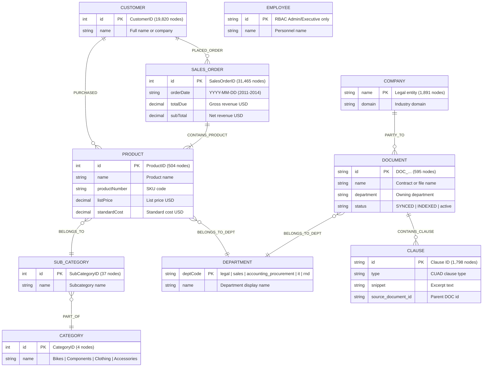
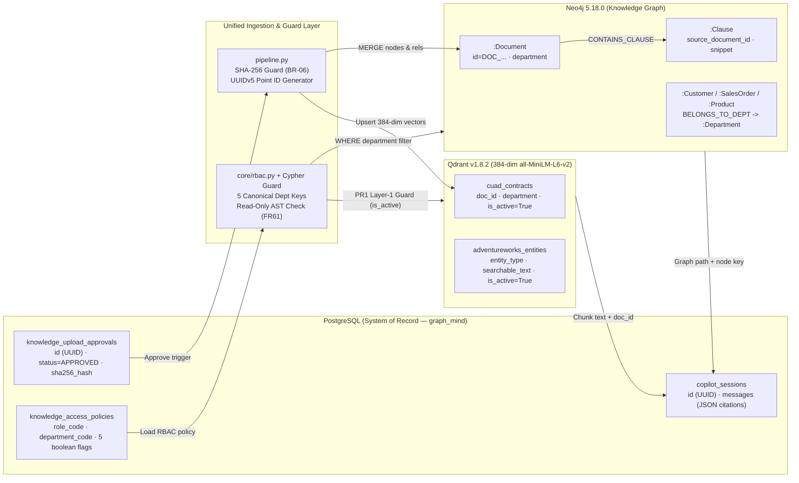

# GraphMind — Entity-Relationship & Multi-Model Schema Diagrams (Ver 1.1)

Tài liệu chứa mã nguồn Mermaid đã kiểm chứng và ảnh PNG tương ứng cho 3 sơ đồ kiến trúc dữ liệu trong `C1SE18_DatabaseDesign_GraphMind_Ver1.1.docx`:
1. **Figure 6.1** — PostgreSQL Physical ERD (13 bảng Implemented MVP).
2. **Figure 6.2** — Neo4j Knowledge Graph Ontology Schema (10 nhãn thực tế).
3. **Figure 4.1** — Cross-Model Key Mapping & Data Lineage (PostgreSQL ↔ Neo4j ↔ Qdrant).

---

## Figure 6.1 — Overall PostgreSQL Physical ERD (13 Implemented MVP Tables)

```mermaid
erDiagram
    USERS ||--o| USER_ACTIVE_SESSIONS : "holds single JTI (CASCADE)"
    USERS ||--o{ COPILOT_SESSIONS : "owns (CASCADE)"
    USERS ||--o{ SOP_DOCUMENTS : "authors (SET NULL)"
    USERS ||--o{ SHIFT_REPORTS : "submits (SET NULL)"
    USERS ||--o{ KNOWLEDGE_UPLOAD_APPROVALS : "uploads (SET NULL)"
    USERS ||--o{ KNOWLEDGE_ACCESS_POLICIES : "updates (SET NULL)"
    USERS ||--o{ AUDIT_LOGS : "performs (SET NULL)"
    USERS ||--o{ PASSWORD_RESET_OTPS : "requests via email"
    PB56_WORKSTATIONS ||--o{ PB56_WORKSTATION_SYNC_LOGS : "logs sync (CASCADE)"
    PB56_WORKSTATIONS ||--o{ PB56_SYNC_MODE_AUDIT_LOGS : "audits mode (CASCADE)"

    USERS {
        string user_id PK "UUID primary key"
        string email UK "unique login email"
        string username UK "optional login username"
        string password_hash "bcrypt cost 12"
        string full_name "display name"
        string role "it_admin | knowledge_manager | executive | department_manager | standard_user"
        string department_id "canonical department UUID"
        string status "active | locked | disabled"
        boolean is_active "synced with status"
        boolean is_superuser "superuser flag"
        datetime last_login_at "most recent login"
        datetime deleted_at "nullable soft-delete"
    }

    USER_ACTIVE_SESSIONS {
        string user_id PK,FK "1:1 with USERS"
        string active_session_token_id "current valid JWT jti"
        string ip_address "client IP"
        string user_agent "browser or device"
        datetime logged_in_at "session start"
    }

    PASSWORD_RESET_OTPS {
        string id PK "UUID"
        string email "recipient email"
        string otp_hash "hashed 6-digit OTP"
        datetime expires_at "valid 300s"
        int attempt_count "max 3 attempts"
        boolean is_used "one-time flag"
    }

    KNOWLEDGE_ACCESS_POLICIES {
        string id PK "UUID"
        string role_code UK "BR-04 role"
        string department_code UK "5 canonical depts or ALL"
        string resource_type UK "knowledge domain"
        boolean can_query "Copilot and Graph read"
        boolean can_view_citation "source citation access"
        boolean can_edit "edit and publish"
        boolean can_upload "upload to approval queue"
        boolean can_view_sensitive "confidential clauses"
        string data_scope "ALL_DEPARTMENTS | OWN_DEPARTMENT | NONE"
        string updated_by FK "nullable IT Admin"
    }

    KNOWLEDGE_PERMISSIONS {
        string id PK "UUID legacy table"
        string domain UK "knowledge domain"
        string role UK "role code"
        boolean allowed "allow flag"
    }

    AUDIT_LOGS {
        string audit_id PK "UUID immutable BR-03"
        string actor_id FK "nullable user_id"
        string action "event action code"
        string resource_type "affected entity type"
        string resource_id "affected entity id"
        string status "OK | DENIED | ERROR"
        string detail "masked description"
        datetime created_at "UTC event time"
    }

    KNOWLEDGE_UPLOAD_APPROVALS {
        string id PK "UUID"
        string file_name "original filename"
        string file_type "PDF | CSV | DOCX | XLSX | TXT"
        int file_size "bytes"
        string file_path "staging path"
        string sha256_hash "BR-06 dedup checksum"
        string department_code "owning department"
        string uploaded_by_id FK "nullable uploader"
        string status "PENDING | APPROVED | REJECTED"
        string reviewed_by "Knowledge Admin"
        string review_note "approval or rejection reason"
    }

    COPILOT_SESSIONS {
        string id PK "UUID"
        string user_id FK "session owner"
        string title "session title"
        string messages "JSON turn and citation array"
        boolean is_pinned "pinned reference flag"
        boolean is_shared "shared to department"
        string department "target department"
        datetime updated_at "last activity"
    }

    SOP_DOCUMENTS {
        string id PK "UUID"
        string code UK "unique SOP code"
        string title "SOP title"
        string department "owning department"
        string version "version label"
        string status "draft | published | archived"
        string steps "JSON procedure steps"
        string author_id FK "nullable author"
        datetime published_at "publication time"
    }

    SHIFT_REPORTS {
        string id PK "UUID"
        string author_id FK "nullable staff author"
        string department "canonical department key"
        string summary "shift execution summary"
        string cases "JSON handled cases"
        string proposals "handover notes"
        string status "DRAFT | SUBMITTED | APPROVED | REJECTED"
        string content_hash "SHA-256 integrity hash"
        string signed_by "Department Manager"
        datetime signed_at "sign-off time"
    }

    PB56_WORKSTATIONS {
        string id PK "VARCHAR64 agent id"
        string hostname "workstation name"
        string ip_address "internal IP"
        string monitored_folder "watched directory"
        string sync_mode "realtime | scheduled"
        string sync_mode_status "applied | pending | pending_offline"
        int heartbeat_interval_sec "default 30s"
        datetime last_heartbeat_at "last ping"
        int files_ingested_total "cumulative files"
    }

    PB56_WORKSTATION_SYNC_LOGS {
        string id PK "UUID"
        string workstation_id FK "agent id"
        string report_id UK "idempotency UUID"
        string sync_mode_used "realtime | scheduled"
        int files_ingested "run files count"
        string status "SUCCESS | FAILED"
        datetime created_at "log time"
    }

    PB56_SYNC_MODE_AUDIT_LOGS {
        string id PK "UUID"
        string workstation_id FK "agent id"
        string action "REQUESTED | APPLIED | CANCELLED | REJECTED"
        string old_sync_mode "previous mode"
        string new_sync_mode "target mode"
        string changed_by "IT Admin"
        datetime created_at "audit time"
    }
```

---

## Figure 6.2 — Neo4j Knowledge Graph Ontology Schema (Actual Implemented Graph)

---

## Figure 4.1 — Cross-Model Key Mapping & Data Lineage (PostgreSQL ↔ Neo4j ↔ Qdrant)

