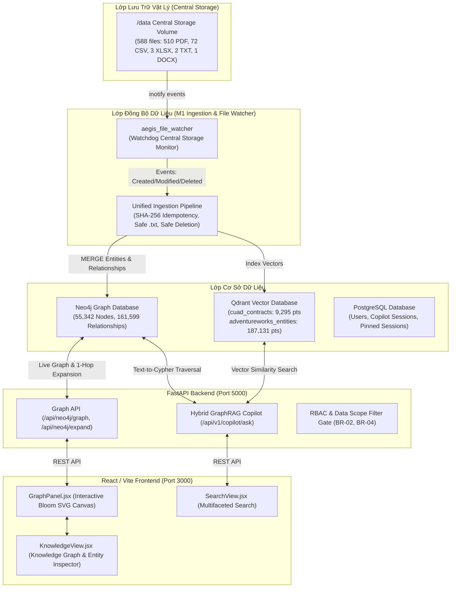

# GraphMind / AEGIS — Kiến trúc Knowledge Graph, Quy chuẩn Provenance, Báo cáo Kiểm toán & Hướng dẫn Migration G1

Tài liệu đặc tả toàn diện hệ thống Knowledge Graph (Neo4j), Vector Database (Qdrant), Central Storage File Watcher và Hybrid GraphRAG Copilot.

---

## 1. Kiến trúc Hệ thống Thực tế (System Architecture)



---

## 2. Thống kê & Hiện trạng Dữ liệu (Audit Inventory)

### 2.1. Neo4j Graph Database (55,342 Nodes, 161,599 Relationships)

| Label Node | Số lượng | Ghi chú nghiệp vụ | Domain quy chuẩn |
| :--- | :--- | :--- | :--- |
| `SalesOrder` | 31,465 | Đơn hàng AdventureWorks ERP | `adventureworks` |
| `Customer` | 19,820 | Khách hàng AdventureWorks ERP | `adventureworks` |
| `Clause` | 1,702 | Điều khoản hợp đồng pháp lý trích xuất từ CUAD PDF | `legal` |
| `Company` | 1,216 | 1,207 công ty có quan hệ PARTY_TO + 9 isolated (degree=0) | `legal` (hoặc `unverified`) |
| `Document` | 586 | 510 CUAD PDF + 71 CSV canonical + 5 văn bản khác | `legal` / `adventureworks` / `unknown` |
| `Product` | 507 | 504 sản phẩm canonical trong `Production_Product.csv` + 3 demo | `adventureworks` (504) / `demo` (3) |
| `SubCategory`| 37 | Nhóm sản phẩm AdventureWorks | `adventureworks` |
| `Category` | 4 | Ngành hàng AdventureWorks | `adventureworks` |
| **Tổng số Nodes** | **55,342** | **Bảo toàn 100% trong toàn bộ quá trình kiểm toán** | |

### 2.2. Giải trình Chênh lệch 12 Nodes (Mathematical Reconcile)

Trước đây xuất hiện sự chênh lệch chưa giải thích giữa số lượng 55,342 Nodes tổng và 55,330 Nodes tiêu chuẩn:
$$\Delta = 55,342 - 55,330 = 12 \text{ Nodes}$$

Kiểm toán thực tế đã định danh chính xác 12 Nodes này:
1. **3 Nodes Product Demo** (ID: 101, 102, 103) có tên:
   - `Mountain-100 Silver` (ID: 101)
   - `Road-150 Red` (ID: 102)
   - `Sport-100 Helmet Red` (ID: 103)
   *(Các product này không nằm trong file canonical `Production_Product.csv` gồm 504 sản phẩm, mà được sinh ra trong các kịch bản demo mẫu).*
2. **9 Nodes Company Đơn độc (Isolated Companies - degree = 0)**:
   - Các node `Company` tồn tại trong database nhưng không có bất kỳ quan hệ `PARTY_TO` nào nối tới `Document`:
   - `Crescent Point Energy U.S. Corp.`
   - `EBIX INC`
   - `First Real Estate Investment Trust of New Jersey`
   - `LIGHTING SCIENCE GROUP CORP`
   - `MAXYGEN INC`
   - `NATURAL HEALTH TRENDS CORP`
   - `NEW FRONTIER MEDIA INC`
   - `PFSWEB INC`
   - `ZAPATA COMPUTING HOLDINGS INC`

Quy tắc bảo vệ dữ liệu: **Không tự ý xóa 12 node này**. Chúng được gắn tag `domain: 'demo'` (cho 3 product) và `domain: 'legal'`, `provenance: 'isolated_entity'` (cho 9 company).

### 2.3. Qdrant Vector Database (196,426 Points Tổng)

- `cuad_contracts`: **9,295** points (Vector dimension: 384, Distance: Cosine).
- `adventureworks_entities`: **187,131** points (121,317 SalesOrderDetail, 31,465 SalesOrder, 19,820 Customer, 8,845 PurchaseOrderDetail, 4,012 PurchaseOrder, 701 Store, 504 Product, 290 Employee, 104 Vendor, 17 SalesPerson).
- Bảo toàn: **100% vector points được bảo vệ nguyên vẹn**.

### 2.4. Central Storage Physical Files (/data: 588 files)

- 510 tệp `.pdf` (CUAD Legal Contracts trong `/data/legal/`)
- 72 tệp `.csv` (AdventureWorks ERP Tables trong `/data/sales/`, `/data/accounting_procurement/`)
- 3 tệp `.xlsx` (`CaseSolver.xlsx`, `Case8_Solver.xlsx`, `8437_Huynhngocminh.xlsx`)
- 2 tệp `.txt` (`MSA_TechVanguard_Consulting_2026.txt` trong `/data/legal/`, `IT_System_Architecture_Overview.txt` trong `/data/it/`)
- 1 tệp `.docx` (`C1SE18_ALGORITHM_GraphMind.docx` trong `/data/rnd/`)
- **Tình trạng 2 tệp `.txt`**: Đã ở trên đĩa Central Storage. Pipeline đã được nâng cấp hỗ trợ đuôi `.txt` an toàn (UTF-8, Latin-1 fallback, empty check). Hai tệp được giữ nguyên trạng thái PENDING chờ batch ingestion chính thức.

---

## 3. Quy chuẩn Provenance & Metadata Schema

### 3.1. Node Provenance Attributes

| Thuộc tính | Kiểu dữ liệu | Ý nghĩa | Phạm vi áp dụng |
| :--- | :--- | :--- | :--- |
| `domain` | `string` | Miền tri thức (`legal`, `adventureworks`, `demo`, `unknown`) | Toàn bộ Nodes |
| `source_file` | `string` | Tên tệp vật lý nguồn trên Central Storage (VD: `Affiliate_Agreement.pdf`) | Document, Clause, Company |
| `source_table` | `string` | Tên bảng CSV canonical (VD: `Production_Product.csv`) | AdventureWorks Nodes |
| `source_document_id` | `string` | Document ID định danh ổn định (VD: `DOC_4A6BD454`) | Clause, Document |
| `evidence_text` | `string` | Đoạn trích dẫn nguyên văn thực tế từ tài liệu nguồn | Clause |
| `provenance_status` | `string` | `verified_canonical` \| `unverified_historical_regex` \| `isolated_entity` \| `demo_sample` | Toàn bộ Nodes |
| `department` | `string` | Phòng ban sở hữu (`Legal`, `Sales`, `IT`, `R&D`, `Accounting_Procurement`) | Document |

**Quy tắc bất biến:**
- Tuyệt đối không tự bịa chuỗi `evidence_text` bằng cách ghép chuỗi tên công ty.
- Tuyệt đối không gán `confidence = 0.95` giả tạo.
- Không dùng `ELSE 'adventureworks'` để gán bừa domain.

### 3.2. Relationship Provenance & Quy tắc Không Liên kết Xuyên Miền

- **Mối quan hệ trực tiếp (Canonical FK)**:
  - `(Document)-[:CONTAINS_CLAUSE]->(Clause)`: Direct extraction từ CUAD PDF.
  - `(Company)-[:PARTY_TO]->(Document)`: Trích xuất tên pháp nhân trong hợp đồng.
  - `(Category)<-[:PART_OF]-(SubCategory)`: Foreign Key `ProductCategoryID` trong `Production_ProductSubcategory.csv`.
  - `(SubCategory)<-[:BELONGS_TO]-(Product)`: Foreign Key `ProductSubcategoryID` trong `Production_Product.csv`.
  - `(Customer)-[:PLACED_ORDER]->(SalesOrder)`: Foreign Key `CustomerID` trong `Sales_SalesOrderHeader.csv`.
  - `(SalesOrder)-[:CONTAINS_PRODUCT]->(Product)`: Foreign Key `ProductID` trong `Sales_SalesOrderDetail.csv`.
- **Mối quan hệ suy diễn (Derived Relationship)**:
  - `(Customer)-[:PURCHASED]->(Product)`: Suy diễn trực tiếp từ đường đi `Customer -> SalesOrder -> SalesOrderDetail -> Product`.
  - Được đánh dấu rõ: `provenance = 'derived_aggregation'`.
- **Quan hệ xuyên miền (Cross-domain relationships)**:
  - Kiểm toán xác minh: **Chính xác 0 quan hệ xuyên miền** giữa CUAD Legal và AdventureWorks ERP.

---

## 4. Đặc tả Vòng đời File Watcher & Ingestion Pipeline

### 4.1. Hỗ trợ Định dạng .txt An toàn
- Đọc nội dung với cơ chế đa tầng:
  1. Thử giải mã UTF-8.
  2. Bắt `UnicodeDecodeError` và fallback sang `latin-1` với `errors="ignore"`.
  3. Xử lý tệp rỗng: trả về chuỗi rỗng an toàn, không tạo node giả.
  4. Giới hạn dung lượng: kiểm soát không gây tràn bộ nhớ.

### 4.2. Vòng đời Xử lý Sự kiện

1. **CREATE**:
   - Debounce ổn định tệp ghi (File stabilization).
   - Tính SHA-256 nội dung.
   - Kiểm tra Idempotency: nếu SHA-256 đã tồn tại và đã index trên cả Neo4j và Qdrant -> Bỏ qua, tránh nhân đôi dữ liệu.
   - Trích xuất text, chia chunk sliding-window (500 chars).
   - Lưu vector vào Qdrant với deterministic point ID.
   - `MERGE (d:Document {hash: ...})` vào Neo4j kèm metadata provenance.
   - Phát sự kiện SSE cho frontend.

2. **MODIFY**:
   - Tính SHA-256 mới. Nếu hash không đổi -> Không xử lý.
   - Nếu hash thay đổi: Cập nhật Document node, cập nhật các Clause thuộc tài liệu, cập nhật vector trong Qdrant. Giữ nguyên các node dùng chung (Company) nếu còn tài liệu khác trỏ tới.

3. **DELETE**:
   - Xóa vector trong Qdrant theo `file_hash`.
   - Trong Neo4j: Xóa các node con độc quyền (`Clause`) thuộc `Document`.
   - **Bảo toàn Entity dùng chung**: Đối với `Company`, chỉ xóa khi không còn bất kỳ quan hệ nào nối tới tài liệu khác (`WHERE NOT (c)--()`), bảo toàn các công ty là đối tác trong nhiều hợp đồng.
   - Xóa node `Document`.

4. **RENAME**:
   - Nhận diện cặp sự kiện `deleted` và `created` cùng hash trong khoảng thời gian ngắn hoặc cập nhật `storagePath`/`name` của Document node mà không xóa bỏ graph liên kết.

---

## 5. Đặc tả Graph API

### 5.1. Endpoints

#### `GET /api/neo4j/graph` (Lấy đồ thị theo domain và bộ lọc)
- **Tham số**:
  - `limit: int = 100` (1 .. 1000)
  - `rel_limit: int = 200` (1 .. 2000)
  - `label: Optional[str]` (Ví dụ: `Product`, `Document`, `Customer`)
  - `domain: Optional[str]` (`all`, `legal`, `adventureworks`, `demo`)
  - `rel_type: Optional[str]` (Ví dụ: `CONTAINS_CLAUSE`, `PARTY_TO`, `BELONGS_TO`, `PLACED_ORDER`)
- **Phản hồi**:
  ```json
  {
    "success": true,
    "source": "neo4j",
    "domain": "legal",
    "data": {
      "nodes": [...],
      "relationships": [...],
      "metadata": {
        "total_nodes": 55342,
        "total_relationships": 161599,
        "returned_nodes": 20,
        "returned_relationships": 18
      }
    }
  }
  ```

#### `GET /api/neo4j/expand/{node_id:path}` (Mở rộng liên kết 1-hop)
- **Mục đích**: Nhấp vào một node trên canvas để tải các hàng xóm liên kết 1 bước mà không làm nghẽn canvas với đồ thị 55,000 node.
- **Tham số**: `limit: int = 25` (1 .. 100)
- **Phản hồi**:
  ```json
  {
    "success": true,
    "node_id": "4:82f42a9b-449e-4a6c-9407-772c695bb8f0:510",
    "count_nodes": 8,
    "count_relationships": 8,
    "data": {
      "nodes": [...],
      "relationships": [...]
    }
  }
  ```

---

## 6. Hướng dẫn Vận hành, Kiểm thử & Migration

### 6.1. Chạy Bộ Kiểm thử Toàn diện (Unit & Integration Tests)
```bash
python scripts/archive/migrations/test_knowledge_graph_full.py
```
*Kết quả: 7/7 Unit Tests PASSED, 7/7 Integration Tests PASSED, 0 database writes.*

### 6.2. Chạy Kiểm toán Read-Only (Full Audit)
```bash
python scripts/audit_knowledge_graph_full.py
```
*Xuất báo cáo chi tiết ra tệp `audit_report.json`.*

### 6.3. Chạy Thử nghiệm Migration G1 (DRY-RUN Mode Mặc định)
```bash
python scripts/migrate_knowledge_graph_g1.py
```
*Mặc định DRY-RUN 100%. In ra danh sách cập nhật dự kiến mà không ghi bất kỳ byte nào vào Neo4j.*

### 6.4. Kế hoạch Sao lưu (Backup) & Phục hồi (Rollback)

- **Bản sao lưu snapshot hiện tại**:
  `backups/neo4j_backup_pre_upgrade.json` (Dung lượng: 67.20 MB, 55,342 nodes, 161,599 relationships).
- **Lệnh tạo backup mới trước khi thực hiện bất kỳ migration nào**:
  ```bash
  python scripts/audit_knowledge_graph_full.py
  ```
- **Lệnh rollback khẩn cấp (chỉ khi có sự cố và được phê duyệt riêng)**:
  ```bash
  python scripts/rollback_neo4j.py
  ```

### 6.5. Điều kiện Tiên quyết trước khi APPLY Migration G1
1. Quản trị viên kiểm tra kỹ báo cáo `audit_report.json`.
2. Kiểm tra SHA-256 của tệp backup `neo4j_backup_pre_upgrade.json`.
3. Phê duyệt lệnh APPLY tường minh:
   ```bash
   python scripts/migrate_knowledge_graph_g1.py --apply --confirm-risk-data-loss
   ```
   *(Cờ kép bắt buộc ngăn ngừa hoàn toàn việc thực thi nhầm lẫn).*
