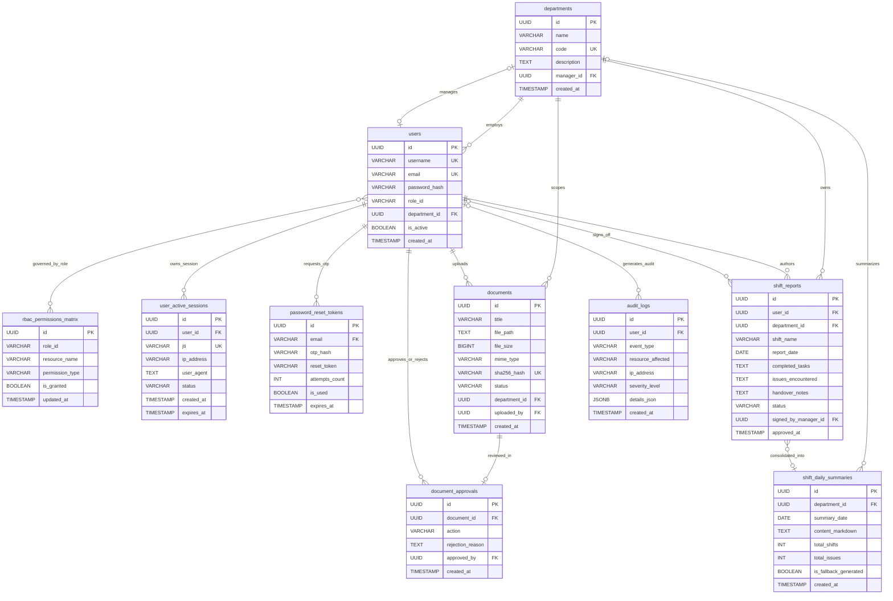

# GraphMind (EKAI v1.2) — Data Architecture Models (PostgreSQL ERD & Neo4j Graph Ontology)

## 1. PostgreSQL Relational Entity-Relationship Diagram (Figure 6.6)

## 2. Neo4j Knowledge Graph Property Ontology Schema (Figure 6.7)

- **Core Governance & Enterprise Nodes**: `:Department`, `:Employee`, `:Document`, `:SOP`, `:Entity`, `:RiskEvent`
- **CRM & Legal Contract Nodes (AdventureWorks + CUAD)**: `:Customer`, `:SalesOrder`, `:Product`, `:Contract`, `:Clause`
- **Core Relationships**:
  - `(:Employee)-[:BELONGS_TO]->(:Department)`
  - `(:Employee)-[:AUTHORED]->(:Document)`
  - `(:Document)-[:MENTIONS {confidence: float}]->(:Entity)`
  - `(:SOP)-[:GOVERNED_BY]->(:Department)`
  - `(:Customer)-[:PLACED]->(:SalesOrder)`
  - `(:SalesOrder)-[:CONTAINS {qty: int, unit_price: float}]->(:Product)`
  - `(:Customer)-[:BOUND_BY {synthetic_link: 'BR-01 (1..3)'}]->(:Contract)`
  - `(:Contract)-[:HAS_CLAUSE]->(:Clause)`
  - `(:RiskEvent)-[:TRIGGERED_BY_ORDER]->(:SalesOrder)`
  - `(:RiskEvent)-[:TRIGGERED_BY_CLAUSE]->(:Clause)`
