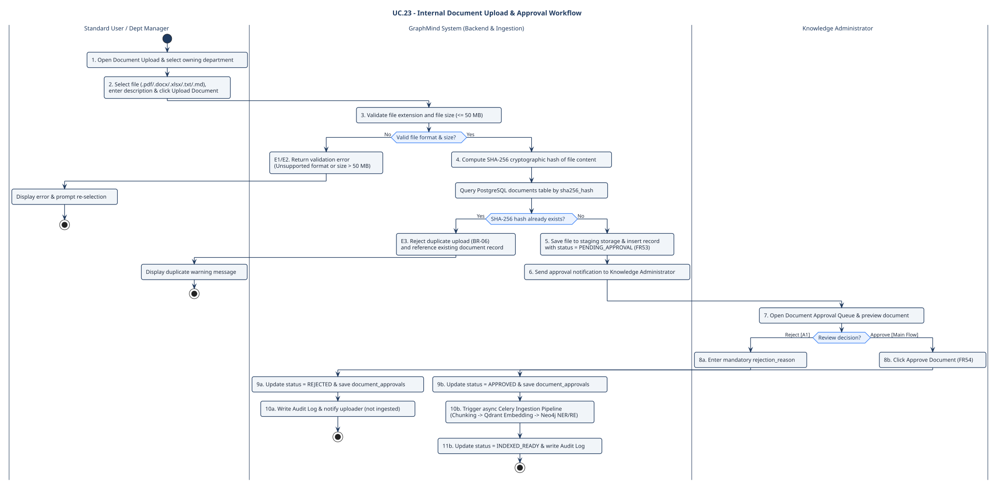
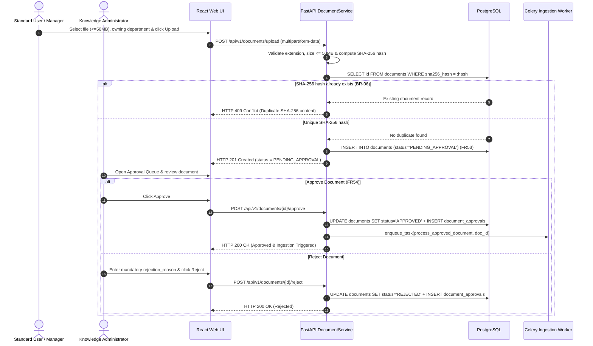
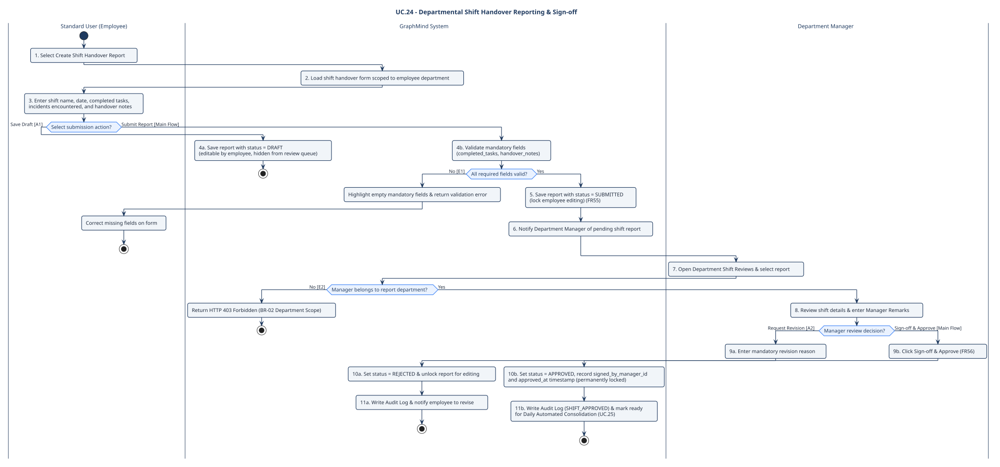
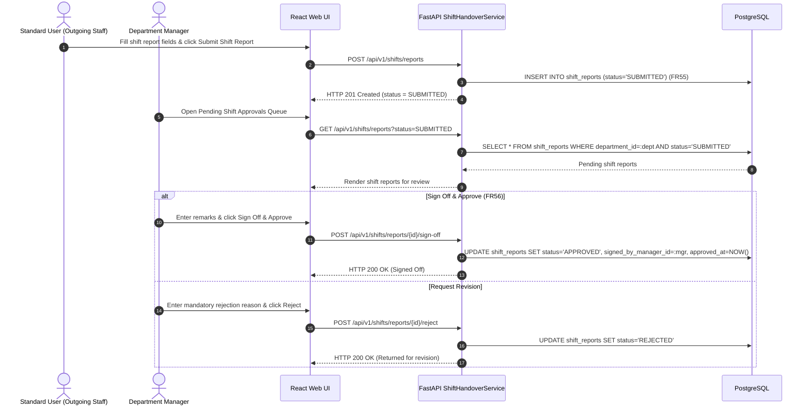
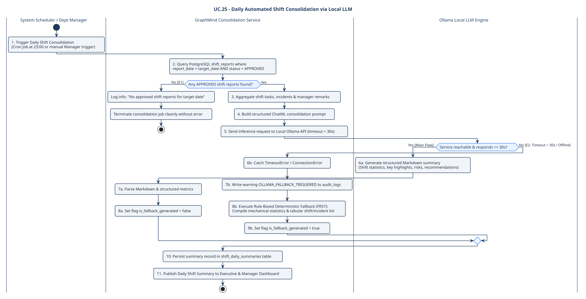
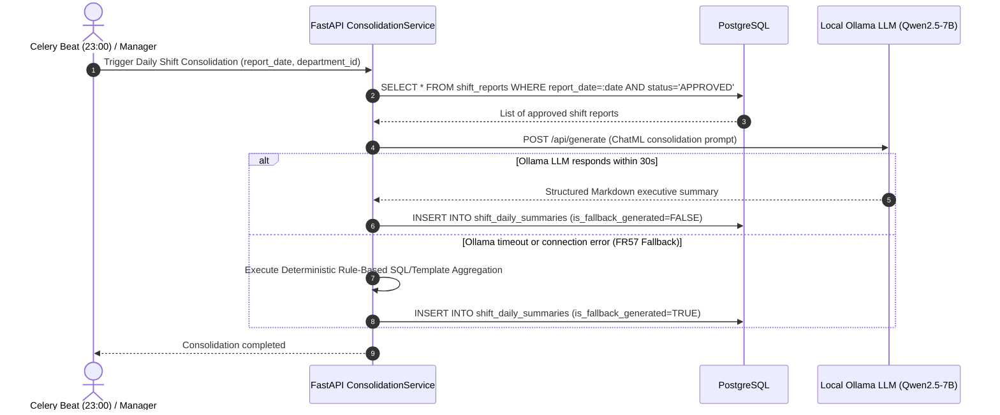
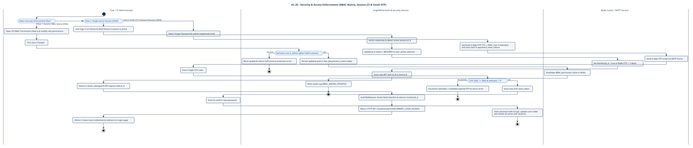
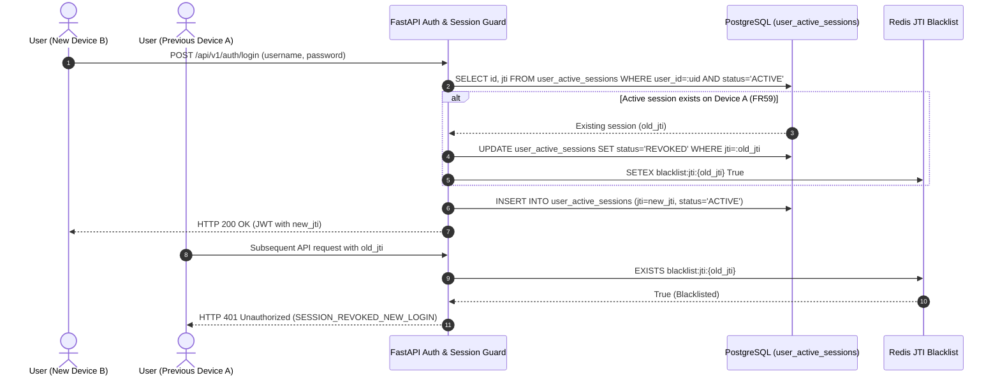
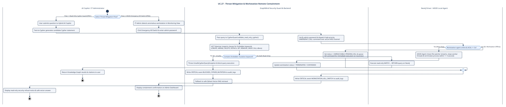

# GraphMind (EKAI v1.2) — Activity & Sequence Flows for UC.23 to UC.27 (Sections 6.3 & 6.4)

## 1. UC.23 — Internal Document Upload & Approval Workflow (FR53, FR54)

### Activity Swimlane Diagram (Figure 6.3.23)


### Sequence Diagram (Figure 6.4.23)


---

## 2. UC.24 — Departmental Shift Handover & Sign-Off (FR55, FR56)

### Activity Swimlane Diagram (Figure 6.3.24)


### Sequence Diagram (Figure 6.4.24)


---

## 3. UC.25 — Daily Automated Shift Consolidation (FR57)

### Activity Swimlane Diagram (Figure 6.3.25)


### Sequence Diagram (Figure 6.4.25)


---

## 4. UC.26 — Granular Security & Access Enforcement (FR58, FR59, FR60)

### Activity Swimlane Diagram (Figure 6.3.26)


### Sequence Diagram (Figure 6.4.26)


---

## 5. UC.27 — Proactive Threat Mitigation & Workstation Kill Switch (FR61, FR62)

### Activity Swimlane Diagram (Figure 6.3.27)


### Sequence Diagram (Figure 6.4.27)
```mermaid
sequenceDiagram
    autonumber
    actor U as Standard User / Manager
    actor A as System & IT Administrator
    participant COP as Hybrid AI Copilot Engine
    participant GUARD as Read-Only Cypher Guard (FR61)
    participant NEO as Neo4j Graph DB
    participantDB as PostgreSQL (audit_logs)
    participant WSS as FastAPI WebSocket Hub
    participant AEGIS as AEGIS Local Agent

    U->>COP: Submit natural language query
    COP->>GUARD: validateReadOnlyCypher(generated_cypher)
    alt Destructive Cypher keyword detected (CREATE/SET/DELETE/MERGE/DROP/REMOVE/CALL)
        GUARD->>participantDB: INSERT INTO audit_logs (severity='CRITICAL', event='CYPHER_MUTATION_BLOCKED')
        GUARD-->>U: HTTP 403 Forbidden (Destructive Cypher blocked)
    else Safe read-only MATCH/RETURN query
        GUARD->>NEO: Execute read-only Cypher query
        NEO-->>COP: Graph query results
        COP-->>U: Grounded response with citations
    end
    A->>WSS: POST /api/v1/workstations/{id}/kill-switch (FR62)
    WSS->>AEGIS: WSS Push {"command": "EMERGENCY_KILL"} (<= 3s SLA)
    AEGIS->>AEGIS: Abort sync threads & wipe local token cache
    AEGIS-->>WSS: ACK KILLED_AND_REVOKED
```
