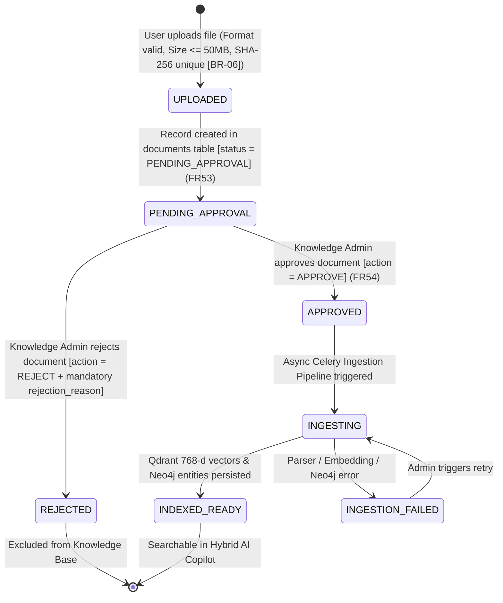
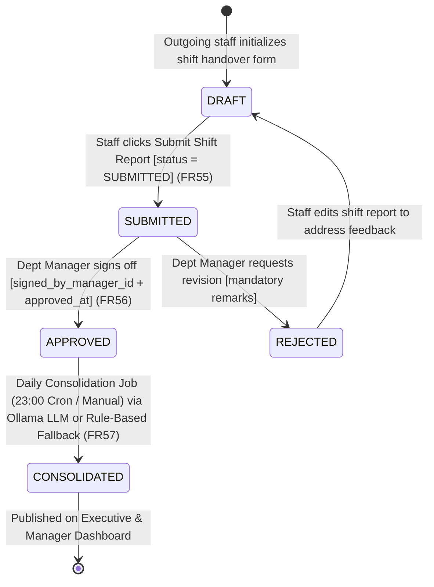

# GraphMind (EKAI v1.2) — State Machine Specifications (Section 6.7)

## 1. Figure 6.8 — Document Approval & Ingestion State Machine Diagram (FR53–FR54)

## 2. Figure 6.9 — Shift Handover & Daily Consolidation State Machine Diagram (FR55–FR57)

