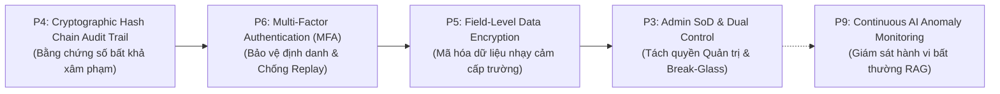
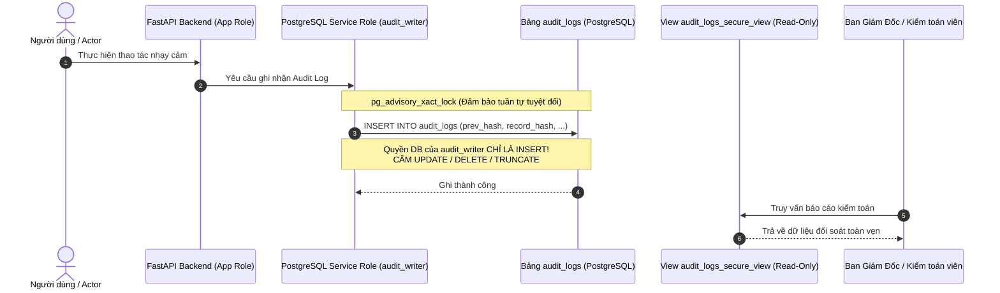
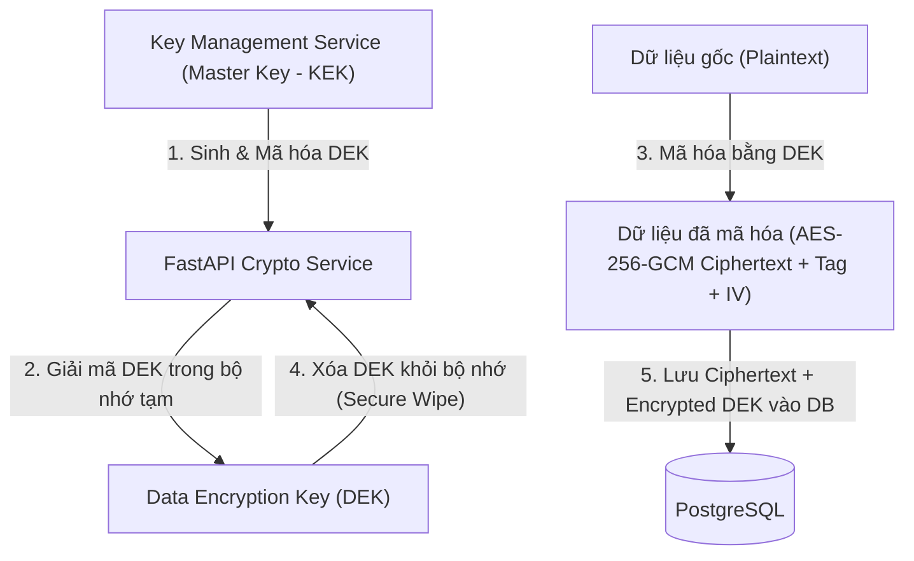
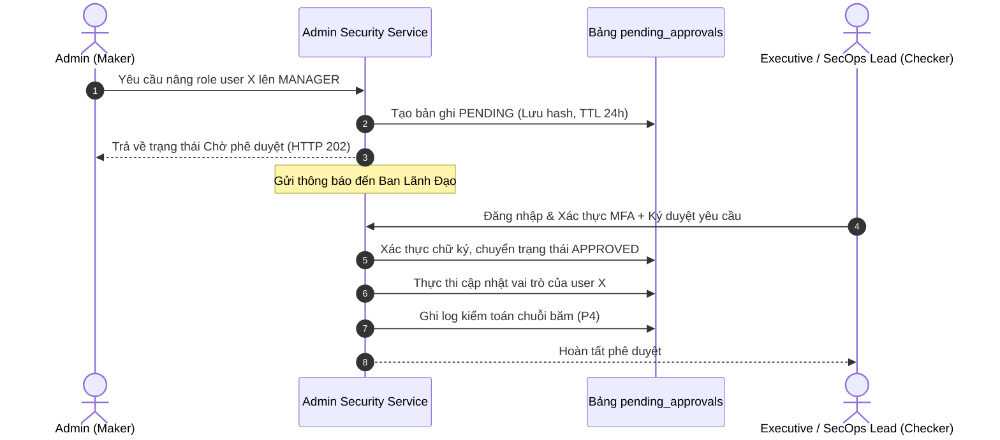

# TÀI LIỆU THIẾT KẾ KIẾN TRÚC AN TOÀN THÔNG TIN PHA 3 (PHASE 3 SECURITY ARCHITECTURE SPECIFICATION)

**Dự án:** Hệ thống Quản trị Tri thức Đa tầng Graph-Mind (Enterprise GraphRAG & RBAC)  
**Tác giả:** Đội ngũ Kỹ thuật Bảo mật & Kiến trúc Hệ thống (Security Architecture Team)  
**Phiên bản:** 3.0-DRAFT (Design Document Only - Không triển khai code)  
**Trạng thái phê duyệt:** Chờ duyệt thiết kế trước khi lập trình  
**Đường dẫn lưu trữ:** `docs/security/evidence/task7_phase3_architecture_design.md`

---

## 1. TỔNG QUAN VÀ LỘ TRÌNH THỰC THI (ROADMAP & SEQUENCING)

Căn cứ trên các rủi ro bảo mật trọng yếu đã phát hiện và cô lập thành công ở Pha 2B (IDOR, Phân quyền ma trận Granular RBAC, Rò rỉ thực thể qua Neo4j/Qdrant, Giả mạo quyền client-side), Pha 3 tập trung củng cố hạ tầng phòng thủ chiều sâu (Defense-in-Depth) với 4 trụ cột chiến lược.

Thứ tự thực thi ưu tiên được chốt chặt chẽ theo nguyên tắc: **Bảo vệ toàn vẹn bằng chứng trước -> Bảo vệ định danh danh tính -> Bảo vệ dữ liệu tại chỗ -> Tách biệt quyền quản trị & Giám sát**.



### Bảng tóm tắt lộ trình Pha 3

| Giai đoạn | Mã định danh | Tên phân hệ | Trọng tâm giải quyết | Mức độ ưu tiên |
|:---|:---:|:---|:---|:---:|
| **Giai đoạn 3.1** | **P4** | **Cryptographic Hash Chain Audit Trail** | Chống chối bỏ, phát hiện can thiệp DB trực tiếp, neo băm ngoài | **Cao nhất (P0)** |
| **Giai đoạn 3.2** | **P6** | **Multi-Factor Authentication (MFA/TOTP)** | Chống đánh cắp thông tin xác thực, chống Replay, thu hồi khẩn | **Cao (P1)** |
| **Giai đoạn 3.3** | **P5** | **Field-Level Encryption (PII & Sensitive Data)** | Bảo vệ dữ liệu nhạy cảm/lương thưởng/tài chính kể cả khi lộ dump DB | **Trung bình (P2)** |
| **Giai đoạn 3.4** | **P3** | **Admin SoD, Dual Control & Metadata Minimization** | IT Admin chỉ thấy metadata, kiểm soát kép (Dual Control), Break-Glass | **Tiêu chuẩn (P3)** |
| **Bổ sung** | **P9** | **Continuous AI & User Anomaly Monitoring** | Phát hiện vét dữ liệu cross-dept, đột biến tần suất query Copilot | **Tích hợp P3** |

---

## 2. P4: THIẾT KẾ CHUỖI BĂM MÃ HÓA NHẬT KÝ KIỂM TOÁN (CRYPTOGRAPHIC HASH CHAIN AUDIT TRAIL)

### 2.1. Mục tiêu và Nguyên lý
Ngăn chặn hoàn toàn kịch bản kẻ tấn công (hoặc Quản trị viên cơ sở dữ liệu bị tha hóa - Rogue DBA) chỉnh sửa, chèn lấn hoặc xóa các dòng nhật ký kiểm toán trong bảng `audit_logs` nhằm che giấu hành vi xâm nhập.

Mỗi bản ghi kiểm toán $R_i$ bắt buộc gắn liền với mã băm mật mã học của bản ghi liền trước $R_{i-1}$, tạo thành một chuỗi liên kết tuyến tính đơn hướng (Forward-secure Hash Chain).

$$\text{record\_hash}_i = \text{HMAC-SHA256}\Big(K_{\text{audit}}, \text{prev\_hash}_{i-1} \parallel \text{timestamp}_i \parallel \text{actor\_id}_i \parallel \text{action}_i \parallel \text{resource\_type}_i \parallel \text{SHA256}(\text{payload}_i)\Big)$$

Trong đó:
- $\text{prev\_hash}_0 = \text{GENESIS\_HASH}$ (Mã băm gốc bất biến được cấu hình tại thời điểm khởi tạo hệ thống).
- $K_{\text{audit}}$: Khóa mật mã được lưu trữ độc lập trong Hardware Security Module (HSM) hoặc AWS/Azure KMS, hoàn toàn nằm ngoài quyền truy cập của database engine.

### 2.2. Kiến trúc Phân tách Quyền Cơ sở dữ liệu (Database Role Separation)
Áp dụng nguyên tắc đặc quyền tối thiểu (Least Privilege) trên PostgreSQL:



1. **Role `audit_writer`:**
   - Được backend sử dụng độc quyền để ghi log.
   - Quyền hạn: `GRANT INSERT ON TABLE audit_logs TO audit_writer;`
   - Bị tước toàn bộ quyền chỉnh sửa hoặc xóa: `REVOKE UPDATE, DELETE, TRUNCATE ON TABLE audit_logs FROM audit_writer, app_user;`
2. **Role `audit_auditor` / `executive_reader`:**
   - Dành cho Ban Giám Đốc và Bộ phận Kiểm toán tuân thủ.
   - Quyền hạn: `GRANT SELECT ON audit_logs_secure_view TO executive_reader;`
   - Chỉ được đọc qua View đã xác thực tính toàn vẹn của chuỗi băm.
3. **Strict Sequential Locking (Kiểm soát tuần tự chống phân nhánh chuỗi):**
   - Khi ghi nhận sự kiện, tiến trình bắt buộc lấy khóa tuần tự qua `pg_advisory_xact_lock(AUDIT_LOCK_ID)` trong transaction.
   - Đảm bảo không xảy ra Race Condition dẫn tới 2 bản ghi có cùng `prev_hash` (phân nhánh chuỗi).

### 2.3. Cơ chế Neo Băm Ra Ngoài (External Cryptographic Hash Anchoring)
Để đối phó với kịch bản toàn bộ database bị xóa hoặc ghi đè từ tầng hạ tầng máy chủ:
- **Cơ chế:** Định kỳ mỗi 1 giờ hoặc sau mỗi 1,000 bản ghi audit, hệ thống tự động tính toán mã băm gốc cây Merkle (Merkle Root Hash) của khối bản ghi đó.
- **Điểm neo ngoài (External Anchors):**
  1. *AWS S3 / Cloudflare R2 Object Lock (WORM - Write Once Read Many):* Ghi file checkpoint chứa `{block_id, start_seq, end_seq, merkle_root, timestamp}` với chính sách khóa bất biến (Compliance Mode Retention) trong 3 năm.
  2. *Public RFC 3161 Timestamping Authority / OpenTimestamps:* Đóng dấu thời gian mã hóa ra mạng lưới công khai không thể giả mạo.

---

## 3. P6: THIẾT KẾ XÁC THỰC ĐA YẾU TỐ VÀ BẢO VỆ ĐỊNH DANH (MULTI-FACTOR AUTHENTICATION & STEP-UP VERIFICATION)

### 3.1. Tiêu chuẩn và Thuật toán
- **Thuật toán TOTP:** Tuân thủ RFC 6238 (HMAC-Based One-Time Password) dựa trên SHA-1/SHA-256, chu kỳ xoay vòng 30 giây, độ dài 6 chữ số.
- **Bảo mật Secret Seed:** Khóa bí mật TOTP của từng người dùng được mã hóa bằng AES-256-GCM trước khi lưu vào bảng `user_mfa_secrets` trong PostgreSQL.

### 3.2. Mã dự phòng một lần (Hashed Backup Recovery Codes)
- Khi kích hoạt MFA, hệ thống cấp cho người dùng 8 mã dự phòng (Recovery Codes), mỗi mã gồm 10 ký tự chữ và số ngẫu nhiên.
- **Lưu trữ an toàn:** Hệ thống KHÔNG lưu mã gốc. Tương tự như mật khẩu, mỗi mã được băm bằng thuật toán Argon2id / Bcrypt trước khi lưu vào DB.
- Khi sử dụng: Mã bị gắn cờ `is_used = TRUE` và bị tiêu hủy ngay lập tức (Single-use strictly enforced).

### 3.3. Chống Tấn công Phát lại (Anti-Replay Token Cache)
- **Vấn đề:** Trong khoảng thời gian hiệu lực 30 giây (hoặc dung sai $\pm 30$ giây chống lệch đồng hồ), một mã OTP có thể bị nghe lén và gửi lại nhiều lần.
- **Giải pháp:**
  - Hệ thống duy trì Redis / In-memory Replay Set lưu trữ cặp `(user_id, otp_code, time_step)`.
  - Bất kỳ mã OTP nào đã được xác thực thành công trong time step hiện tại sẽ bị từ chối ngay lập tức nếu gửi lại lần thứ hai trong cùng chu kỳ hiệu lực.

### 3.4. Lộ trình Áp dụng Bắt buộc (Phased Mandatory Rollout)
1. **Pha 1 (Bắt buộc tức thì):** Áp dụng bắt buộc đối với nhóm tài khoản có đặc quyền cao nhất:
   - Toàn bộ tài khoản vai trò `Admin` (IT/SecOps).
   - Toàn bộ tài khoản vai trò `Executive` (Ban Giám Đốc/C-Level).
   - Đăng nhập không có MFA hợp lệ bị từ chối truy cập mọi tài nguyên doanh nghiệp.
2. **Pha 2:** Áp dụng cho cấp Trưởng phòng (`Department Manager`) và chuyên viên xử lý dữ liệu nhạy cảm.

### 3.5. Quy trình Đặt lại MFA bằng Kiểm soát Kép (Dual-Control MFA Reset)
- **Rủi ro:** Admin đơn phương reset MFA của Executive để chiếm đoạt tài khoản.
- **Thiết kế chặn:** Admin KHÔNG ĐƯỢC PHÉP tự ý reset MFA của bất kỳ tài khoản nào.
- **Quy trình Kiểm soát Kép:**
  1. Người dùng mất thiết bị gửi yêu cầu Reset MFA.
  2. Admin hệ thống (Initiator/Maker) tạo yêu cầu `MFA_RESET_REQUEST`.
  3. Yêu cầu bắt buộc phải có sự phê duyệt độc lập (Approver/Checker) từ một thành viên trong Ban Giám Đốc (`Executive`) hoặc Trưởng bộ phận An ninh thông tin (`SecOps Lead`) thông qua chữ ký số / mật khẩu cấp hai.
  4. Sau khi đủ 2 phê chuẩn, hệ thống mới mở khóa phiên nhập Recovery Code cho người dùng.

---

## 4. P5: THIẾT KẾ MÃ HÓA CẤP TRƯỜNG DỮ LIỆU (FIELD-LEVEL ENCRYPTION)

### 4.1. Phạm vi Bảo vệ
Bảo vệ các trường thông tin đặc biệt nhạy cảm trong cơ sở dữ liệu kể cả khi xảy ra sự cố rò rỉ toàn bộ file sao lưu (Database Dump Leak):
- Thông tin định danh cá nhân (PII): Số CCCD/Hộ chiếu, địa chỉ cư trú, số điện thoại cá nhân.
- Thông tin tài chính & nhân sự: Mức lương cơ bản, thưởng, số tài khoản ngân hàng, thông tin điều khoản bồi hoàn bí mật trong hợp đồng.

### 4.2. Kiến trúc Mã hóa Envelope Encryption (Phong bì Mã hóa)


1. **Key Encryption Key (KEK):** Khóa chủ lưu trữ trong AWS KMS / HashiCorp Vault, không bao giờ xuất hiện ở dạng plaintext bên ngoài KMS.
2. **Data Encryption Key (DEK):** Khóa sinh ngẫu nhiên cho từng nhóm bản ghi, dùng thuật toán `AES-256-GCM` đảm bảo tính bí mật và tính toàn vẹn (Authenticated Encryption with Associated Data - AEAD).
3. **Dynamic Masking on Retrieval:**
   - Chuyên viên (`Standard User`): Dữ liệu lương/CCCD luôn hiển thị dưới dạng che dấu: `***-***-1234`.
   - Trưởng phòng (`Manager`): Chỉ hiển thị dữ liệu của phòng ban mình phụ trách.
   - Ban Giám Đốc (`Executive`): Được phép giải mã xem toàn bộ khi có lý do nghiệp vụ (Justified Audit Log).

---

## 5. P3: TÁCH QUYỀN QUẢN TRỊ, KIỂM SOÁT KÉP VÀ CHE GIẤU METADATA

### 5.1. SoD: Tách biệt Giữa Quản trị Hạ tầng (IT Admin) và Tri thức Nghiệp vụ (Business Knowledge)
- **Vấn đề lịch sử:** IT Admin trước đây mang cờ `is_unrestricted = True`, vừa quản trị hệ thống vừa đọc được toàn bộ nội dung hợp đồng tối mật của Pháp chế.
- **Thiết kế mới (Metadata-Only Access):**
  - IT Admin quản lý node, cụm máy chủ, cấu hình kết nối, quyền tài khoản nhưng **CHỈ THẤY METADATA** (Node ID, Label, Kích thước file, Trạng thái đồng bộ).
  - Khi IT Admin thực hiện tìm kiếm hoặc xem node hợp đồng/điều khoản của Pháp chế, hệ thống ẩn toàn bộ trường `text`, `searchable_text`, `clean_text`.
  - Chỉ có `Legal Manager` và `Executive` mới có quyền đọc nội dung chi tiết điều khoản Pháp chế.

### 5.2. Chống Tự Nâng Quyền (Self-Elevation Block)
- Backend kiểm tra định danh người thực hiện thao tác thay đổi vai trò hoặc cấp quyền:
  ```python
  if target_user_id == current_user.user_id and new_role != current_user.role:
      raise ForbiddenAction("ADMIN_SELF_ELEVATION_PROHIBITED")
  ```
- Không có bất kỳ tài khoản quản trị nào có thể tự thăng hạng quyền hạn của chính mình.

### 5.3. Quy trình Kiểm soát Kép (Dual Control / Maker-Checker)
Mọi hành động nhạy cảm cấp độ hệ thống bắt buộc phải đi qua quy trình 2 bước:
1. Đổi vai trò tài khoản (`Role Change`) lên cấp Quản trị hoặc Ban Lãnh đạo.
2. Đặt lại mật khẩu tài khoản Quản trị / Giám đốc.
3. Thay đổi Ma trận Phân quyền Tri thức (`KnowledgeAccessPolicy Matrix Update`).



### 5.4. Che Giấu Metadata và Tên File Cho Tài Liệu Không Có Quyền (Metadata Minimization)
- **Vấn đề phát hiện:** Khi tài khoản Kinh doanh (`ops`) mở rộng đồ thị (Expand Neighbors) hoặc gọi API tìm kiếm, dù không đọc được nội dung hợp đồng nhưng vẫn có thể nhìn thấy tên file nhạy cảm (ví dụ: `Thoa_thuan_sap_nhap_Mua_lai_Vingroup_2026.pdf`). Tên file bản thân nó là một nguồn rò rỉ thông tin tình báo doanh nghiệp nghiêm trọng.
- **Giải pháp:**
  - Khi một node tài liệu hoặc điều khoản nằm ngoài phạm vi phân quyền của người dùng:
    + Trường `name` và `contract_name` bị che giấu thành: `[Tài liệu Hạn chế - ID: DOC_***]`.
    + Trường `title` của điều khoản bị làm mờ thành: `[Điều khoản Bảo mật - Giới hạn Truy cập]`.
    + Thuộc tính đường dẫn file (`storagePath`, `file_path`) bị xóa bỏ hoàn toàn khỏi JSON response.

### 5.5. Quy trình Phá Kính Khẩn Cấp (Break-Glass JIT Access Flow)
Trong các tình huống khẩn cấp (sự cố an ninh mạng, kiểm toán đột xuất, triệu tập tòa án) khi thành viên Ban Giám Đốc vắng mặt hoặc không thể phê duyệt:
1. **Kích hoạt:** Admin cấp cao kích hoạt chế độ `BREAK_GLASS_EMERGENCY`.
2. **Thời hạn (TTL):** Quyền truy cập chỉ có hiệu lực tối đa **2 giờ (120 phút)** và tự động thu hồi ngay sau đó.
3. **Cảnh báo tức thời:** Hệ thống tự động gửi SMS/Email khẩn cấp đến toàn bộ Hội đồng Quản trị và Giám đốc Điều hành.
4. **Nhật ký tăng cường:** Mọi thao tác truy vấn, đọc tài liệu trong phiên Break-Glass đều được ghi lại với cờ `CRITICAL_EMERGENCY_AUDIT` và đưa thẳng vào chuỗi băm P4.

---

## 6. P9: HỆ THỐNG GIÁM SÁT HÀNH VI BẤT THƯỜNG TRUY VẤN AI (CONTINUOUS AI & USER ANOMALY MONITORING)

### 6.1. Mục tiêu
Phát hiện sớm các hành vi thu thập dữ liệu nội bộ bất thường thông qua giao diện hỏi đáp Copilot / Knowledge Explorer trước khi dữ liệu bị trích xuất hàng loạt (Mass Exfiltration).

### 6.2. Các Dấu Hiệu Bất Thường Trọng Yếu (Anomaly Signatures)
1. **Dò quét liên phòng ban (Cross-Department Probing):** Một tài khoản thuộc phòng Kinh doanh liên tục đặt các câu hỏi ngữ nghĩa về điều khoản bảo mật, sáp nhập, lương thưởng, pháp lý trong khoảng thời gian ngắn.
2. **Đột biến tần suất truy vấn (Query Rate Spikes):** Tần suất gọi API Copilot vượt quá 20 truy vấn/phút đối với người dùng thông thường.
3. **Cố tình khai thác Prompt Injection / Jailbreak:** Phát hiện các mẫu câu hỏi cố tình yêu cầu mô hình LLM bỏ qua Layer-2 Grounding Gate hoặc xuất toàn bộ ngữ cảnh hệ thống.

### 6.3. Cơ chế Phản ứng Tự động (Automated Mitigation)
- Mức độ 1 (Điểm rủi ro 50-70): Tự động giảm tốc độ phản hồi (Throttling / Delay 5-10 giây mỗi câu hỏi) và ghi log cảnh báo mức WARNING.
- Mức độ 2 (Điểm rủi ro 71-90): Tạm thời khóa tính năng Copilot của tài khoản trong 30 phút, yêu cầu xác thực lại MFA.
- Mức độ 3 (Điểm rủi ro > 90): Tự động thu hồi phiên đăng nhập (Revoke JWT Session), khóa tài khoản tạm thời và gửi cảnh báo khẩn cấp đến Quản trị viên SecOps.

---

## 7. BẢNG MA TRẬN PHÂN CHIA TRÁCH NHIỆM VÀ KẾ HOẠCH TRIỂN KHAI

| Hạng mục | Trách nhiệm thiết kế | Trách nhiệm kiểm tra (QA/Sec) | Phê chuẩn kiến trúc | Kế hoạch dự kiến |
|:---|:---|:---|:---|:---:|
| **P4: Chuỗi băm Audit** | Đội ngũ Backend Core | Đội ngũ Security Audit | Chief Architect | Sprint 1 (Pha 3) |
| **P6: MFA & Chống Replay** | Đội ngũ Identity/Auth | Đội ngũ Pentest | Head of SecOps | Sprint 2 (Pha 3) |
| **P5: Mã hóa cấp trường** | Đội ngũ Data Engineering | Đội ngũ Cryptography | Data Protection Officer | Sprint 3 (Pha 3) |
| **P3: SoD & Dual Control** | Đội ngũ Governance & Admin | Đội ngũ Compliance | Ban Giám Đốc (Executive) | Sprint 4 (Pha 3) |
| **P9: Giám sát AI Anomaly** | Đội ngũ AI/LLMOps | Đội ngũ SOC/SecOps | Head of AI & Security | Sprint 5 (Pha 3) |

> [!IMPORTANT]
> **Cam kết tuân thủ:** Toàn bộ nội dung tài liệu này phục vụ mục đích thiết kế kiến trúc và định hướng kỹ thuật cho Pha 3. Tuyệt đối không có bất kỳ dòng mã nguồn logic nghiệp vụ nào của Pha 3 được triển khai vào hệ thống trước khi nhận được sự phê duyệt chính thức từ Ban Lãnh Đạo và các bên liên quan.
